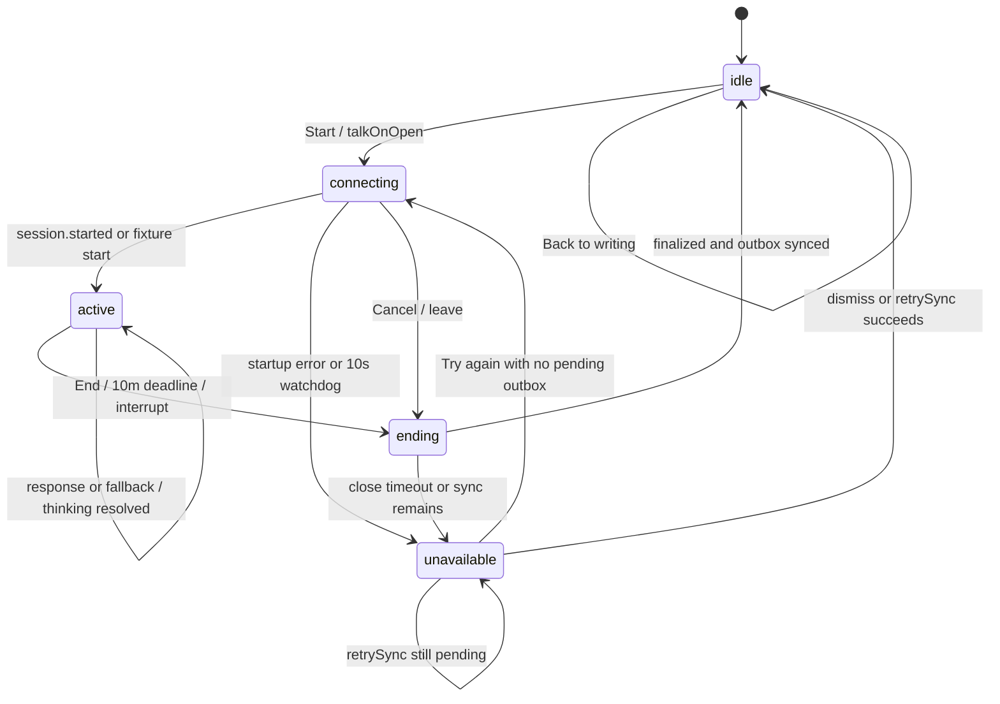

# Drillbit app teardown — 4 October 2026

Screen-by-screen notes on the native iOS app as built, written so someone could rebuild every screen from them. Code is the primary source (every section cites file:line); the simulator screenshots in [shots/](shots/) are the second. Nothing here is physical-device verified.

How the screenshots were taken: a signed debug build (`sh scripts/check-ios-launch.sh 32C4E22D-369B-4538-9816-96C7FF7FDCAE`, iPhone 17, iOS 27, light appearance via `xcrun simctl ui … appearance light`), then the XCUITest tour in [apps/ios/UITests/AuditScreenshots.swift](../../../apps/ios/UITests/AuditScreenshots.swift), which dismisses the simulator's Apple-ID alert, walks each flow and attaches a screenshot at every step. Attachments were exported with `xcrun xcresulttool export attachments`. A few states (dark, accessibility XXL) were also captured by the same tests. Screens no fixture reaches are reconstructed from code and say so.

Contents:

1. [Screen index and screenshots](#screen-index)
2. [First run and Home](#first-run-and-home-ux-teardown) — Welcome, sign-in, Setup, first question, first rep, feedback, Home, root/tabs, coachmarks, first-run flow map
3. [Preparation, preview and the text interview](#drillbit-ios-ux-teardown-preparation-preview-and-interview) — includes **the interview turn model as implemented** and the contract constraints
4. [Live voice](#live-voice-ux-teardown)
5. [Reflection, Recall, Library, Settings, gate, widget](#reflection-recall-library-settings) — with flow maps for finish → feedback → Home, Recall, Library, Settings and the gate
6. [Checkpoint: ten problems, assets to keep, open questions](#checkpoint)

## Screen index

Every screen a user can reach, the Swift view, how it was captured, and the pattern(s) that could land there: (1) tiny steps + instant feedback, (2) manipulable diagrams, (3) canvas + palette, (4) mock-interview critique, (5) visible framework path.

| # | Screen | Swift view (file) | Reached by | Shots | Patterns |
|---|---|---|---|---|---|
| 1 | Launch / restoring | `LaunchSurface` (RootView.swift) | every cold start; `--fixture-slow-launch` | reconstructed from code: Bit centred, "Picking up where you left off…" after 1.2 s | — |
| 2 | Welcome (playable example) | `WelcomeView`, `RetryExample` (WelcomeView.swift) | first launch, signed out; `--fixture-signed-out --fixture-walkthrough` | [a01](shots/a01-welcome.png) [a02](shots/a02-welcome-doubled.png) [a03](shots/a03-welcome-fixed.png) | 1, 2 |
| 3 | Sign-in / invite | `WelcomeView.authentication` | Get started; `--fixture-signed-out` | [a04](shots/a04-signin.png); invite variant reconstructed (same shell, `Invite code` field) | — |
| 4 | Setup 1: goal + date | `SetupView` page 1 | after invite; `--fixture-onboarding` | [a05](shots/a05-setup-goal.png) [a06](shots/a06-setup-goal-interview.png) | 1 |
| 5 | Setup 2: familiarity | `SetupView` page 2 | Continue | [a07](shots/a07-setup-familiarity.png) | 1 |
| 6 | First question (writing, then preview) | `QuestionFlow` first-rep variant | Show me a question | [a09](shots/a09-first-question-writing.png) [a10](shots/a10-first-question-preview.png) | 5 |
| 7 | Interview, Guided first rep | `InterviewView` + `GuidedPathBar` + `GuidedChoices` | Start writing | [a11](shots/a11-first-rep-opener.png) [a12](shots/a12-first-rep-nudge.png) [a13](shots/a13-first-rep-typing.png) [a14](shots/a14-guided-path-choices.png) [a15](shots/a15-guided-path-steps.png) [a16](shots/a16-guided-step2.png) [a17](shots/a17-interview-menu.png) [a18](shots/a18-finish-alert.png) | 1, 3, 4, 5 |
| 8 | Feedback, first rep (reminder offer) | `ReflectionView` | Finish interview | [a20](shots/a20-first-rep-feedback.png) [a21](shots/a21-first-rep-feedback-scrolled.png) | 1, 4 |
| 9 | Home after first rep | `HomeView` + `Ticket` | Done for today | [a22](shots/a22-home-after-first-rep.png) | — |
| 10 | Home, ready ticket / rich | `HomeView` | default; `--fixture-home-rich` | [b01](shots/b01-home-rich.png) [b02](shots/b02-home-ticket-menu.png) [d19](shots/d19-home-dark.png) [d21](shots/d21-home-axxl.png) [d23](shots/d23-home-light.png) | 5 |
| 11 | Home, empty / preparing / failed / free-rep waiting | `HomeView` | `--fixture-dashboard`, `--fixture-auto-question --fixture-slow-generation`, `--fixture-generation-failure`, `--fixture-gate` | [c01](shots/c01-home-dashboard.png) [d18](shots/d18-home-preparing.png) [d17](shots/d17-home-generation-failure.png) [d16](shots/d16-home-free-rep-waiting.png) | — |
| 12 | New question (preparation sheet) | `PreparationView`, `GuidanceModePicker`, `PracticeAreaPicker` | Home ticket long-press → Choose focus or level; empty ticket → Prepare | [b03](shots/b03-prepare-sheet.png) [b04](shots/b04-prepare-sheet-bottom.png) [b05](shots/b05-prepare-session-style.png) | — |
| 13 | Question preview | `QuestionFlow` preview | ticket tap; Prepare question | [b06](shots/b06-preview.png) [c02](shots/c02-preview-generating.png) [c03](shots/c03-preview-mock.png) [c07](shots/c07-preview-talk.png) [d24](shots/d24-preview-light.png) | 5 |
| 14 | Interview, Practice mode (text) | `InterviewView` | Start writing | [b07](shots/b07-interview-empty.png) [b08](shots/b08-interview-writing.png) [b09](shots/b09-interview-question-draft.png) [b10](shots/b10-interview-sending.png) [b11](shots/b11-interview-follow-up.png) [b12](shots/b12-interview-menu.png) [b16](shots/b16-original-question-expanded.png) [d20](shots/d20-interview-dark.png) [d22](shots/d22-interview-axxl.png) [d25](shots/d25-interview-light.png) | 1, 2, 3, 4, 5 |
| 15 | Assistance popup (Nudge / Example) | `InterviewView.assistancePopup` | ••• → Need a nudge? / Show an example; inline Need a nudge? | [b13](shots/b13-example-loading.png) [b14](shots/b14-example.png) | 1 |
| 16 | Session style (in-room) | `GuidanceModePicker` | ••• → Session style | [b15](shots/b15-session-style-menu.png) | — |
| 17 | Interview, Mock (clock) | `InterviewView` + `RoundClock` | Prepare with Mock interview | [c04](shots/c04-mock-clock.png) | 4, 5 |
| 18 | Feedback, Practice / Mock debrief | `ReflectionView`, `DebriefCard` | Finish interview | [b17](shots/b17-reflection.png) [b18](shots/b18-reflection-scrolled.png) [c05](shots/c05-mock-debrief.png) [c06](shots/c06-mock-debrief-scrolled.png) | 1, 4 |
| 19 | Home, done today | `HomeView` | Done for today | [b19](shots/b19-home-done.png) | — |
| 20 | Voice room: idle / live / muted / caption / transcript / connecting | `InterviewVoiceRoom`, `LiveVoice` | Talk capsule; preview Talk it through; `--fixture-voice…` | [c08](shots/c08-interview-talk-capsule.png) [c09](shots/c09-voice-idle.png) [c10](shots/c10-voice-live.png) [c11](shots/c11-voice-muted.png) [c12](shots/c12-voice-caption.png) [c13](shots/c13-voice-transcript.png) [c14](shots/c14-after-voice-transcript-rows.png) [c15](shots/c15-voice-connecting.png) | 2, 4, 5 |
| 21 | Voice unavailable alert | `InterviewView` alert "Voice" | `--fixture-voice-unavailable` | [c16](shots/c16-voice-unavailable.png) | — |
| 22 | Recall: Review / Map / Paths / card | `RecallView` | Recall tab | [d01](shots/d01-recall.png) [d02](shots/d02-recall-map.png) [d03](shots/d03-recall-paths.png) [d04](shots/d04-recall-card.png) [d05](shots/d05-recall-card-revealed.png) | 1, 5 |
| 23 | Library list, menu, question detail, session detail, evidence | `LibraryView`, `LibraryQuestionView`, `SessionDetailView`, `PracticeEvidenceView` | Library tab | [d06](shots/d06-library.png) [d07](shots/d07-library-menu.png) [d08](shots/d08-library-detail.png) [d09](shots/d09-library-detail-scrolled.png) [d10](shots/d10-library-detail-bottom.png) [d11](shots/d11-practice-evidence.png) | 4, 5 |
| 24 | Settings (+ Learning plan, About your practice, LLM provider, Time zone, Export) | `SettingsView` and nested views | Home / Library toolbar gear | [d12](shots/d12-settings-top.png) [d13](shots/d13-settings-mid.png) [d14](shots/d14-settings-bottom.png) [d15](shots/d15-settings-end.png); nested pages reconstructed from code | — |
| 25 | Paywall | none built | — | — (gate is action-absence + "Your free rep comes back …", see §5) | — |
| 26 | Widget | `DrillbitWidget` | home screen | reconstructed from code | — |
| — | Internal / dead: `PracticeView`, `HelpView`, `CompanionPanel`, `HistoryView` | PracticeWorkspace.swift, HelpView.swift, CompanionPanel.swift, LibraryView.swift | not constructed on any active route (see §3 "Legacy") | — | — |

Note on appearance: the app's `@AppStorage("appearance")` default is **dark**, so most captures are dark even though the simulator was set to light. [d19](shots/d19-home-dark.png)/[d20](shots/d20-interview-dark.png) are explicit `--dark` runs; [d23](shots/d23-home-light.png), [d24](shots/d24-preview-light.png) and [d25](shots/d25-interview-light.png) were launched with `-appearance light`.


## What the screenshots show (visual pass)

The code audit below is exhaustive on structure and copy; this section records what only the pictures show. Light-mode captures are rare because the app's stored appearance defaults to dark.

**Look and feel, across screens**
- Palette: near-black navy (`#1b1f2a`-ish) background, one amber accent used for *everything* active (CTA fill, eyebrows, progress, links, step bar, selected tab, settings gear), grey secondary text. Amber on dark reads as a developer tool, not an interview room. Light mode exists but is not the default.
- Typography: system SF for body and titles; **monospaced uppercase eyebrows** on every screen (`SYSTEM DESIGN MOCK ROUNDS`, `TRY ONE · 20 SECONDS`, `01 / 02`, `SUN, OCT 4`, `NO. 001`, `OCT 4 · MID-LEVEL`, `LESSON RECAP`, `WHAT WORKED`, `WHAT TO FIX`, `TRY IT SOLO`, `OTHER MOMENTS`). The user has already rejected this tic; it is the single most repeated visual element.
- Surfaces: one shade lighter rounded rectangles (ticket, choice rows, nudge sheet, level promise, reminder card). Radius is consistent. No white cards, no gradients except the Welcome glow and the ticket's subtle fill.
- Buttons: full-width amber capsules for the primary action on every screen (Get started, Show me a question, Start writing, Got it, Done for today, Prepare question); secondary actions are amber text links. Hierarchy is clear but every screen ends the same way.
- Density: Welcome, Setup, feedback are generous and centred-left; the interview and Settings are dense text. Nothing is diagrammatic anywhere except the Welcome receipts.

**Welcome** ([a01](shots/a01-welcome.png)–[a03](shots/a03-welcome-fixed.png)): Bit (≈100 pt with glow) sits beside a speech bubble; three receipt rows with a bell icon, `request 7f3a`, status; two choice capsules; `Get started` pinned. After the fix, the bubble says "Same request, same result. That's an idempotency key." and a secondary line sells the product. It works, and it is the only screen where touch changes something. The receipts are text rows: the same idea drawn as a two-node diagram (phone ← server) with a travelling dot would be the first "animated system diagram" the user asked for.

**Sign-in** ([a04](shots/a04-signin.png)): logo, "Ready when you are.", three provider buttons. Quiet, fine. Apple button is black-on-dark with a white glyph; on light it should be the system black button.

**Setup** ([a05](shots/a05-setup-goal.png)–[a07](shots/a07-setup-familiarity.png)): `01 / 02` eyebrow + amber progress line; Bit (76×84) as the speaker of the heading bubble; choice rows with a check; on page 1 an `I know the date` toggle + date picker + "12 days until your interview" (large numeral) when chosen; on page 2 a brown-tinted promise card ("We'll skip the definitions and push on your decisions."). Nothing shows what an interview *is*; the screen is a form with a mascot.

**First question** ([a09](shots/a09-first-question-writing.png), [a10](shots/a10-first-question-preview.png)): `THE SCENARIO` eyebrow, title, three paragraphs streaming in; while writing, a small drilling Bit above the footer; once settled: "Guided practice helps you structure the approach.", `How you'll answer` segmented Write it / Talk it through, "Type it out. You can switch to talking any time.", `Start writing`, `Choose another question`. The footer is four stacked controls for one decision. The question prompt in the fixture preview differs from the prompt later shown under `Original question` in the room (fixture inconsistency, not a product bug).

**Interview room** ([a11](shots/a11-first-rep-opener.png)–[a17](shots/a17-interview-menu.png), [b07](shots/b07-interview-empty.png)–[b16](shots/b16-original-question-expanded.png)): nav `Close · System design · •••`; in Guided a 4-segment step bar with "Step 1 of 4  Pin down what the queue promises ˅"; `Original question` disclosure with title and 3-line prompt; `Interviewer` opener typed in; hairline; `Your reply` label and placeholder "A sentence is fine. Send when you've got a first take."; footer `Talk` capsule (waveform glyph), `Need a nudge?` text link, amber up-arrow send. After Send: `You` row collapsed to one line with a chevron, `Interviewer` follow-up, then Guided choices as two scrolling capsules ("Store a done marker per job", "Make the work itsel…") above the composer. The ••• menu lists Need a nudge? / Show an example / Session style / Finish interview / Skip question (red). The Nudge is a half-sheet with a bulb icon and `Got it`. Visually this is a chat transcript with section labels; the step bar is the only thing that isn't.

**Feedback** ([a20](shots/a20-first-rep-feedback.png), [a21](shots/a21-first-rep-feedback-scrolled.png)): Bit (64 pt) → `LESSON RECAP` → "Here's what you worked out." → "No explicit help recorded" → `WHAT WORKED` / amber rule / `WHAT TO FIX` → `WHAT YOU WORKED OUT` two green checks → `TRY IT SOLO` → summary → `Full feedback ›` → reminder card → `Done for today` → `OTHER MOMENTS` branch row → `Review in Recall` → `Practise this next`. Three screens tall; six eyebrows; three competing next actions. The two quoted lines are the good part and they sit in the middle.

**Home** ([a22](shots/a22-home-after-first-rep.png), [b01](shots/b01-home-rich.png)): `SUN, OCT 4` / gear / "Sunday" / subtitle / Bit (72 pt) right; the ticket: `NO. 001 · OCT 4 · MID-LEVEL`, title, 3-line prompt, perforation, stub `Practice · Nudges if you ask · [Open]`. Done state: `DONE 13:55`, "Worked out together", the takeaway quote, then "Next one's picked when you open the app tomorrow." and `One more?`. Tab bar Home / Recall / Library. Pleasant, but a weekday heading and a ticket metaphor say "daily habit app", not "interview". No sign of a path, a framework, or what the next rep will push on.

**Preparation sheet** ([b03](shots/b03-prepare-sheet.png)–[b05](shots/b05-prepare-session-style.png)): grouped list: Practice area › Automatic; Target level ⌃ Mid-level; `Session style` header + `Session style › Practice` row; "Any custom instructions? (e.g. talk like a pirate)"; `Prepare question`; "Your current question stays until the new one is ready." Honest and native; the duplicated label and the pirate placeholder are the only faults.

**Mock** ([c04](shots/c04-mock-clock.png), [c05](shots/c05-mock-debrief.png), [c06](shots/c06-mock-debrief-scrolled.png)): the only visible differences from Practice are a small `⏱ 19:58` under the nav title and the missing `Need a nudge?` link. The opener personalises ("You've designed a few systems, so let's skip the basics."). The debrief: Bit, `INTERVIEW DEBRIEF`, "Here's how the round went.", the same What worked / What to fix pair, then "◑ Borderline. Could go either way." with a reason, then a card of four rows `Requirements Strong · Design Mixed · Trade-offs Weak · Communication Strong` in green/amber/red. The coloured ratings are the loudest thing on the page and read as a scorecard, which the vision forbids.

**Voice room** ([c09](shots/c09-voice-idle.png)–[c15](shots/c15-voice-connecting.png)): `Talk it through` + `0:02` clock; the question disclosure; a 168-pt particle orb (grey shell, amber core) ; "You're talking"; the dock: Transcript (grey) · Mute (big amber mic) · End (red ×). It's calm and legible. Faults: the orb is the glowing-orb trope the user rejected; Mute is the visually primary control; the question takes a third of the screen and nothing on the screen is about system design; captions appear only after the interviewer has spoken ([c12](shots/c12-voice-caption.png)); the transcript view ([c13](shots/c13-voice-transcript.png)) is a chat log. Back in the document ([c14](shots/c14-after-voice-transcript-rows.png)) the spoken exchange appears as plain `You` / `Interviewer` rows, indistinguishable from typed ones; the preview's allowance line reads "resets 00:00" on a UTC simulator ([c07](shots/c07-preview-talk.png)).

**Recall, Library, Settings** ([d01](shots/d01-recall.png)–[d15](shots/d15-settings-end.png)): Recall's fixture deck is empty ("NOTHING DUE / You're caught up."), so the personal card UI is only reconstructed from code; the Paths tab shows the authored catalog card ([d04](shots/d04-recall-card.png), [d05](shots/d05-recall-card-revealed.png)). Library question detail ([d08](shots/d08-library-detail.png)) is a plain grouped list: title, `Original question ›`, Concepts (`Queues & streams`, `Retry safety & idempotency`), `Try again`, `Practise this concept`, Attempts. Correct and forgettable. Settings is a long native form.

**Light mode** ([d23](shots/d23-home-light.png)–[d25](shots/d25-interview-light.png)): warm off-white background, white ticket, amber CTA, dark text. It already reads calmer and more serious than dark; the mono eyebrows turn brown and still dominate. The interview room in light is nearly empty: title, question, "Your reply", placeholder, three footer controls. This is the honest baseline for the prototype: there is a lot of room on the screen for a step bar, a canvas and a probe.


---

# First-Run and Home UX Teardown

> Code-based reference for the native iOS implementation, read on 4 October 2026.
> Scope: Welcome and its playable example, authentication/invite, Setup, the first question/rep/feedback handoff, Home, root restoration/tabs, and coachmarks.
> Method: SwiftUI source and adjacent models/contracts/docs only. No simulator, build, or live-service behavior was exercised.

## Reading key

- Copy tables list authored user-facing strings found in the covered view paths. Dynamic model/API values are called out as dynamic rather than invented.
- “System” means a SwiftUI/UIKit/Apple-auth control; “custom” means a Drillbit composition or `ButtonStyle` over native primitives.
- Fixture arguments below are DEBUG/UI-test launch arguments. `--fixtures` selects synthetic data; the named `--fixture-*` flags only work in that context unless otherwise noted.
- API paths are relative to `/v1/` unless stated. DTO names refer to the native Swift contract models, not independent API verification.
- The app architecture doc is useful context, but live view code wins where navigation has since changed.

## Welcome

### Source and route

- Main view and branch selection: [WelcomeView.swift:3-61](../../../apps/ios/Drillbit/WelcomeView.swift#L3-L61).
- Authentication variant and invite field: [WelcomeView.swift:63-135](../../../apps/ios/Drillbit/WelcomeView.swift#L63-L135).
- Playable `RetryExample`: [WelcomeView.swift:138-280](../../../apps/ios/Drillbit/WelcomeView.swift#L138-L280).
- Shared Bit bubble and motion: [FirstUse.swift:1-44](../../../apps/ios/Drillbit/FirstUse.swift#L1-L44), [BitView.swift:1-78](../../../apps/ios/Drillbit/BitView.swift#L1-L78), [DesignSystem.swift:1-73](../../../apps/ios/Drillbit/DesignSystem.swift#L1-L73).
- Reached when no active bootstrapped account exists, after root restoration finishes. `Get started` changes the local walkthrough version and swaps to the authentication variant; successful sign-in leads to invite redemption, then Setup after bootstrap returns an active account.
- DEBUG route: `--fixture-signed-out --fixture-walkthrough` forces the walkthrough even though fixture mode normally skips it. `--fixture-walkthrough` alone forces it until this view's local `leftWalkthrough` becomes true.

### Job

- Juggles a product promise and a short interactive systems lesson before asking for identity.
- The example is a scripted state machine, not an interview, assessment, AI call, or score. Its feedback is about delivery behavior, not the visitor.
- In fixture mode, the normal authentication variant is shown directly unless walkthrough is explicitly forced.

### Layout, top to bottom

| Order | Component | Implementation / control |
|---|---|---|
| 1 | Scrollable page shell | SwiftUI `NavigationStack`, `ScrollView`, `VStack`; max content width 560 points, 24-point inset, 32-point major spacing. |
| 2 | Brand | Custom `DrillbitLogo(compact: true)`; accessibility name `Drillbit`. |
| 3 | Eyebrow and promise | `SignalEyebrow` plus native `Text`; title is three explicit lines, subcopy wraps vertically. |
| 4 | Playable example | `RetryExample`: eyebrow, `BitAsks` question bubble, receipt rows, then step-specific actions. |
| 5 | Pinned CTA | Bottom `safeAreaInset`, hairline and full-width custom `PracticeButtonStyle` button `Get started`. |

### Visible copy

| Location / state | Exact authored copy |
|---|---|
| Eyebrow | `System design mock rounds` (rendered uppercase by `SignalEyebrow`). |
| Promise heading | `Grills you like\nthe real one.\nWants you to pass.` |
| Supporting line | `Talk it through or type it out. Get honest notes on what to fix.` |
| Example eyebrow | `Try one · 20 seconds` (rendered uppercase). |
| Initial prompt | `Your push to their phone timed out. Now what?` |
| Checked prompt | `Smart. But the server never answered, so you can’t tell if it went out.` |
| Duplicate prompt | `Oops. It went out the first time. Their phone buzzed twice.` |
| Fixed prompt | `Same request, same result. That’s an idempotency key.` |
| Initial receipt | `Push notification`; `request 7f3a`; `Timed out`. |
| Checked receipt | `Push notification`; `request 7f3a`; `No answer`. |
| Duplicate receipts | First: `Push notification`; `request 7f3a`; `Delivered`. Second: `Push notification`; `request b21c`; `Delivered again`. |
| Fixed receipts | First: `Push notification`; `request 7f3a`; `Delivered`. Second: `Push notification`; `request 7f3a`; `Duplicate skipped`. |
| Initial actions | `Retry it`; `Check first`. |
| Checked/duplicate action | `Retry with the same request ID`. |
| Fixed explanation | `That’s the kind of hole Drillbit pokes. Then it tells you how to patch it.` |
| Fixed action | `Again`; VoiceOver label `Play the example again`. |
| Pinned action | `Get started`. |

### States and fixture reachability

| State | Trigger / display | Fixture |
|---|---|---|
| First visit | `walkthroughVersion < 2` and non-fixture, unless the user already set the global key. | `--fixture-walkthrough` forces this. |
| Returning | `walkthroughVersion >= 2`; root presents authentication directly. | Default `--fixtures` also bypasses the walkthrough. |
| Asking | Initial `Step.asking`; one timed-out receipt, two answer choices, Bit idle. | Enter on first display or `Again`. |
| Checked | `Check first`; same request becomes `No answer`; one safe retry action. | Interactive only. |
| Duplicate | `Retry it`; two different request IDs show duplicate delivery; primary action offers the fix. | Interactive only. |
| Fixed | Stable request ID shown, duplicate skipped, explanation and replay. | Interactive only. |
| Loading/error/offline/gated | None in this local example. No network/model dependency. | Not applicable. |

### Interaction, motion, access

- `Retry it` moves directly to duplicate; `Check first` moves to checked; the next action in either noninitial branch goes to fixed; `Again` resets to asking.
- `withAnimation(.spring(duration: 0.3, bounce: 0))` changes the scripted step. Receipt insertions use opacity/offset/scale (opacity-only under Reduce Motion); status, symbol, and request IDs use content transitions.
- `.sensoryFeedback` emits warning on duplicate and success on fixed. No `UIImpactFeedbackGenerator` is used here.
- Example rows combine their children for VoiceOver and hide the decorative receipt symbol. Bit and logo are decorative/labeled respectively. Buttons have accessible labels/identifiers; there is no separate announcement for each changed example prompt.
- Scroll content adapts by intrinsic text wrapping; bottom CTA stays above safe areas. No explicit Dynamic Type branch, but system text styles and fixed vertical sizing are used.
- Reduce Motion disables the example's step spring and changes row transition; the welcome-level page animation itself is not conditional on Reduce Motion.
- Bit appears in the example's `BitAsks`, 76×84 points outside accessibility sizes. Moods: idle → thinking → concerned → content; each reflects the scripted system outcome. At accessibility text sizes the Bit and pointer drop away.

### Data and verdict

- `@AppStorage("walkthroughVersion")` is device-wide `UserDefaults`, not account-scoped. `Get started` writes `2`; no server endpoint or practice persistence is involved.
- Verdict: strongest onboarding element because a visitor can manipulate a concrete failure and immediately see the consequence. The four-state narrative teaches one systems concept well, but it is not representative of the app's real interview turn model, setup choices, or feedback surface; the “20 seconds” label is an estimate, not a timer.
- Pattern fit: (1) tiny steps + instant feedback, **strong**; (2) manipulable diagrams, **possible next iteration** (receipts are currently static rows); (3) canvas + component palette, **no**; (4) AI mock-interview critique, **no**; (5) visible framework path + progress, **no**.

## Sign-in and invite

### Source and route

- Same `WelcomeView.authentication` branch, not a separate screen type: [WelcomeView.swift:63-135](../../../apps/ios/Drillbit/WelcomeView.swift#L63-L135).
- Auth and invite API actions: [AppModel.swift:420-439](../../../apps/ios/Drillbit/AppModel.swift#L420-L439); token construction and `/v1/` path mapping: [APIClient.swift:1-58](../../../apps/ios/Drillbit/APIClient.swift#L1-L58).
- Authenticated but not invited: `model.bootstrap != nil` selects invite copy/field. Successful invite POST refreshes bootstrap; Setup follows when account status is `active` and onboarding is incomplete.
- Architecture/operations say Apple is native Sign in with Apple; Google/GitHub use Clerk OAuth. The view uses ClerkKit actions through `AppModel`, not bespoke credential fields.

### Job and layout

- Juggles identity acquisition and single-use invitation redemption in the same pinned-footer shell.
- Scroll area: centered logo and two-line status block, max width 400, centered within available height. Bottom inset contains either three auth actions plus reserved progress row, or invite text field and primary action.
- Invite uses native SwiftUI `TextField`, ASCII keyboard, no autocapitalization/autocorrection, `.go` submit action, and focus-on-entry. Auth choices are native `Button`s; Apple uses `Label` with the Apple SF Symbol identifier, provider buttons use plain title text.

### Visible copy

| State | Exact authored copy |
|---|---|
| Signed out heading | `Ready when you are.` |
| Signed out subheading | `Sign in to keep your reps and feedback.` |
| Invite heading | `One last step.` |
| Invite subheading | `Enter your invite code to begin.` |
| Apple button | `Sign in with Apple` |
| Google button | `Continue with Google` |
| GitHub button | `Continue with GitHub` |
| Auth progress | `Signing in…` (the row reserves space at opacity 0 when idle, and is accessibility-hidden until active). |
| Invite placeholder | `Invite code` |
| Invite submit | `Start practising` |
| Invite busy accessibility label | `Checking invite` |
| Root-level operation alert title/action | `Drillbit`; `OK`; body is dynamic `model.error`. |
| Common no-token API error | `Sign in to continue.` |
| Common stale-session recovery | `Sign in again to continue. Your local draft is safe.` |

### States, interaction, access

| State | Behavior / visible treatment | Fixture |
|---|---|---|
| Signed out | Provider buttons visible; `model.bootstrap == nil`. | `--fixtures --fixture-signed-out`. |
| Authenticating | All footer children disabled; progress row appears; guard prevents duplicate tasks. | Test by tapping provider; no dedicated fixture. |
| Invite required | `bootstrap != nil`; code is trimmed at both ends before redeem; blank code disables submit. | Fixture account is active by default, so invite path is not seeded by `seedFixture`; requires an invite-required backend state. |
| Redeeming | Focus is cleared, auth task sets busy, button label/accessibility changes, controls disabled. | No dedicated fixture. |
| Auth/API failure | `AppModel.perform` stores localized error; RootView presents its global `Drillbit` alert. | Requires failure injection/live service; not a named fixture. |
| Offline | No explicit offline label. Clerk/OAuth/invite request failure surfaces through the global alert; invite text remains local view state while the view survives. | No named fixture. |
| Locked | No subscription gate on identity; invite redemption is the account activation gate. | Backend authority. |

- Apple invokes `Clerk.shared.auth.signInWithApple()`; Google/GitHub invoke `signInWithOAuth(provider:)`; both refresh after success. Invite sends `POST /v1/invite` with `CodeInput(code:)`, then refreshes.
- Focus auto-enters on invite branch. `.submitLabel(.go)` submits nonempty trimmed code. Busy state serializes all auth/invite actions.
- SwiftUI opacity transitions animate branch changes; focused-state reveal animation is disabled under Reduce Motion, but footer branch animation is not.
- Native field supports VoiceOver through placeholder/system semantics; invite submit gets the explicit busy label. No custom hint, inline form error, password/OAuth web explanation, or auth-state announcement exists.
- Bit: absent. Brand logo remains about 30 points tall (roughly 116×30 by its source ratio), but is not Bit.

### Data and verdict

- Clerk stores identity/session; `APIClient` requests Clerk JWT template `drillbit` as a Bearer token. Invite contract `CodeInput`; bootstrap contract `Bootstrap`.
- Root restores `bootstrap:<account>` and secrets `account` / `subject`; exact cache implementation is covered under Root. No invite code persistence or `@AppStorage` key.
- Verdict: compact provider selection and direct invite handoff; weak point is that the UI treats invitation and network errors as a root alert instead of field-local recovery, and does not explain why an invite is required beyond “One last step.” Auth progress is a generic label shared by sign-in and redemption (`Signing in…` visually remains on provider path only).
- Pattern fit: (1) tiny steps + instant feedback, **partial** (clear step, weak field-level recovery); (2) manipulable diagrams, **no**; (3) canvas + component palette, **no**; (4) AI mock-interview critique, **no**; (5) visible framework path + progress, **no**.

## Setup

### Source and route

- Main pages, page transition, footer, and sheet handoff: [SetupView.swift:1-145](../../../apps/ios/Drillbit/SetupView.swift#L1-L145).
- Date/countdown/promise and per-account restore/save: [SetupView.swift:146-227](../../../apps/ios/Drillbit/SetupView.swift#L146-L227).
- Shared choice rows/progress/cascade: [DesignSystem.swift:290-502](../../../apps/ios/Drillbit/DesignSystem.swift#L290-L502); Bit bubble: [FirstUse.swift:1-44](../../../apps/ios/Drillbit/FirstUse.swift#L1-L44).
- Root presents Setup in a `NavigationStack` for an active account with `settings.onboardingComplete == false`. `--fixture-onboarding` makes `seedFixture()` set that setting false. `--fixture-signed-out` does not reach Setup.
- `Show me a question` saves plan/settings and `FirstUseProgress(stage: .firstRep)`, then presents `QuestionFlow` as a sheet. Setup remains underneath; first rep completion later replaces it with Home.

### Job and layout

- Juggles goal selection, optional interview date, self-assessed depth, and first-question launch in two pages. This is more than a profile form: it creates the initial learning plan and starts the first counted practice loop.
- Top: pinned `SignalStepProgress` (`01 / 02` or `02 / 02`) and 2-point progress track.
- Scroll body: `BitAsks` heading, then page content. On page 1 the custom choice rows select goal; interview goal conditionally reveals native `Toggle`, native `DatePicker`, countdown. On page 2 explanatory `Text`, four custom single-choice rows, and a custom highlighted promise surface.
- Bottom: hairline and pinned `Back` (page 2 only) plus `Continue` / `Show me a question` button. Navigation bar hidden. Failure text appears below page content.
- Content max width 560, 24-point insets. Scroll view is clipped and resets to top on page changes.

### Visible copy

| Page/state | Exact authored copy |
|---|---|
| Page 1 heading | `What are we drilling for?` |
| Goal choices | `An interview’s coming up`; `I want to get sharper`; `Just keeping fresh`. |
| Conditional date toggle | `I know the date`. |
| Conditional date picker label | `Interview date`. |
| Countdown, same day | `That’s today. One quick rep to warm up.` |
| Countdown, one day | `That’s tomorrow. One good rep tonight.` |
| Countdown, later | `\(days) days until your interview. Let’s find one thing to sharpen today.` |
| Page 2 heading | `How much system design have you done?` |
| Level explanation | `This sets how deep your questions go. You can change it any time.` |
| Starting point choices | `New to system design`; `I’ve designed a few systems`; `I design systems regularly`; `I lead architecture across teams`. |
| Junior promise | `We’ll start with the building blocks and work through them together.` |
| Mid/default promise | `We’ll skip the definitions and push on your decisions.` |
| Senior promise | `Expect tradeoffs and failure modes, not definitions.` |
| Staff promise | `We’ll go straight to the hard tradeoffs. Expect pushback.` |
| Footer page 1 | `Continue`. |
| Footer page 2 | `Back`; `Show me a question`. |
| Save/open busy | `Opening…`. |
| Failure | Dynamic `error.localizedDescription` from saving first-use/settings; shown as destructive footnote. |
| Progress accessibility label | `Step \(step) of \(total)`. |

### States, interaction, motion, access

| State | Behavior / display | Fixture |
|---|---|---|
| Page 1 default | Objective `learn`; no target date. | `--fixture-onboarding`; otherwise use a real incomplete account. |
| Interview objective | Toggle/date picker/countdown become visible. Date is optional and clamped to today or later. | Interactive only. |
| Page 2 | Selected level restores from `onboarding-v2:<account>` when present, else settings level; promise follows selection. | Interactive only. |
| Saving | Footer disabled; CTA says `Opening…`; failure cleared before attempt. | Force settings persistence/network failure; no setup-specific fixture. |
| Question handoff | `firstRep` starts generation from saved plan using Guided mode; user gets one question swap. | `--fixture-onboarding` enters Setup; `--fixture-slow-generation` and `--fixture-generation-failure` reach first-question loading/failure after tapping CTA. |
| Returning/incomplete | Restores page, objective, level, optional date from account-keyed local cache. | Requires cached onboarding draft; no named launch flag. |
| Offline | Draft restore/persist is local. Saving settings creates local pending command; first rep can fail if plan remains unsynced. | `--fixture-settings-offline` tests settings in Settings UI, not Setup's first-rep error. |
| Gated | CTA does not query `mayStartRep`; generation request/server owns rejection. | `--fixture-gate` is seeded on Home fixture and does not itself model invite/setup entry. |

- Goal selection is custom `Button` per `SignalChoiceRow`; changing selection triggers selection haptic only on selecting a row, not on deselection. Native `Toggle` and `DatePicker` use accent tint. `Continue`/`Back` mutate page, increase Bit cheers, and scroll to top.
- Date countdown is calendar-day arithmetic, not elapsed 24-hour math. `DatePicker` uses current calendar and `.date`; saved serialization uses Gregorian `yyyy-MM-dd` in account timezone.
- Page change uses custom asymmetric `DealTransition` (offset, scale, blur, opacity; spring insertion/ease-out removal); content cascades in with staggered spring. Progress track has spring animation. Date/promise reveal uses short animation.
- `BitAsks` uses 76×84 points and default `.idle` mood; `bitCheers` increases when changing pages, producing a small hop. Bit is removed at accessibility text sizes, leaving the question bubble heading intact.
- `InterviewCountdown` scales its numeral with `@ScaledMetric`, combines its content into a VoiceOver label equal to the sentence line, and avoids separate reading of the oversized number + subtitle. Choice rows expose selected trait; progress announces step number. Text grows; no explicit maximum Dynamic Type clamp.
- Most page transitions/cascades/progress honor Reduce Motion; `SignalChoiceRow` selection spring and header content transition are not fully conditional. `BitView` suppresses taps/hops under Reduce Motion.
- No screen-level offline announcement, recovery link, or skip path. `failure` is plain text; no explicit VoiceOver announcement.

### Data and verdict

- Draft: SwiftData-backed `DiskStore.cache` key `onboarding-v2:<account>` encodes `{page, objective, level, targetDate}`. It is persisted on every coordinator draft change; not `@AppStorage`.
- Progress: `first-use:<account>` encodes `FirstUseProgress`; setup writes `.firstRep`. Settings mutate `PracticeSettings.learningPlan.objective`, `targetDate`, and selected engineering level; local pending write key `settings-pending:<account>`.
- DTOs: `LearningPlan`, `PracticeSettings`, `FirstUseProgress`, `PreparationInput`, `Challenge`, `QuestionDraft`; eventual endpoints `PUT /v1/settings`, `POST /v1/challenges`, `GET /v1/jobs/{id}` and `GET /v1/jobs/{id}/stream`.
- The setup generation request chooses `guidanceMode: .learnTogether`, focus from saved settings, kind `design`, selected level, and replaces an existing `ready` challenge only. `completeOnboarding()` is deferred until first rep completion/skip.
- Verdict: the two-page progression is clear and the level promise explains a real behavioral difference. Weak: page 1 contains two separate decisions (goal and date), date selection creates an oversized number plus redundant sentence, and “Show me a question” hides that it immediately enters a practice rep rather than only previewing a question.
- Pattern fit: (1) tiny steps + instant feedback, **strong**; (2) manipulable diagrams, **no**; (3) canvas + component palette, **no**; (4) AI mock-interview critique, **no**; (5) visible framework path + progress, **partial** (two-step indicator but no persistent learning path until the Guided interview).

## First-question preview, first rep, and feedback

### Source and route

- Question flow and preview: [QuestionFlow.swift:1-271](../../../apps/ios/Drillbit/QuestionFlow.swift#L1-L271); preparation controls: [PreparationView.swift:1-136](../../../apps/ios/Drillbit/PreparationView.swift#L1-L136).
- Generation/start and completion state: [AppModel.swift:696-870](../../../apps/ios/Drillbit/AppModel.swift#L696-L870), [AppModel.swift:983-1056](../../../apps/ios/Drillbit/AppModel.swift#L983-L1056).
- Interview room/controller: [InterviewView.swift:1-280](../../../apps/ios/Drillbit/InterviewView.swift#L1-L280), [InterviewController.swift:1-235](../../../apps/ios/Drillbit/InterviewController.swift#L1-L235).
- Optional Talk room: [InterviewVoiceRoom.swift:1-360](../../../apps/ios/Drillbit/InterviewVoiceRoom.swift#L1-L360).
- Feedback: [ReflectionView.swift:1-275](../../../apps/ios/Drillbit/ReflectionView.swift#L1-L275), [ReflectionView.swift:276-390](../../../apps/ios/Drillbit/ReflectionView.swift#L276-L390).
- Setup presents the flow sheet. First-rep stage auto-runs preparation, disables interactive dismissal, and suppresses Close. Starting calls `openForPreview`; `ready` becomes `in_progress`; `onStart` closes the sheet and `model.presented` opens the full-screen interview. Finish returns `ReflectionView` inside the full-screen cover. Completion/feedback exit exposes Home.

### Job and layout

- Preview job: reveal the generated scenario, allow one first-rep swap, then choose write/talk and Start. For the initial rep, the user is not asked to configure the general preparation form again.
- Preview uses a `NavigationStack`, independently scrolling `StreamingDocument`, and a safe-area footer. While writing, a 56-point Bit sits above controls; once question arrives it is removed. Footer uses segmented `Picker` for `Write it` / `Talk it through`, explanatory line, primary start, optional swap.
- First interview is a continuous scroll document: original question disclosure, optional generated interviewer opener, Guided path bar, chronological turns, draft editor, bottom controls. Top toolbar contains scenario title, Close except warm-up, and `Menu`; first-rep question generated by model has `.learnTogether` guidance.
- `GuidedPathBar` is pinned at top when the `Challenge.path` exists. `GuidedChoices` are generated suggestions in a horizontal scroll; native multiline editor is a UIKit-backed growing editor. Footer is Talk, nudge, Send.
- Feedback scrolls in this order: Bit + mode-specific heading, assistance summary, “what worked / what to fix” evidence, Guided lesson or Mock debrief, summary/full feedback, reminder (first rep only), action(s), Recall and next-practice affordances.

### Visible copy: preview and first rep

| Location / state | Exact authored copy |
|---|---|
| Preview eyebrow | `The scenario` (rendered uppercase). |
| Guided preview note | `Guided practice helps you structure the approach.` |
| Generation failure actions | Dynamic error text; `Try again` on first rep, `Back to preparation` otherwise. |
| Preview title | Generated `Challenge.title` / streamed `QuestionDraft.title`; not statically knowable. |
| Preview body | Generated formatted `Challenge.displayPrompt` / streamed `QuestionDraft.prompt`; not statically knowable. |
| Answer mode label/options | `How you’ll answer`; `Write it`; `Talk it through`. |
| Talk allowance note | `Up to \(Int(LiveVoice.sessionLimit / 60)) min`; optional capability allowance line, e.g. `4 of 6 left today · resets 2 AM` from `VoiceCapability.allowanceLine()`. |
| Write note | `Type it out. You can switch to talking any time.` |
| Start actions | `Start writing`; `Start talking`; `Resume`; busy `Opening…`. |
| One-swap action | `Choose another question`. |
| Interview document labels | `Original question`; `Interviewer`; `Your reply`; `Asking the interviewer`; `You`; `Clarification`; `Example · assisted`; `Nudge`. |
| Empty editor hint, first reply | `A sentence is fine. Send when you’ve got a first take.` |
| Empty editor hint, subsequent | `Answer or ask a question…` |
| Interview action menu | `Interview options`; `Need a nudge?`; `Show an example`; `Session style`; `Finish interview`; `Skip question`; conditional `Continue interview`. |
| Session style picker | Title `Session style`; options `Guided` / `Practice` / `Mock interview`; explanations `Work through an approach together, with examples along the way.` / `Take the lead. Get useful pointers when you’re stuck or missing something.` / `Put your approach to the test. Save the coaching for the debrief.`; `Back` when presented from the room. |
| Bottom controls | `Talk` (VoiceOver `Talk it through`, hint `Switch to live voice. Your writing stays here.`); `Need a nudge?`; Send (VoiceOver `Send`). |
| Assistance sheet | Heading `Nudge` or `Example`; loading accessibility `Preparing nudge` / `Preparing example`; fallback `That didn’t load. Your reply is unchanged.`; actions `Cancel` while requesting, otherwise `Got it`. |
| Voice gate errors | Alert title `Voice`; actions `Open Settings` when permission requires it and `Done`; messages include `Live voice is currently unavailable. You can continue in text.`, capability-provided reason, `Allow microphone access to use live voice.`, and `Voice isn’t reachable right now. Your reply is unchanged.` |
| Voice dock errors | Fallback `Voice could not connect.`; action `Try again` while blocking text or `Dismiss` otherwise. |
| Finish confirmation | `Finish interview?`; `Keep writing`; `Finish interview`; `Your shared answers and current draft will be saved for review.` |
| Skip confirmation | `Skip this question?`; `Keep practising`; `Skip question`; `End this interview without a review and return to Home.` |
| Guided path | `Step \(index + 1) of \(steps.count)`; VoiceOver `Step \(index + 1) of \(steps.count): \(steps[index])`; hint `Shows every step`. |
| Path popover | `How a strong answer usually goes. You move on as you cover each step.`; `You’re here`; VoiceOver per step: `Step \(step + 1)\(step < current ? ", done" : step == current ? ", you’re here" : ""): \(steps[step])`. |
| Guided choice hint | `Sends this as your reply`. Choice text itself is generated. |
| Composer coachmark | `Your turn.`; `A rough first take is fine. End a line with “?” to ask the interviewer instead.` |
| Tools coachmark | `Stuck?`; `Nudges, an example and Finish live up here.` |

### Visible copy: feedback

| Mode/state | Exact authored copy |
|---|---|
| Practice heading | Eyebrow `Practice complete`; title `One idea to carry forward.` |
| Guided heading | Eyebrow `Lesson recap`; title `Here’s what you worked out.` |
| Mock heading | Eyebrow `Interview debrief`; title `Here’s how the round went.` |
| Evidence lead labels | `What worked`; `What to fix`; fallback `Your reflection`. Quote and observation are model/API content. |
| Guided ending | `What you worked out`; `Try it solo`; lesson contents are API/model data. |
| Mock verdicts | `You’d pass this round.`; `Borderline. Could go either way.`; `Not this round, yet.` |
| Mock signal labels | `Requirements`; `Design`; `Trade-offs`; `Communication`; ratings `Strong`; `Mixed`; `Weak`; fallback `Not shown`. Notes/reason/To pass are API/model data. |
| Mock final prompt | `To pass`. |
| Full feedback | Disclosure `Full feedback`; section labels `What worked`; `Next time`; `Practise next`. Contents are API/model data. |
| First-rep reminder | `Want a nudge tomorrow?`; `Every day at \(time). Change it in Settings.`; `Remind me`; `No thanks`. |
| Feedback waiting | `Your answer is saved. Feedback is being prepared.`; accessibility `Preparing feedback`. |
| Offline waiting | `Saved on this device. Your answer will sync when connected.` |
| Delayed feedback | `Your warm-up is done. Feedback will show up here in a moment.` or `Your practice is complete. Feedback will appear here and in your library when it’s ready.` |
| Feedback actions | `Check feedback`; `Retry feedback`; `Review in Recall`; `Practise this next`; `Done for today`; `Retry this moment`; `Start a clean branch here`; dynamic `Review \(count) cards · about \(minutes) minutes`. |
| Warm-up branch | `Warm-up done`; `That’s the whole loop. This one didn’t count.`; `Done`. |
| Feedback assistance provenance | `Practised with an assisted draft`; `Practised with help`; `No explicit help recorded`. |
| First-rep mock fixture data | `You gave workers durable ownership of queued jobs.`; `Used leases and durable records`; `Explain what happens when work finishes but its acknowledgement is lost.`; `Make retries safe before making them automatic.`; `A lease lets another worker take over a stalled job`; `Retries need a stable operation ID to stay safe`; `Design retries for a payment webhook without any hints.`; verdict `Borderline. Could go either way.`; reason `Durable ownership is solid, but a lost acknowledgement would still run the job twice.`; signal notes `Pinned down retries and ordering early.`; `Leases are right; completion isn't idempotent yet.`; `Didn't weigh at-least-once against exactly-once.`; `Clear, in a sensible order.`; to-pass `Show how a retry recognises work that already finished before running it again.` |

### States, interaction, motion, access

| State | Behavior / display | Fixture |
|---|---|---|
| Generating first question | FirstRep calls `generateForPreview(nil)`; spinner is not the primary preview treatment: the scenario writes into `StreamingDocument`; model publishes `QuestionDraft` snapshots. | `--fixture-slow-generation` adds delay; fixture also types streamed words locally. |
| Generation failure | Preview shows dynamic error and Try again; Home's existing ready challenge remains if replacement failed. | `--fixture-generation-failure`. |
| Ready preview | Full question revealed, then answer mode + Start + one `Choose another question`. | Default first-rep setup fixture after generation. |
| Start failure | Inline failure stays in preview; user can choose another/reprepare. | `--fixture-start-failure`. |
| Interview loading | Content remains hidden/noninteractive until reading cache loads and controller restoration finishes. | Network/restore; no dedicated first-rep fixture. |
| Streaming interviewer | Pending turn renders partial response; failed response has inline Retry and retains submitted answer. | Live API path; no first-rep stream fixture. |
| Offline draft | Draft saves to SwiftData and queues; feedback can state saved locally. | UI test uses fixture infrastructure for local flow; real offline sync is documented but not verified here. |
| Finishing | Confirmation precedes `InterviewController.finish`; durable complete write is queued locally, then reflection appears. | Fixture completion returns seeded `Reflection`. |
| Feedback pending/failure | Polls `GET /v1/challenges/{id}` up to 90 seconds; summary job failure exposes `Retry feedback`; manual `Check feedback` restarts polling. | No named feedback-delay fixture. |
| First rep complete | `FirstUseProgress` returns to `.complete`, stores `firstRepID`, writes `onboardingComplete`, displays reminder once; Done exits to Home. | First-rep UI test confirms reminder, Recall action, then Home. |
| Free-rep gate | Feedback hides gated repeat/retry branch and shows next-free line; Recall remains accessible. | `--fixture-gate` seeds Home; server/API gate is authoritative. |

- The one swap is bounded by local `rerolls`; later question prep uses `mayStartRep(swapping:)`. Start persists/loads the challenge, then POSTs `/v1/challenges/{id}/start`. First answer creates an `InterviewInput(kind: "answer")` and durable command; `?`-terminated single-line text becomes a clarification instead of an answer.
- Main motion: question/preview segments reveal in order; path updates with page animation; coachmarks delay 320 ms then spring in; transcript structural changes animate around 380–420 ms; streaming height settles over 180 ms; answer acceptance triggers light impact haptic. Reflection transition/reveal respects Reduce Motion; success haptic fires when feedback arrives.
- Interview controls use accessible labels/hints, disclosure expanded/collapsed values, status labels, keyboard caret reveal, and no-progress-spinner waiting copy for normal interviewer work. Guided path and choices expose current step and send hint. `BitView` and decorative symbols are VoiceOver-hidden.
- Preview Bit: 56-point high while title/body are writing, `.drilling`, hidden at accessibility text sizes. Interview room: no Bit; Reflection heading: 64-point high Bit with `greets: true`, default idle pose, marks completion. Mock clock is read as remaining/over-time minutes.
- `@AppStorage("answerMode")` remembers write/talk mode device-wide. Interview draft/outbox/disclosures are per-account and per-challenge in DiskStore cache/SwiftData. See flow map for exact keys and requests.

### Optional Talk room copy and states

| State / control | Exact authored copy |
|---|---|
| Navigation title | `Talk it through`. |
| Idle stage prompt | `Say it out loud, like the real one. The interviewer talks back.` |
| Idle speaker label | `Ready when you are`. |
| Connected speaker labels | `Connecting`; `Mic off. They can’t hear you.`; `Working through your answer`; `Voice connected`; visual floor labels `Interviewer’s talking`, `You’re talking`, `Listening`. |
| Connected announcement | `Connected. Go ahead and talk.`; end announcement `Voice ended.` |
| Allowance | `Up to \(Int(LiveVoice.sessionLimit / 60)) min a session`; optional `VoiceCapability.allowanceLine()`; active clock shows elapsed time, then `\(clock) left` in final two minutes. |
| Controls | `Start talking`; `Back to writing`; `Cancel` (hint `Stops connecting and returns to writing`); `Transcript` / `Live`; `Mute` / `Unmute` (VoiceOver `Mute microphone` / `Unmute microphone`, value `Microphone on` / `Muted`); `End` (VoiceOver `End voice`, hint `Stops talking and returns to writing. The interview stays open.`). |
| Active-state warning | `Two minutes left in this voice session.` |
| Connecting/ending | `Connecting…`; `Saving the conversation…`. |
| Fixture-only controls | `Simulate speech` with `--fixture-voice`. |
| Transcript labels | `You`; `Interviewer`; `You · \(turn.kind.capitalized)`; `Give me a nudge`; `Show an example`; `Keep going`; `Response unavailable`; `Response pending`; jump button accessibility label `Latest`. |

- Voice room layout: question at top, 168×168 `SignalPresence` (not Bit) unless accessibility Dynamic Type, speaker state, four-line latest interviewer caption, pinned dock. Transcript replaces stage with scrollable conversation and Latest button when not following.
- `--fixture-voice-unavailable` reaches the unavailable message; `--fixture-voice` adds the simulated-speech control. Start/connecting/active/ending/unavailable have distinct dock controls. Active emits medium impact; low-time emits warning haptic and an announcement. Reduce Motion makes stage transitions opacity-only. No Bit.
- This is an optional branch from the first-rep preview; this audit does not claim live-service or device verification. Operations docs explicitly require real device acceptance for authentication and AI/voice paths.

### Verdict and pattern fit

- Strengths: first rep is a real counted session, generated from the chosen level, and onboarding does not finish until completion; feedback has evidence-first hierarchy and mode-specific endings.
- Weaknesses: preview is effectively a commitment screen (start a rep), not a neutral inspect/close screen during onboarding; generated copy is unbounded content under a constrained first-run task; the path may be generated and presented as progress but there is no user-controlled framework selection or explicit step completion action beyond model replies.
- Pattern fit: (1) tiny steps + instant feedback, **strong**; (2) manipulable diagrams, **not present**; (3) canvas + component palette, **not present**; (4) AI mock-interview critique, **present only in Mock mode**, not this Guided first rep; (5) visible framework path + progress, **strong in Guided interview** through `Challenge.path` / `GuidedPathBar`.

## Home

### Source and route

- Home state selection, layout, ticket branches, and actions: [HomeView.swift:1-466](../../../apps/ios/Drillbit/HomeView.swift#L1-L466).
- Ticket object, stub and press style: [Ticket.swift:1-209](../../../apps/ios/Drillbit/Ticket.swift#L1-L209).
- Free-rep policy/fixtures: [AppModel.swift:56-74](../../../apps/ios/Drillbit/AppModel.swift#L56-L74), [AppModel.swift:1204-1282](../../../apps/ios/Drillbit/AppModel.swift#L1204-L1282).
- Arrived at after onboarding completion, via Home tab, notification/deep-link routing, or closing a completed reflection. Question flow is a sheet; active interview is a full-screen cover; ticket tap opens preview or resumes in-progress work.
- Home is one of three active tabs in current code: Home, Recall, Library. Settings is a sheet opened by toolbar button.

### Job and layout

- Juggles daily orientation, current question state, resume/start/skip/regenerate actions, post-completion next step, Recall due prompt, and retryable failed jobs. It is not only a dashboard.
- ScrollView top-to-bottom: header; one ticket and conditional after-ticket text/action; failed non-help job rows; conditional Recall row. Max content width 640, 20-point horizontal inset, 8 top / 40 bottom padding; tab clearance reserves bottom system bar space.
- Header: date in monospaced uppercase caption; native icon-only Settings button; weekday title; subtitle; Bit aligned upper-right when Dynamic Type is not accessibility size.
- Ticket: custom `Ticket` with upper question body, perforated divider, lower stub. Upper shows number/date-or-level and title/prompt/status. Lower communicates next action/style/status. Whole ticket is a native `Button` or `NavigationLink`; context menu attaches to ready/in-progress question.
- Recall row is a custom button with title, evidence/introduction copy, due count and chevron. Failed jobs show error + Retry.

### Visible copy

| State/location | Exact authored copy |
|---|---|
| Header date | `Date.now.formatted(.dateTime.weekday(.abbreviated).day().month(.abbreviated))`, uppercased (locale-formatted). |
| Header title | `Date.now.formatted(.dateTime.weekday(.wide))`. |
| Default subtitle | `One question, about \(model.settings.learningPlan?.dailyGoalMinutes ?? 10) minutes.` |
| Completed subtitle | `Today’s rep is in the bag.` |
| Home countdown | `Interview’s today. You’ve got this.`; `Interview tomorrow. One more rep.`; `Interview \(day.formatted(.dateTime.weekday(.wide))), \(days) days out.`; `Interview in \(days) days.` |
| Header control | `Settings` (icon-only visually; accessible name retained). |
| Ticket number/detail | `Today`; `No. %03d`; `Warm-up`; dynamic short date `Date.now.formatted(.dateTime.day().month(.abbreviated))`; dynamic `\(shortDate) · \(challenge.levelLabel)`; completed `Done \(time)`. |
| Preparing body | Streamed title; optional first three prompt lines. Stub: `Drilling one out`; `Takes a few seconds`. Combined VoiceOver label: `Picking today’s question`. |
| Preparing failed ticket | `Couldn’t write today’s question.`; dynamic failure; stub `Your settings are safe`; `Check them and try again`; pill `Review`. |
| Completed ticket | Title dynamic; with evidence: `Your line` + `“\(quote)”`; else `Worked out together` or `One thing to carry forward`; fallback `Open it to see how it went.` |
| Free-rep waiting body | Dynamic `Your free rep comes back later today.` / `Your free rep comes back tomorrow.` / `Your free rep comes back \(weekday).`; `Recall and Library are still open in the meantime.`; stub `Free reps`; `One a week, on the house`. |
| Empty ticket | `Nothing picked yet.`; `Choose an area and level, or let Drillbit pick.`; stub `Prepare a question`; `Takes a few seconds`; pill `Prepare`; button spoken label `Prepare`; Voice Control input labels `Prepare`, `Today’s question`. |
| Ready ticket stub | Style `Guided` / `Practice` / `Mock interview`; note `Step by step, with examples` / `Nudges if you ask` / `No nudges, on the clock`; pill `Open`. |
| In-progress ticket stub | `Where you left off`; note dynamic `“\(lastLine)”` or mode title; pill `Resume`. |
| Question actions | `Regenerate`; `Choose focus or level`; `Choose another question`; `Skip question`. |
| Skip alert | `Skip this question?`; `Keep practising`; `Skip question`; `It goes to Skipped questions in Library. Your draft stays saved.` |
| After completion | `Next one’s picked when you open the app tomorrow.`; `Tomorrow: \(label-or-title), picked from today’s answer.`; if next-free `Tomorrow: \(label-or-title), picked from your last answer.`; `One more?`; dynamic free-rep line. |
| Recall intro | `\(count) card` / `\(count) cards` + `from your first rep. A quick check now makes it stick.` |
| Recall default | Evidence quote `“\(quote)”` or `A few things from past sessions, ready to test.`; count `\(dueRecallCount) due`; accessibility label `Recall, \(dueRecallCount) due`. |
| Failed background job | `job.error` or fallback `Preparation couldn’t finish.`; `Retry`. |
| Recall coachmark | `Keep this one.`; `Cards from your own answers. A quick check now makes them stick.` |

### State precedence and fixtures

`today` is computed in this exact order: `preparing` (`model.busy` or generate job pending/running), active `bootstrap.challenge`, `preparationFailure`, today's non-warm-up completed session from Memory, `nextFreeRep`, then `empty`. This ordering means an existing challenge masks a preparation error on Home; the error remains in preview/recovery flow.

| State | Visible result and transitions | Fixture |
|---|---|---|
| Preparing/streaming | ticket header, streamed title/prompt, drilling stub; Home refreshes while pending/running jobs exist. | `--fixture-auto-question` with `--fixture-slow-generation`; `--fixture-generation-failure` reaches error. |
| Ready | entire ticket button opens question preview; long-press menu only offers Regenerate/Choose focus or level when `mayStartRep(swapping:)` permits. | Default fixture; `--fixture-home-rich` enriches Memory but leaves ready challenge in place. |
| In progress | button resumes via `model.open`; long-press can offer choose-another if gate allows; skip always available. | `--fixture-interview-history` makes seeded challenge in progress. |
| Generation failure, no active challenge | failure ticket + `Review` stub opens saved preparation. | `--fixture-dashboard --fixture-auto-question --fixture-generation-failure` reaches Home failure; without auto-question, open Prepare and submit to reach the QuestionFlow error. |
| Completed today | done ticket opens session detail; after-ticket gives tomorrow state and `One more?` or free-rep return line. | `--fixture-dashboard` seeds old completion date, so it does not reliably create this `todaysSession` branch on current date. |
| Free-rep wait | explanatory ticket and no Prepare action; Recall/Library remain described as open. | `--fixture-dashboard --fixture-gate`. |
| Empty | “Nothing picked yet” and prepare action. | `--fixture-dashboard` sets challenge nil. |
| Dashboard/rich fixture | `--fixture-dashboard` seeds `TodayPlan` counts (12 total/4 last 7 days/1 today) and `MemoryResponse.statistics`; Home does not render those totals. With challenge nil, its visible branch is generally empty ticket. `--fixture-home-rich` seeds evidence/coverage but does not seed due recall or clear the ready challenge, so Home mainly shows the ready ticket. | These fixture names do not guarantee the corresponding rich dashboard screen. |
| Offline/returning | cache can restore bootstrap/Memory and Home has no explicit offline banner. Start/refresh may fail later; practice draft persistence is in the room. | `--fixture-cached-home`; `--fixture-slow-launch`; offline production behavior not device-verified. |

### Interaction, motion, access

- Ticket press scales to 0.98 over 180 ms; Reduce Motion substitutes opacity. State replacement fades/slides 8 points unless Reduce Motion. Bit cheers when preparing resolves to question.
- Ticket body uses `Button`, not a separate stub-only action. Context menu supports Regenerate, Choose focus or level, Choose another question, Skip question; menu availability is based on current lifecycle plus `mayStartRep`. Skip gets native confirmation alert. VoiceOver custom action also exposes Skip question.
- Recall row tap marks tip seen, marks first Recall intro, posts `OpenRecall`; it asynchronously loads recall if empty. Coachmark appears only after first rep, complete stage, due count > 0, no question flow, and unseen tip.
- `TicketHeader` uses `ViewThatFits(.horizontal)` to switch HStack to VStack, and drops monospaced tracking at accessibility sizes. `stubRow` uses `ViewThatFits` to stack its pill when needed. Home removes Bit at accessibility Dynamic Type, giving heading/subtitle the full width.
- Ticket parent combines accessibility children in preparing/waiting states; actionable tickets use spoken labels/input labels. Recall combines children and says exact due count. Bit hidden from accessibility.
- Bit size: header frame height 72 points; rendered width follows Bit's 200×220 viewbox (about 65.5 points at 72-high before negative spacing/padding). Moods: drilling while preparing, concerned on failure, content when done, idle otherwise. It mirrors text state; it is absent at accessibility sizes.
- Interactions that persist: coach dismissal via `coach.recall`; first-Recall introduction in `FirstUseProgress`; skips are queued to local DiskStore before API delivery. Haptic on Bit tap is light; ticket tap has only press animation, no explicit ticket haptic.
- No explicit loading skeleton for cached restore; root owns restoration. A job retry button is a plain row button. Generation failure message can include raw localized error detail; no standalone retry action exists in the ticket itself other than Review/retry from flow.

### Data, gate, and verdict

- Reads `Bootstrap.challenge`, `.jobs`, `.todayPlan`, `.queuedNext`, `.practice`; `MemoryResponse.sessions/statistics`; `RecallDeckResponse`; `PracticeSettings.learningPlan`; `FirstUseProgress`.
- Endpoints behind model: `GET /v1/bootstrap`, `GET /v1/memory`, `GET /v1/recall`, `POST /v1/daily-question`, `POST /v1/challenges`, `GET /v1/jobs/{id}`, `GET /v1/jobs/{id}/stream`, `POST /v1/recall/{card}/review`, `POST /v1/challenges/{id}/skip`, `POST /v1/challenges/{id}/start`.
- Ticket is custom view geometry (`TicketHalf`, `Perforation`, `Canvas`) and not a data object of its own. Challenge is the DTO carrying lifecycle, title, prompt, level, guidance mode, `freeRepAt`, `swapped`, session, reflection.
- `mayStartRep(swapping:)`: if gate is off, allow; if replacing the current server-designated free rep and it has not been swapped, allow the swap; otherwise require `PracticeAccess.available`. `nextFreeRep` is surfaced only when free reps are enabled and unavailable. Server remains authoritative; failed POST `practice_gate` refreshes bootstrap.
- `@AppStorage(CoachMark.recall.storageKey)` = `coach.recall`; no Home selection state is saved. Cached bootstrap/memory/recall use account-keyed `DiskStore` payloads; Home question drafts persist through `StoredDraft` and interview keys.
- Verdict: distinctive ticket metaphor gives question and action one object and makes long-press recovery discoverable. Weak: too many state responsibilities share one tall card; free-rep waiting removes the core action without suggesting a concrete non-rep task CTA; “one question” and “One a week” are generic and do not expose current progress. Dashboard stats are seeded in the DTO but not visible in this screen.
- Pattern fit: (1) tiny steps + instant feedback, **moderate** (state transitions/feedback, not the main surface); (2) manipulable diagrams, **no**; (3) canvas + component palette, **no**; (4) AI mock-interview critique, **only via completed ticket/session detail**; (5) visible framework path + progress, **not on Home** (path only inside Guided interview).

## Root, tabs, and restoration

### Source and route

- Root routing, tabs, lifecycle, covers/sheets: [RootView.swift:1-127](../../../apps/ios/Drillbit/RootView.swift#L1-L127).
- Launch surface and keyboard dismissal: [RootView.swift:129-226](../../../apps/ios/Drillbit/RootView.swift#L129-L226).
- App configuration and SwiftData/Clerk initialization: [DrillbitApp.swift:1-109](../../../apps/ios/Drillbit/DrillbitApp.swift#L1-L109).
- Account bootstrap/session restoration and fixture entry: [AppModel.swift:365-506](../../../apps/ios/Drillbit/AppModel.swift#L365-L506).
- Runs once from root `.task`; session cache can paint before network refresh. Root's computed stage is restoring, welcome, setup, or app. A successful bootstrap chooses based on active account + onboarding setting.

### Job and layout

- Owns app-level route decisions, permanent tab selection, settings sheet, active interview full-screen cover, conflict recovery sheet, global operation alert, deep links, foreground/background refresh and notification routing.
- Conditional root surfaces: neutral restoration surface; Welcome; Setup `NavigationStack`; or `TabView` with three tabs. Each tab owns a `NavigationStack`; current code has Home, Recall, Library despite the older architecture overview diagram listing Today/Memory.
- Settings is a non-dismissable native sheet; interview is full-screen cover; draft conflict is a non-dismissable sheet with cloud/local recovery and ShareLink; error is native alert.
- Root applies appearance choice and semantic background/tint. A UIKit `UIViewRepresentable` sets host window background behind keyboard corners; a simultaneous tap recognizer dismisses keyboard outside `UITextField`, `UITextView`, `UISearchBar` while allowing controls to receive taps.

### Visible copy

| State/location | Exact authored copy |
|---|---|
| Restore slow status | `Picking up where you left off…` (opacity/VoiceOver-hidden before 1.2 seconds). |
| Restore failure | Dynamic `launchError`; retry button `Try again`. |
| Auth restore timeout | `Couldn’t restore your session. Check your connection and try again.` |
| Account bootstrap failure | `Couldn’t load your account. Your saved practice is safe. Try again.` |
| Configuration failure | `Setup required`; exact config message `Set API_BASE_URL and CLERK_PUBLISHABLE_KEY in Config/Local.xcconfig, then rebuild. No provider secret belongs in the app.` |
| Unsigned test build failure | `This is an unsigned test build, so sign-in can’t use the Keychain. Run Drillbit from Xcode or scripts/check-ios-launch.sh to install a signed build.` |
| SwiftData open failure | `The local store could not open. Your existing files have not been deleted. \(error.localizedDescription)` |
| Tabs | `Home`; `Recall`; `Library`. |
| Settings toolbar | `Settings`. |
| Conflict | `Review draft`; `The answer changed on another device. Your local draft is still stored.`; `Cloud answer`; `No answer`; `Use cloud answer`; `Keep my local answer`; or `This session is already complete. Copy your local draft before replacing it.`; `Local answer`; `Export local answer`. |
| Global error | Alert title `Drillbit`; `OK`; dynamic `model.error`. |

### States, restoration, fixtures

| State | Routing/data behavior | Fixture |
|---|---|---|
| Restoring | `restoringSession || launchError != nil`; LaunchSurface holds Bit at center. Slow label after 1.2 s. | `--fixture-slow-launch` waits 8 s inside fixture launch; fixture launch itself then seeds. |
| Welcome | no active bootstrapped account; signed-out path after restore. | `--fixture-signed-out`. |
| Setup | active account, onboarding incomplete. | `--fixture-onboarding`. |
| Main app | active account, onboarding complete; current code selects Home/Recall/Library. | Default fixtures; `--fixture-recall` starts selected Recall. |
| Cached restore | Clerk loaded and `subject` matches Keychain subject; account secret and `bootstrap:<account>` decode; restore cache, then live refresh. | `--fixture-cached-home` seeds cache; UI test verifies Home appears without sign-in. |
| Clerk timeout | after 25 × 200 ms checks, shows retry message. | No deterministic timeout fixture. |
| Background/active | active triggers refresh + ensureHomeQuestion; background schedules refresh except fixture and syncs. | Testable lifecycle; not run here. |
| Sign out | clears local disk, account/session secrets, pending state, widget snapshot, reminders; routes Welcome. Pending writes require sync or explicit discard. | Fixture skips remote Clerk signout. |
| Deep links/notifications | open practice selects Home and refreshes; open recall selects Recall/load; custom URL callback is ignored, other URLs select Home. | Notification posts `OpenPractice`. |

- `selectedTab` is `@State`, default Home; fixture `--fixture-recall` changes initial selection. It is not persisted across launches. `@AppStorage("appearance")` defaults to `dark`; fixture `--dark` picks dark explicitly. Settings sheet inherits chosen scheme.
- `AppModel.launch()` waits Clerk load in production, checks saved subject/account/bootstrap cache, restores first-use/settings/memory/recall/library snapshots, then calls refresh. Clerk JWT is fetched via token template `drillbit`; bootstrap is `GET /v1/bootstrap`.
- `DrillbitApp` requires `APIBaseURL` and `ClerkPublishableKey` for production; `--fixtures` bypasses external setup and uses in-memory SwiftData. The Root LaunchSurface forces dark appearance regardless of the selected theme.
- Restore has no explicit “offline” label: cached content may appear, then refresh may silently retain it. The slow restoration message is hidden from VoiceOver until visible. Error surface exposes retry button; Bit is decorative.
- Persistent models: `StoredDraft` and `CachedPayload` are SwiftData `@Model`s behind `@ModelActor DiskStore`; production container persists, fixture uses in-memory configuration. Cached data includes `bootstrap:<account>`, `first-use:<account>`, `memory:<account>`, `recall:<account>`, `onboarding-v2:<account>`, pending settings, interview state/reading, library snapshots and outboxes. Identity/widget tokens live in Keychain, not SwiftData.
- Verdict: restoration is deliberately quiet and cached Home avoids a fake loading screen; weak is state opacity on ordinary refresh failures and there is no explicit stale/offline status. Tab selection is ephemeral while appearance is persistent; the current root structure and three-tab implementation are newer than the architecture diagram and should be the rebuild baseline.
- Pattern fit: (1) tiny steps + instant feedback, **partial** (retry/failure recovery); (2) manipulable diagrams, **no**; (3) canvas + component palette, **no**; (4) AI critique, **not root scope**; (5) visible progress, **no**.

## Coachmarks

### Source and route

- Copy, state key, enable gate, anchor preference, overlay: [FirstUse.swift:46-151](../../../apps/ios/Drillbit/FirstUse.swift#L46-L151).
- Callout view and button style: [FirstUse.swift:152-222](../../../apps/ios/Drillbit/FirstUse.swift#L152-L222).
- Call sites: composer/tools in [InterviewView.swift:49-63](../../../apps/ios/Drillbit/InterviewView.swift#L49-L63) and [InterviewView.swift:257-259](../../../apps/ios/Drillbit/InterviewView.swift#L257-L259); Recall in [HomeView.swift:13-18](../../../apps/ios/Drillbit/HomeView.swift#L13-L18), [HomeView.swift:83-84](../../../apps/ios/Drillbit/HomeView.swift#L83-L84), [HomeView.swift:319-363](../../../apps/ios/Drillbit/HomeView.swift#L319-L363).
- `CoachMark` values: composer, tools, recall. It is an overlay, not a navigation step; each view supplies an anchor except toolbar tools (special placement).

### Job, layout, copy

- Job: give a contextual, dismissible tip at the first moment a related control matters, without blocking the rest of the screen.
- Callout is a custom rounded elevated surface, max width 296 or viewport minus 32, pointer edge/offset chosen from measured `Anchor<CGRect>`. Default placement prefers above target unless insufficient room; below then. Tools points to top-trailing toolbar at fixed approximation. Missing anchor falls back centered near top.
- Exact copy:

| Mark | Title | Message |
|---|---|---|
| composer | `Your turn.` | `A rough first take is fine. End a line with “?” to ask the interviewer instead.` |
| tools | `Stuck?` | `Nudges, an example and Finish live up here.` |
| recall | `Keep this one.` | `Cards from your own answers. A quick check now makes them stick.` |

- All callouts include `Got it`; announcement is `Tip. \(mark.title) \(mark.message)`. Dismissal is persisted per key `coach.<rawValue>` in `UserDefaults` via `@AppStorage` call sites.

### States, interaction, access

| State | Behavior |
|---|---|
| Disabled in production? | No: `CoachMark.enabled` is true unless in fixtures. |
| Fixture default | `--fixtures` suppresses all coachmarks so unrelated test taps are stable. |
| Fixture opt-in | `--fixtures --fixture-coach` enables them. |
| Composer eligible | Restored interview, text mode, draft visible, unfinished; first tip waits until opener settles or no opener, first answer not sent, and empty draft. Typing dismisses it even if it had not yet appeared. |
| Tools eligible | Composer tip already seen, non-Mock mode, follow-up exists, unfinished draft. |
| Recall eligible | Stage complete, firstRepID present, due recall count > 0, Home flow closed, not already seen. |
| Loading / failure / offline | No network; overlay appears after 320 ms (0 ms with Reduce Motion). |

- `Got it` marks matching `@AppStorage` boolean true; tapping Recall itself also marks recall tip seen and may set `recallIntroduced`. Coach tips do not trap taps or dim the rest of the screen.
- Insertion is spring scale+opacity from pointer origin; removal opacity. Reduce Motion uses opacity and removes delay. Accessibility announcement uses `AccessibilityNotification.Announcement`; callout children remain separately accessible; `Got it` preserves a 44-point hit target.
- Dynamic type wraps callout text naturally; measured callout height feeds placement. Width clamps at 296. No safe-area/keyboard avoidance beyond “prefer above composer”; the fallback below anchor can meet the keyboard on a compact layout.
- No Bit. The callout teaches a control, so the UI itself is the anchor.
- Verdict: good contextual timing, persistent dismissal, explicit VoiceOver announcement and fixture opt-in. Weak: only one generic tool tip, fixed toolbar estimate, and callout placement doesn't account for keyboard/safe-area collisions beyond preferring above.
- Pattern fit: (1) tiny steps + instant feedback, **supporting role**; (2) manipulable diagrams, **no**; (3) canvas + component palette, **no**; (4) critique, **no**; (5) framework progress, **no**.

## Flow map: first run

```text
DrillbitApp configuration
  -> RootView restoring surface
  -> Welcome walkthrough (new user) or authentication (returning / fixture)
  -> Clerk sign-in
  -> invite redemption
  -> active-account bootstrap
  -> Setup page 1 -> Setup page 2
  -> first-use stage = firstRep; save plan/settings
  -> generated question preview (one swap)
  -> Start writing / Start talking
  -> first counted Guided interview
  -> Finish interview -> Reflection/feedback
  -> firstUse stage = complete + firstRepID
  -> Home -> Recall introduction / practice gate
```

| Transition | State/flag that drives it | Side effect / persistence |
|---|---|---|
| App initializes | `--fixtures` controls in-memory SwiftData and bypasses Clerk config; production requires publishable key/API URL and Keychain entitlement. | Clerk configured in non-fixture app; `DiskStore` created from SwiftData container. |
| Restore → Welcome | `model.restoringSession`, `model.launchError`, `model.bootstrap?.account.status`; Clerk `isLoaded`, `user.id`; secrets `subject` and `account`. | Cache key `bootstrap:<account>` can restore before live GET. |
| Welcome walkthrough → auth | `walkthroughVersion` (`@AppStorage`, set to 2); `leftWalkthrough`; fixture `--fixture-walkthrough`. | Local-only example. |
| Auth → invited bootstrap | `signIn()` / `signIn(provider:)`; `model.bootstrap != nil` switches view to invite. | Apple/Google/GitHub via Clerk; refresh calls `GET /v1/bootstrap`. |
| Invite → active account | trimmed `code` nonempty; `signingIn`; server account status becomes `active`. | `POST /v1/invite` with `CodeInput`; refresh; caches bootstrap and account/subject secrets. |
| Root → Setup | active account and `settings.onboardingComplete == false`; `--fixture-onboarding`. | `LearningPlanCoordinator.Draft` restores/saves at `onboarding-v2:<account>`. |
| Setup page 1 → 2 | `draft.page`; `move(_:to:)`; `objective`, `targetDate`. | Custom selection state persists on every draft change. |
| Setup → first question | CTA `Show me a question`; `settings.learningPlan`, `settings.selectedLevel`; `FirstUseProgress(stage: .firstRep)`. | `first-use:<account>`; `PUT /v1/settings`; `settings-pending:<account>`; only then sheet appears. |
| First question request | `firstUse.stage == .firstRep`; default `PreparationInput` is `.learnTogether`; `busy`; `preparingDraft`; `preparationFailure`. | `POST /v1/challenges`; stream `GET /v1/jobs/{id}/stream`; poll `GET /v1/jobs/{id}`; one reroll tracked by local `rerolls`. |
| Preview → active rep | `question.lifecycle == ready`; `revealed`; `starting`; `visible`; captured `account`; `scenePhase`. | `openForPreview` loads `GET /v1/challenges/{id}`, `POST /v1/challenges/{id}/start`, loads local `StoredDraft`; `model.presented` opens cover. |
| Rep typing/sending | `InterviewController.loaded`, `answer`, `editGeneration`, `pending`, `locked`, `failedTurn`; mode `.learnTogether`; generated `path` and `choices`. | SwiftData `StoredDraft`; `interview:<account>:<challenge>` cache for command/state/reading; `POST /v1/challenges/{id}/interview` with `InterviewInput` and idempotency key; SSE `GET /v1/challenges/{id}/interview/{turn}/stream`. |
| Rep finish | `interview.canFinish`; confirmation `confirmFinish`; `interview.finished`. | Draft/complete `POST /v1/challenges/{id}/complete`; completion result carries `Challenge`/`Reflection`. |
| Feedback → Home | `hasReflection`; first-use firstRep match; reminder booleans; `leave()` clears `model.presented`; `completeOnboarding()` sets settings true. | `FirstUseProgress` resets stage to default `.complete`, saves `firstRepID`; `onboardingComplete = true`; cache `onboarding-v2:<account>` cleared; Home visible. |
| Home → Recall intro | `firstUse.firstRepID != nil`, `!recallIntroduced`, `todayPlan.dueRecallCount > 0`; recall tip key `coach.recall`. | `markRecallIntroduced()` writes `first-use:<account>`; `OpenRecall` selects Recall tab. |
| Home → next rep / gate | `model.mayStartRep(swapping:)`; `PracticeAccess.freeReps`, `.available`, `.nextFreeRepAt`; `Challenge.freeRepAt`, `.swapped`. | `POST /v1/daily-question` or `POST /v1/challenges`; server can reject with `practice_gate`, triggering refresh. |

### Gate placement and return behavior

- `mayStartRep(swapping:)` is a client-side capability check, not the authoritative entitlement decision. It is consulted by Home's Regenerate/Choose focus or level/Choose another menu availability, QuestionFlow's non-first-rep swap, Reflection's Retry this moment/Practise this next actions, and feedback follow-up affordances.
- `generateForPreview` handles first rep specially (Guided request, one replacement) and calls `POST /v1/challenges`; `practice_gate` error refreshes bootstrap. The actual server gate must therefore remain authoritative even where a UI affordance is visible.
- `openForPreview` calls `POST /v1/challenges/{id}/start` for ready challenge. Current native method does not itself call `mayStartRep`; server start policy is the final guard. Resume of an in-progress challenge is a separate route.
- Completing a first rep writes `stage = .complete` and `firstRepID = challenge.id` only for non-warm-up. Skipping the first rep still calls `completeOnboarding()` but resets FirstUse to defaults, so there is no first-rep Recall introduction.
- Returning account: restoration rehydrates settings, bootstrap, FirstUse, Memory, Recall, and local drafts before refresh. `selectedTab` resets to Home; appearance and walkthrough version are device-wide preferences.
- Recovery boundaries: failed generation stays in preview with retry; failed start leaves preview open; interrupted answer retains local draft/outbox; feedback is polled and retryable; Home refreshes cached state and reports next free-rep date instead of reopening a gate screen.

### Rebuild implications

- Preserve this transition graph and the first rep's counted/Guided semantics, but make the first preview read-only until an explicit Start action and communicate the “this starts a rep” boundary in copy.
- Use one actual visible framework path as a teachable object: allow a learner to inspect/reorder or manipulate steps only if model/controller semantics can honor that state; current path is generated progress, not a canvas.
- Put the free-rep return date beside a clear meaningful alternative action (Recall or Library), and expose cached/offline status where a remote action is unavailable.
- Keep first-run and Home behavior grounded in real display state: either render the dashboard DTO metrics seeded by `--fixture-dashboard`, or stop treating those values as an implemented rich Home state.
- Keep evidence-first feedback and local draft guarantees. Separate “feedback pending” from “feedback failed” and ensure retry status is announced to VoiceOver.

---

# Drillbit iOS UX teardown: preparation, preview, and interview

Code snapshot: 2026-10-04. This is a source audit, not a simulator/device review.
No build or simulator was run.
Primary route: Home/Library or first-use flow -> `QuestionFlow` -> successful Start -> `RootView` presents `InterviewView`.
The implementation, not the older architecture prose, is authoritative below.
Main files: [PreparationView.swift](../../../apps/ios/Drillbit/PreparationView.swift#L3-L136), [QuestionFlow.swift](../../../apps/ios/Drillbit/QuestionFlow.swift#L1-L271), [InterviewView.swift](../../../apps/ios/Drillbit/InterviewView.swift#L1-L877), [InterviewController.swift](../../../apps/ios/Drillbit/InterviewController.swift#L1-L339).

## Question preparation sheet

### Identity and route

| Field | Implemented behavior |
|---|---|
| Swift view | `PreparationView`, embedded as the non-preview branch of `QuestionFlow`. |
| Source | [PreparationView.swift](../../../apps/ios/Drillbit/PreparationView.swift#L3-L136); its taxonomy subroute is `PracticeAreaPicker` in the same file. |
| Entry | New question from Home, a Library question/retry, reflection's “Practise this next”, or first-use `QuestionFlow`. Home/Library/Reflection construct `QuestionFlow`; first rep is inferred from `model.firstUse.stage == .firstRep`. See [HomeView.swift](../../../apps/ios/Drillbit/HomeView.swift#L90-L105), [LibraryView.swift](../../../apps/ios/Drillbit/LibraryView.swift#L125-L142), [ReflectionView.swift](../../../apps/ios/Drillbit/ReflectionView.swift#L195-L210), [QuestionFlow.swift](../../../apps/ios/Drillbit/QuestionFlow.swift#L34-L52). |
| Exit | Prepare submits to the preview in the same sheet. Cancel dismisses the preparation navigation level. Successful preview Start calls `openForPreview`, then `onStart` and dismisses `QuestionFlow`; the root presents the active interview. |
| One job | Specify a new system-design question without changing global settings. It also supports regeneration from failed preparation and optional carry-forward feedback from a completed session. |
| Misleading spec delta | There are no focus preset buttons, no question-format picker, and no Quick/Standard/In-depth setting here. Current controls are practice area, target engineering level, Guided/Practice/Mock interview mode, and optional request. |

### Layout, top to bottom

| Order | Component and control type | Behavior |
|---:|---|---|
| 1 | `SignalList` containing SwiftUI `Section`; `NavigationLink`; `LabeledContent` | “Practice area” opens taxonomy/custom-topic picker. Value is Automatic, selected taxonomy label, or custom topic. |
| 2 | SwiftUI `Picker` | “Target level”; options are generated from `EngineeringLevel.choices`. |
| 3 | Conditional `Section`, `Text`, `NavigationLink`, `Button` | Only when a source challenge has reflection and `includeSource` is true. Shows prior improvement, source session link, Remove. |
| 4 | SwiftUI `Section`, `NavigationLink`, `LabeledContent` | “Session style” opens `GuidanceModePicker`, whose active choices are Guided, Practice, Mock interview. |
| 5 | SwiftUI `Section`, multiline `TextField` | Optional custom instruction, 2–4 lines. A custom topic is composed into the same instruction as a prefix. |
| 6 | SwiftUI `Section`, `Button` using `PracticeButtonStyle` | Primary Prepare question action. Disabled while model busy or current challenge is in progress; footer explains existing-question behavior. |
| 7 | Inline navigation chrome | Navigation title “New question”, inline title display, Cancel toolbar button. |

### User-visible copy

Every static string in this view and its picker is listed. Dynamic values are identified rather than fabricated.

| Location | Exact visible string |
|---|---|
| Main row | “Practice area” |
| Main row value, no selected area | “Automatic” |
| Main picker | “Target level” |
| Source section | “Building on your last session” |
| Source section | `source.title` (verbatim challenge title) |
| Source section | `source.reflection.improve` (verbatim generated reflection text) |
| Source action | “Remove” |
| Mode section and row | “Session style” |
| Optional request placeholder | “Any custom instructions? (e.g. talk like a pirate)” |
| Optional request accessibility label | “Optional request” |
| Primary action | “Prepare question” |
| In-progress challenge footer | “Finish or skip your current interview before preparing another. Your choices here won’t change it.” |
| Ready challenge footer | “Your current question stays until the new one is ready.” |
| Navigation title | “New question” |
| Navigation action | “Cancel” |
| Target levels | “Intern”; “Junior”; “Mid-level”; “Senior”; “Staff”; “Principal” |
| Picker navigation title | “Practice area” |
| Automatic taxonomy option | “Automatic” |
| Taxonomy categories | `PracticeAreaGroup.all` titles, sourced from the app catalog; not literalized in this view. |
| Custom topic section | “Your own topic” |
| Custom topic placeholder | “For example, collaborative editing” |
| Custom topic action | “Use this topic” |
| Mode option | “Guided” |
| Mode explanation | “Work through an approach together, with examples along the way.” |
| Mode option | “Practice” |
| Mode explanation | “Take the lead. Get useful pointers when you’re stuck or missing something.” |
| Mode option | “Mock interview” |
| Mode explanation | “Put your approach to the test. Save the coaching for the debrief.” |
| Mode picker navigation title | “Session style” |
| Mode picker return button, when embedded | “Back” |

The mode and level strings are defined in [Models.swift](../../../apps/ios/Shared/Models.swift#L500-L532); picker layout is in [InterviewView.swift](../../../apps/ios/Drillbit/InterviewView.swift#L705-L730).

### State and fixtures

| State | Reachability and result |
|---|---|
| Fresh standard preparation | `QuestionFlow` defaults to PreparationView; focus is initialized to System design, area empty/Automatic, `kind` auto in the view but sent as design, mode Practice, request empty; level is overwritten from `model.settings.selectedLevel` on appear. |
| Returning from an active challenge | Entry supplies `initial`; QuestionFlow skips preparation and opens its preview with instant reveal. Start is “Resume” and no answer-mode picker is shown. |
| First rep | FirstUse stage triggers automatic generation with `guidanceMode: .learnTogether`, configured level, System design, design kind, no user preparation screen. There is no Close or interactive dismissal in QuestionFlow. Its one swap is allowed, then Choose another disappears. See [AppModel.swift](../../../apps/ios/Drillbit/AppModel.swift#L703-L721) and [QuestionFlow.swift](../../../apps/ios/Drillbit/QuestionFlow.swift#L34-L52). |
| Carry-forward | Only for a source with reflection; starts included. Remove turns off `followUpId`; source title navigates to SessionDetailView. |
| Current interview blocks preparation | Submit disabled; footer explains that current interview must be finished or skipped and current selections do not change it. |
| Existing ready question | Request can include `replaceId`; footer assures the current question stays until new one is ready. Server replacement is successful-insertion transactional. |
| Loading | QuestionFlow shows the text being written in preview and Bit at the bottom, not a conventional spinner/status. Fixture generation waits two seconds plus word-by-word text; slow-generation adds six seconds. |
| Generation failure | Error is `error.localizedDescription`; non-first-rep action returns to preparation; first-rep action is Try again. Existing ready challenge is preserved. |
| Start failure | Error appears in preview; question remains available and action is still in the preview state. Fixture message comes from AppModel. |
| Offline | No dedicated offline preparation view. Worker/API failure is surfaced through `localizedDescription`; a failed server job can be reconciled by QuestionFlow's generation path. |
| Locked/free gate | Backend `practice_gate` may reject new generation; `AppModel.generateForPreview` refreshes and rethrows. Free-rep state is surfaced outside this sheet on Home/Reflection, not as an explicit picker lock here. |

Relevant launch args: `--fixtures` enables in-memory fixture app; `--fixture-generation-failure`, `--fixture-slow-generation`, `--fixture-start-failure`, `--fixture-long-question`, `--fixture-long-focus`, `--fixture-gate`, `--fixture-free-reps`, and `--fixture-onboarding`. `--fixture-long-focus` changes a settings value but this view resets focus to System design. The fixture seeding and generation branches are in [AppModel.swift](../../../apps/ios/Drillbit/AppModel.swift#L1207-L1279); the first-rep fixture generation is at [AppModel.swift](../../../apps/ios/Drillbit/AppModel.swift#L703-L780).

### Interaction, accessibility, motion, data

| Concern | Implementation |
|---|---|
| Practice-area navigation | NavigationLink to a taxonomy search/list. `DisclosureGroup` expands categories; choosing a concept dismisses the picker. Automatic clears concept and custom topic. Custom topic text clears concept on entry. |
| Preparation submit | Trims user topic/request; joins topic instruction and request with one space; sends `PreparationInput` through QuestionFlow's `prepare`. No global setting is mutated here. |
| Availability | Button disabled for empty `focus`, busy model, or active challenge; focus is hardcoded “System design”, so its emptiness guard is not user-controllable in this screen. |
| Dynamic Type | Native List/Picker/TextField/NavigationLink; multiline request has 2–4 lines. No custom font scaling. |
| VoiceOver | Native control semantics. Practice area has `prepareArea`; level `prepareLevel`; mode row `interviewStyle`; submit `submitPreparation`; custom instructions explicitly labeled Optional request. |
| Reduced motion | No local custom animation in PreparationView. It inherits system navigation/control motion. |
| Haptics | None explicitly attached to this view. |
| Bit | Not shown in preparation itself. It is a QuestionFlow preview/loading affordance, described below. |
| Request payload | `PreparationInput` includes selected `primaryConceptId`, `guidanceMode`, hard-coded `interviewStyle: .standard`, `focus: "System design"`, `kind: "design"`, difficulty/engineeringLevel, optional replaceId, composed `instruction`, optional `followUpId`. |
| API/data | `POST /v1/challenges` with idempotency key starts generation; taxonomy loads from API; follow-up uses source reflection. Generation schema supports guidanceMode, concept, style enum, focus, kind, engineering level, difficulty, replaceId, instruction, followUpId. See [AppModel.swift](../../../apps/ios/Drillbit/AppModel.swift#L721-L780), [domain.ts](../../../apps/api/src/domain.ts#L200-L218), [index.ts](../../../apps/api/src/index.ts#L300-L350). |
| Local persistence | Preparation choices are not persisted by this view. `recovery` restores the submitted input after a failure; source selection is represented by `followUpId`. |

### Verdict and pattern fit

| Pattern | Fit here |
|---|---|
| 1. Tiny steps with instant feedback | Medium: taxonomy selection and selected-state checkmark are direct; preparation itself waits for a full prompt before Start. |
| 2. Manipulable diagrams | Poor: this is question setup, not answer construction. A diagram here risks previewing the solution. |
| 3. Canvas with component palette | Poor: no active answer canvas yet; a palette belongs in the interview workspace if it models an explicit design choice. |
| 4. AI mock-interview critique | Medium: Mock interview can be selected, but the interaction starts later and critique arrives only after explicit finish/reflection. |
| 5. Visible framework path with progress | Strong for Guided: question generation already supplies a 3–5 step path, but preparation does not preview it; the interview does. |

Works: familiar native controls, temporary per-question settings, clear ready-question replacement behavior, exact preview before commitment. Weak: the title “Session style” ambiguously contains teaching mode, while old interview depth style exists in the data contract; topic is silently folded into instruction; no format control despite old preparation expectations; several state variables (`focus`, `kind`) imply controls that do not exist.

## QuestionFlow preview and first rep

### Identity and route

| Field | Implemented behavior |
|---|---|
| Coordinator | `QuestionFlow` owns preparation, generation, preview, choice of answer input, swap, Start/Resume, and first-rep special cases. It is a sheet-flow coordinator, not merely a router. |
| Source | [QuestionFlow.swift](../../../apps/ios/Drillbit/QuestionFlow.swift#L1-L271); generation and Start boundary in [AppModel.swift](../../../apps/ios/Drillbit/AppModel.swift#L703-L865). |
| Entry | Home/Library/Reflection pass optional existing challenge, source, recovery, browse-topic flag, or area. First rep is auto-generated from FirstUse stage. |
| Exit | Start awaits server start/open, then passes opened Challenge to parent and dismisses; errors remain inline. Close/Cancel dismiss without starting; first rep has no exit. |
| One job | Let the person inspect the exact generated question, choose write vs live voice where available, and explicitly start/resume it. |

### Layout, top to bottom

| Order | Component and control type | Behavior |
|---:|---|---|
| 1 | `NavigationStack` | Contains browse, preview, or PreparationView. Background is semantic AppPalette background. |
| 2 | Optional browse-topic `SignalList`, `Section`, `Button`, searchable field | Used when `browseTopics` true and no selected concept/custom topic. Selects curated concept or custom topic before preparation. |
| 3 | Preview `ScrollView` + `StreamingDocument` | Animated document writes scenario eyebrow/title/prompt blocks; prompt markup can render text, bullets, code. Content has 24-point padding. |
| 4 | Inline failure row | Localized error, plus first-rep Try again or Back to preparation. |
| 5 | Bottom safe-area inset | While writing and not accessibility Dynamic Type, 56-point BitView `.drilling`. Once revealed, segmented answer-mode Picker and explanatory note for new starts. |
| 6 | Bottom primary button | Start writing, Start talking, or Resume; shows Opening… while awaiting `openForPreview`. |
| 7 | Bottom secondary action | Choose another question while ready and swap entitlement permits; first rep only once. |
| 8 | Navigation title/toolbar | “Question preview”; Close omitted for first rep. The sheet is interactively non-dismissible for first rep. |

Browse-before-prepare copy is active when Home sends `browseTopics`: Core areas; Your own topic; For example, search ranking; Continue; Find a core area; Back; Close; selected area or System design title. See [QuestionFlow.swift](../../../apps/ios/Drillbit/QuestionFlow.swift#L92-L139).

### User-visible copy

| Location | Exact visible string |
|---|---|
| Browse section | “Core areas” |
| Browse custom section | “Your own topic” |
| Browse custom placeholder | “For example, search ranking” |
| Browse custom action | “Continue” |
| Browse search prompt | “Find a core area” |
| Browse navigation action | “Back” |
| Browse navigation action | “Close” |
| Browse root title | “System design” |
| Browse selected area title | `selectedArea.title` |
| Preview eyebrow, rendered uppercase | “THE SCENARIO” (source `The scenario`.uppercased()) |
| Guided preview note | “Guided practice helps you structure the approach.” |
| Answer-mode picker label | “How you’ll answer” |
| Segmented mode | “Write it” |
| Segmented mode | “Talk it through” |
| Talk mode note | “Up to \(Int(LiveVoice.sessionLimit / 60)) min” plus capability allowance line when present, joined with “ · ”. |
| Write mode note | “Type it out. You can switch to talking any time.” |
| Starting action, writing | “Start writing” |
| Starting action, voice | “Start talking” |
| Existing active challenge | “Resume” |
| While opening | “Opening…” |
| Opening accessibility label | “Opening” |
| Alternate question action | “Choose another question” |
| Preview navigation title | “Question preview” |
| Preview toolbar action for non-first rep | “Close” |
| First-rep generation failure | “Try again” |
| Other generation failure | “Back to preparation” |
| Preview labels | `challenge.title`, `challenge.displayPrompt`; generated question text is variable and shown verbatim. |
| Question format | QuestionMarkup may produce formatted headings/list/code; no format choice is offered in this flow. |

### State and fixtures

| State | Reachability and result |
|---|---|
| Normal entry | Starts on PreparationView unless initial challenge is passed, then enters preview instantly. |
| First rep | Automatically calls `prepare(nil)`, uses saved plan/level and Guided mode; sheet cannot be dismissed interactively and has no Close. First generated question gets one swap, after which Choose another is hidden. |
| Preparing | `question == nil && failure == nil`; Bit appears in bottom inset except accessibility type sizes. `StreamingDocument` reveals generated draft as callbacks update it. No progress text or native ProgressView. |
| Preview ready | Actions appear only after `StreamingDocument.settled`; voice/write selector omitted when resuming. |
| Choose another, ordinary | Rewinds old text for 0.5 seconds, exits preview to preparation, clears current state; new request happens after rewinding. |
| Choose another, first rep | Generates replacement in held state while old preview rewinds; then swaps draft/question and reveals. |
| Generation error | Failure shown inline; preserves `retryInput`, also stores AppModel failed preparation/source. First rep can retry in place; otherwise returns to prep. |
| Start error | Error remains in preview; Start action returns to normal title after failure. |
| Background/account change | Background dismisses; account identity mismatch dismisses and prevents stale async result presentation. |
| Offline | No explicit offline indicator. Start failure uses the localized API/network message; question remains in preview. |
| Already in progress | Preview labels Start action Resume; openForPreview fetches detail and avoids another start mutation. |
| Fixture coverage | `--fixture-slow-generation`, `--fixture-generation-failure`, `--fixture-start-failure`, `--fixture-long-question`, `--fixture-long-focus`, `--fixture-auto-question`, `--fixture-free-reps`, `--fixture-gate`; `--fixture-onboarding` changes first-use route. `--fixtures` is required to activate the fixture model. |

### Interaction, accessibility, motion, data

| Concern | Implementation |
|---|---|
| Start | Guard against duplicate Start; async `model.openForPreview(question)` loads detail, server POST start for ready questions, updates bootstrap; only if sheet visible, app active, account unchanged does it route and dismiss. |
| Answer mode | Global `@AppStorage("answerMode")`, default `write`; segmented control writes persisted setting. Voice availability is server capability (unknown/older server remains offered); resumed sessions skip choice. |
| Voice allowance copy | Voice note uses `LiveVoice.sessionLimit` and capability allowanceLine; `model.talkOnOpen` causes InterviewView to enter voice after Start. Voice is a distinct room; text remains available. |
| Question swap | Ordinary swap reopens preparation; first rep counts only one. Button appears only while `lifecycle == ready`; free-rep logic may hide it after eligibility is used. |
| Dynamic Type | Bottom Bit is omitted for `typeSize.isAccessibilitySize`; segmented control and text use SwiftUI scaling. `StreamingDocument` owns text accessibility; preview has identifier `questionPreviewScroll`. |
| VoiceOver | Picker identifier `answerMode`; note identifier `answerModeNote`; Start button accessible name mirrors Start writing/Start talking/Resume and Opening. No explicit announced completion of question stream. |
| Reduced motion | `arrival` uses opacity-only under Reduce Motion; otherwise fade/12-point vertical offset with stagger. Streaming reveal has instant path; answer-note/button content transitions disabled under Reduce Motion. |
| Motion timing | Initial generation reveal waits 0.35 seconds; first-rep swap holds the replacement; general entry can be instant. Generated text arrives incrementally. |
| Haptics | Segmented answer mode uses selection sensory feedback. No haptic on question arrival or Start in this file. |
| Bit | Present only during generation/unfinished writing; `BitView(mood: .drilling)`, fixed height 56. Hidden when question/failure exists and at accessibility Dynamic Type sizes. Mood communicates active writing, then Bit leaves before answer begins. |
| Local data | No preparation values saved here other than answerMode `@AppStorage`; request/recovery held in state/AppModel. Question generation job and challenge persist server-side. |
| Network | `POST challenges` for generation, GET job/stream or polling fallback while generating, GET challenge and POST `challenges/:id/start` on Start. See [AppModel.swift](../../../apps/ios/Drillbit/AppModel.swift#L721-L865), [index.ts](../../../apps/api/src/index.ts#L300-L365). |

### Verdict and pattern fit

| Pattern | Fit here |
|---|---|
| 1. Tiny steps with instant feedback | Strongest fit: title/prompt stream directly, then Start is explicit. Weakness: generation still blocks all controls. |
| 2. Manipulable diagrams | Not here: preview is a reading surface and should not leak a solution diagram. |
| 3. Canvas with component palette | Not here: preview is not the design-work surface. |
| 4. AI mock-interview critique | Partial: Mock is selectable and leads to a timed workspace/debrief, but critique is a post-finish destination. |
| 5. Visible framework path with progress | Good for Guided: path exists in generated challenge; preview only says the generic sentence and does not expose the actual steps. |

Works: exact question before starting; Start/Resume distinction; replacement does not silently mutate an active attempt; first-rep containment is deliberate. Weak: loading has no textual status for VoiceOver; after first reveal there is no regeneration progress or cancellation affordance; “Talk it through” preview creates a second room while footer “Talk” in text workspace is a voice route, not simply input dictation; answer-mode choice persists globally even though setup is per-question.

## Text interview workspace

### Identity and route

| Field | Implemented behavior |
|---|---|
| Swift views | `InterviewView`, `InterviewController`, `InterviewExchange`, `InterviewTurnRow`, `InterviewDisclosureText`, `GrowingInterviewEditor`, `GuidedPathBar`, `GuidedChoices`, `RoundClock`; ReflectionView is destination. |
| Source | [InterviewView.swift](../../../apps/ios/Drillbit/InterviewView.swift#L1-L877), [InterviewController.swift](../../../apps/ios/Drillbit/InterviewController.swift#L1-L339), [InterviewDocumentRows.swift](../../../apps/ios/Drillbit/InterviewDocumentRows.swift#L1-L108), [GrowingInterviewEditor.swift](../../../apps/ios/Drillbit/GrowingInterviewEditor.swift#L1-L74). |
| Entry | RootView presents InterviewView only after QuestionFlow's Start/Resume succeeds. Warm-up uses same view but removes Close and Skip. [RootView.swift](../../../apps/ios/Drillbit/RootView.swift#L80-L94). |
| Exit | Close flushes an unlocked draft and closes presentation; Finish interview asks confirmation, flushes and completes, then swaps to ReflectionView. Skip uses destructive confirmation and returns Home without review. |
| One job | Keep original prompt, current interviewer prompt, submitted answers and recovery in one durable reading/editing document; explicit answer commit advances the interviewer. It also hosts clarifications, examples/nudges and optional live voice. |

### Layout, top to bottom

| Order | Component and control type | Behavior |
|---:|---|---|
| 1 | Navigation bar; title, toolbar buttons, SwiftUI `Menu` | Title is scenario truncated to first two words, falling back to System design. Close at leading except warm-up. Menu at trailing. Mock replaces principal title with scenario and timer. |
| 2 | Guided safe-area inset | Only when mode Guided and `challenge.path` nonempty. Thin progress segments, current step and tappable popover. |
| 3 | Main vertical SwiftUI `ScrollView` | One `VStack` document, horizontal padding 24, top 20, bottom 24, spacing 12. Scroll position and disclosure state restored per attempt. |
| 4 | Original question block | 44-point disclosure button: “Original question”, actual title and chevron; prompt clipped to 3 lines when collapsed and full-height when expanded. Prompt markup supports question body/bullets/code. |
| 5 | First interviewer opener | If challenge.opener exists, label “Interviewer” plus `StreamingDocument`; types only on a new round, instant on resume. |
| 6 | Chronological exchange blocks | Follow-up prompt, inline clarification row(s), submitted You answer, response text, one-time Nudge/Example, pending/failed recovery. Dividers separate exchange blocks. |
| 7 | Active composer | “Your reply” or “Asking the interviewer”, optional GuidedChoices, UIKit `UITextView` bridge that grows vertically and leaves vertical scrolling to outer ScrollView. Placeholder is accessibility-hidden. |
| 8 | Bottom safe-area footer | Optional voice unavailable status; “Talk” Capsule button; inline Need a nudge? unless Mock; spacer; icon-only Send arrow. Footer has 16 padding and 8-point vertical spacing. |
| 9 | Modal sheets/alerts | Session style list; assistance popup; voice alert; Skip question confirmation; Finish interview confirmation. |

This is not a separate “Full question” screen: tapping the Original question disclosure expands the prompt in-place. There is no visible “Ask interviewer” menu item; a qualifying question in the composer is routed as clarification. There is no separate “Return to answer” affordance while reading history. The footer remains pinned and the user scrolls back to the active block manually.

### User-visible copy

Literal copy below comes from InterviewView, its row components, GuidanceModePicker, RoundClock, GuidedPathBar/Steps/Choices, and CoachMark. Generated prompt/reply text is variable and stays verbatim.

| Location | Exact visible string |
|---|---|
| Navigation title | `challenge.scenario` first two whitespace-delimited words; fallback “System design”. |
| Leading nav action | “Close” (not present for warm-up). |
| Menu accessibility label | “Interview options” |
| Menu, historic wrap-up state | “Continue interview” |
| Menu assistance action | “Need a nudge?” |
| Menu assistance action | “Show an example” |
| Menu style action | “Session style” |
| Menu finish action | “Finish interview” |
| Menu skip action, non-warm-up | “Skip question” |
| Skip alert title | “Skip this question?” |
| Skip alert cancel | “Keep practising” |
| Skip alert destructive action | “Skip question” |
| Skip alert message | “End this interview without a review and return to Home.” |
| Finish alert title | “Finish interview?” |
| Finish alert cancel | “Keep writing” |
| Finish alert action | “Finish interview” |
| Finish alert message | “Your shared answers and current draft will be saved for review.” |
| Original disclosure label | “Original question” |
| Original disclosure accessibility label | “Original question. ” + `challenge.plainPrompt` |
| Original disclosure value | “Collapsed” or “Expanded” |
| Original disclosure hint | “Expand exchange” or “Collapse exchange” |
| Original title/body | `challenge.title`; `challenge.displayPrompt` (rendered markup). |
| Opener row label | “Interviewer” |
| Follow-up prompt label | “Interviewer” |
| Submitted answer label | “You” |
| Clarification row label | “Clarification” |
| Draft label with qualifying question | “Asking the interviewer” |
| Draft label otherwise | “Your reply” |
| First-reply empty editor placeholder | “A sentence is fine. Send when you’ve got a first take.” |
| Later empty editor placeholder | “Answer or ask a question…” |
| Editor accessibility label | “Your reply or question” |
| Guided choice accessibility hint | “Sends this as your reply” |
| Example transcript label | “Example · assisted” |
| Nudge transcript label | “Nudge” |
| Clarification loading accessibility label | “Interviewer is answering” |
| Retry action | “Retry” |
| Missing response fallback | “The response couldn’t load.” |
| Detail refresh failure | “The response couldn’t load. Try again.” |
| Stream interruption | “The response was interrupted. Your answer is safe.” |
| Assistance default title | “Help” |
| Assistance title/action | “Nudge” or “Example” |
| Assistance loading accessibility label | “Preparing \(assistanceTitle.lowercased())” |
| Assistance fallback error | “That didn’t load. Your reply is unchanged.” |
| Assistance action while pending | “Cancel” |
| Assistance action when settled | “Got it” |
| Session style picker title | “Session style” |
| Session style picker return action | “Back” |
| Mode option | “Guided” |
| Mode explanation | “Work through an approach together, with examples along the way.” |
| Mode option | “Practice” |
| Mode explanation | “Take the lead. Get useful pointers when you’re stuck or missing something.” |
| Mode option | “Mock interview” |
| Mode explanation | “Put your approach to the test. Save the coaching for the debrief.” |
| Mock clock, over limit | “+” + `m:ss` |
| Mock clock VoiceOver, in time | “\(max(1, (seconds + 59) / 60)) minutes left” |
| Mock clock VoiceOver, overtime | “Over time by \(max(1, seconds / 60)) minutes” |
| Guided path header | “Step \(index + 1) of \(steps.count)” + active `steps[index]` |
| Guided path accessibility label | “Step \(index + 1) of \(steps.count): \(steps[index])” |
| Guided path accessibility hint | “Shows every step” |
| Guided path popover intro | “How a strong answer usually goes. You move on as you cover each step.” |
| Guided step status | “You’re here” |
| Guided step accessibility | “Step \(step + 1), done: \(steps[step])”; current says “Step \(step + 1), you’re here: \(steps[step])”; future omits status phrase. |
| Guided choices | Each generated choice text verbatim; server allows at most three. |
| Coachmark title, composer | “Your turn.” |
| Coachmark message, composer | “A rough first take is fine. End a line with “?” to ask the interviewer instead.” |
| Coachmark title, tools | “Stuck?” |
| Coachmark message, tools | “Nudges, an example and Finish live up here.” |
| Coachmark action | “Got it” |
| Voice footer visual label | “Talk” |
| Voice footer accessibility label | “Talk it through” |
| Voice footer accessibility hint | “Switch to live voice. Your writing stays here.” |
| Voice unavailable fallback | “Voice could not connect.” |
| Voice unavailable action, blocked | “Try again” |
| Voice unavailable action, unblocked | “Dismiss” |
| Voice capability fallback | “Live voice is currently unavailable. You can continue in text.” |
| Voice permission failure | “Allow microphone access to use live voice.” |
| Voice connection failure | “Voice isn’t reachable right now. Your reply is unchanged.” |
| Voice alert title/action | “Voice”; “Open Settings”; “Done” |

Dynamic opener, original prompt, follow-ups, choices, nudge/example content, capability reason/allowance and API failure message are runtime data, not additional static copy. The complete copy-producing code is in [InterviewView.swift](../../../apps/ios/Drillbit/InterviewView.swift#L169-L877), [InterviewDocumentRows.swift](../../../apps/ios/Drillbit/InterviewDocumentRows.swift#L1-L108), [FirstUse.swift](../../../apps/ios/Drillbit/FirstUse.swift#L52-L185), and [Models.swift](../../../apps/ios/Shared/Models.swift#L500-L532).

### State, interaction, motion

| State/interaction | Implemented behavior |
|---|---|
| Empty initial answer | Active draft row visible; placeholder varies before first answer vs later; Send disabled for whitespace-only text. |
| First run | `challenge.opener` types after a 0.8-second settle; composer coachmark can appear after 320 ms; only one tip at a time. |
| Returning | Saved `InterviewReadingState` loads before document is interactive; offset/disclosure restored; opener appears instantly; existing turn history is projected inline. |
| Drafting | `InterviewController.edit` updates answer immediately; 300 ms debounce writes local SwiftData draft then syncs. UITextView adjusts intrinsic height and reveals caret above keyboard/footer. |
| Send answer | `shareAnswer` stages the outgoing snapshot expanded, creates UUID, submits, and after acceptance folds submitted answer and the answered question. |
| Clarification | A qualifying one-line question submits as `clarification`; only after success is editor cleared. Clarification is rendered nested under the current exchange, not as a new interviewer question. |
| Guided choice | Appears only in Guided when last answered turn has nonempty choices, editor empty, and unlocked. Tap sets choice as answer and immediately calls `shareAnswer`; it is a real answer command, not a draft suggestion. |
| Nudge / Example | Explicit request opens a sheet and durable interview command. One-time overlay is not in the exchange document. Result streams into the popup; dismissing while request runs cancels server hint/example job and ignores late output. |
| Loading/streaming answer | Outgoing answer is projected inline; response stream updates prompt partial. No artificial character replay is added. Clarification has a small ProgressView; answer response does not have a distinct loading caption/spinner. |
| Failed response | Failed turn stays associated with submitted answer and exposes Retry. Retry creates new command/job for existing turn; it does not submit answer again. |
| Offline answer | Pending command is persisted before POST. Network ambiguity retains command and locks composer; local answer survives. `Retry` recovers same command; API 409 conflict marks local draft conflict and exposes cloud recovery. |
| Offline draft | `StoredDraft` local answer remains; sync status exists at AppModel level but this workspace intentionally has no save-status caption. |
| Failed assistance | Popup shows exact localized error, fallback if absent, and Got it; current answer is unchanged. |
| Pending assistance | Small ProgressView with accessible “Preparing nudge/example”; Cancel dismisses and requests cancel. |
| Wrap-up state | The view only conditionally adds menu item “Continue interview” when `state.wrapUp`; there is no Finish & review / Keep going block. Current per-kind API schema cannot create a new wrap_up (details below), so this branch is historical/compatibility state. |
| Scroll history | User scroll state disables follow-to-end. Active exchange is not surfaced through “Return to answer”; pinned footer remains. Question disclosure tap also stops following live end. |
| Finish | Finish interview confirmation; writes final draft and completion; active view becomes ReflectionView. |
| Skip | Confirmation; queues skip with current editor text; returns Home with no review. Warm-up suppresses Close and Skip. |
| Voice | Talk opens a separate `InterviewVoiceRoom`, can block text while active; unavailable/permission states use Voice alert. Voice is not text dictation. |

| Fixture flag | Reachable interview state |
|---|---|
| `--fixtures` | In-memory test account and base ready challenge; first rep may use Guided if FirstUse stage is firstRep. |
| `--fixture-interview-history` | Active challenge with three completed answer/follow-up exchanges. |
| `--fixture-short-turn` | With interview-history, first answer is short so it has no disclosure chevron. |
| `--fixture-slow-interview` | Delayed fixture response; partial response grows in chunks. |
| `--fixture-slow-assistance` | Delays fixture hint/example response so assistance loading and cancel can be exercised. |
| `--fixture-coach` | Enables first-run composer/tools coachmarks; fixture default otherwise suppresses them. |
| `--fixture-voice-example` | Adds a prior example turn to the transcript. |
| `--fixture-voice-unavailable` | Talk action shows live-voice-unavailable alert. |
| `--fixture-voice`, `--fixture-voice-connecting` | Reach the separate voice room/connecting fixture, not a text-only interview state. |
| `--fixture-free-reps`, `--fixture-gate` | Set bootstrap rep-access state. InterviewController fixture requests bypass Worker cap checks, so these do not exercise `FREE_REP_FOLLOW_UPS` or `FREE_REP_NUDGES`. |
| `--fixture-follow-up` | Passed by UI tests but not consumed by active app fixture code; no special follow-up state is created by this flag. |

Fixture implementation is in [AppModel.swift](../../../apps/ios/Drillbit/AppModel.swift#L1207-L1279), [InterviewController.swift](../../../apps/ios/Drillbit/InterviewController.swift#L234-L280), and [FirstUse.swift](../../../apps/ios/Drillbit/FirstUse.swift#L52-L78). The unused `--fixture-follow-up` argument appears in [PracticeUITests.swift](../../../apps/ios/UITests/PracticeUITests.swift#L1120-L1176).

| Motion/haptics | Details |
|---|---|
| Structural document | 320 ms shared document animation; response text height settles over 180 ms; sent answer stages full-height then collapses; disclosure height uses measured clipped text and 220 ms. |
| Following | Wait 340 ms, then animate to active exchange bottom; cancelled by target changes, manual scroll, modal, inactive scene. Reduced Motion uses zero delay/no animation. |
| Opener | Typewriter starts after 0.8 seconds only for a new session; returning round is instant. |
| Choices | Staggered opacity/8-point rise; offset removed under Reduce Motion. |
| Haptics | Light impact on accepted answer. Selection haptic for answer mode lives in preview. |
| Reduced Motion gap | Most workspace/document motion is gated by `accessibilityReduceMotion`, but `RoundClock` uses unconditional `.animation(.snappy, value: seconds)` and GuidedPathBar uses unconditional `.animation(DrillbitMotion.page, value: index)`. |

### Accessibility and responsive behavior

| Area | Implementation and risk |
|---|---|
| Dynamic Type | Native Text uses system styles; question/answer measured heights reflow at current width and content size. UITextView uses preferred body font plus `adjustsFontForContentSizeCategory`. ScrollView owns long content. |
| Dynamic Type risk | Follow-up exchange disclosure uses one-line preview; GuidedPathBar current step is `.lineLimit(1)`; Mock scenario title is one line. These may truncate at larger sizes. |
| VoiceOver original prompt | Disclosure button labels title plus full plain prompt, exposes Expanded/Collapsed and Expand/Collapse exchange. Hidden measurement duplicate is accessibility-hidden. |
| VoiceOver turns | Longer turn gets 44-point disclosure target and label `title + ". " + text`; short turns have no disclosure button. Text selection is enabled for prompt, answers and responses. |
| VoiceOver composer | Accessible UITextView label “Your reply or question”; placeholder is hidden from accessibility. Send has label Send and is disabled when empty/locked/failed. |
| VoiceOver assistance | Clarification wait announces “Interviewer is answering”; assistance spinner announces dynamic “Preparing …”; most pending interviewer answer state has no explicit announcement. |
| VoiceOver clock/path | Clock has label for minutes remaining/overtime. Path button labels current step and hint; popover labels step/done/current. |
| Announcements | Coachmark explicitly posts `AccessibilityNotification.Announcement("Tip. \(mark.title) \(mark.message)")`; no dedicated announcement on streamed response completion. |
| Hit targets | Original disclosure min-height 44; turn disclosure chevron button 44x44; Talk min-height 48; send icon button uses shared icon control. |
| Keyboard | Scroll dismisses interactively; UIKit editor selection/caret geometry is used to reveal caret; responder changes are deferred outside `updateUIView` to avoid reentrant SwiftUI focus updates. |

### Data, storage, routing

| Concern | Implemented contract |
|---|---|
| Active route | `RootView` constructs InterviewView from `model.presented`; Start is the boundary. `PracticeView` is not on this route. |
| InterviewState DTO | Optional `guidanceMode`; `style` defaults standard; current `prompt`; `wrapUp`; ordered `turns`. See [Models.swift](../../../apps/ios/Shared/Models.swift#L500-L622), [wire.ts](../../../packages/contracts/wire.ts#L52-L74). |
| Turn DTO | id, ordinal, kind, prompt, text, createdAt, jobId, status, optional error/partial/voice/result. `InterviewResponse` native fields are outcome, text, parameters, choices, step; API additionally has curveball. |
| Draft storage | SwiftData `StoredDraft`: account:challenge unique key, answer, serverAnswer, revision, pendingKind, command, conflict. `CachedPayload` stores pending interview command, response state, reading state. See [Persistence.swift](../../../apps/ios/Drillbit/Persistence.swift#L4-L68). |
| Autosave | Edit debounce 300 ms -> local save -> sync; `flush()` saves and syncs only current challenge. Cloud draft endpoint is PUT `challenges/:id/draft`, revision checked and idempotent. |
| Interview cache keys | `interview:<account>:<challenge>:pending`; `:state`; `:guidanceMode`; `:reading`. Reading cache holds expandedAnswers, collapsed IDs and scroll offset. |
| Coachmark keys | `@AppStorage("coach.composer")`, `@AppStorage("coach.tools")`; flags reset by fixture. Enabled in normal builds and only `--fixture-coach` fixture runs. |
| Answer mode key | `@AppStorage("answerMode")` stores `write`/`talk`, reset on fixture seeding. |
| Network endpoints | GET `challenges/:id`; GET `challenges/:id/interview/:turn/stream`; POST `challenges/:id/interview`; POST `challenges/:id/interview/:turn/retry`; POST `challenges/:id/interview/:turn/cancel`; PUT `challenges/:id/draft`; POST `challenges/:id/complete`; POST `challenges/:id/skip`; POST `challenges/:id/start`. APIClient prefixes `/v1/`. |
| Idempotency | All interview POSTs send `Idempotency-Key`; server requires UUID. Answer command UUID is also turn ID/job ID. Pending command persists before send. |
| Private data | Account-scoped API rows/cache; draft/question text is not logged by the UI path. Completion freezes help exposure as unknown rather than inferring that displayed help was read. |

### Verdict and pattern fit

| Pattern | Fit here |
|---|---|
| 1. Tiny steps with instant feedback | Strong: answer is committed explicitly; follow-up streams into the same document; Guided choices can be one-tap answer commits. Weakness: the edit-to-commit semantics are mostly taught by a first-run tip. |
| 2. Manipulable diagrams | Strongest extension point: add a diagram as an editable answer artifact only if it serializes into the same explicit answer command and preserves text rationale. No diagram editor exists now. |
| 3. Canvas with component palette | Good possible workspace model for system design, but it must coexist with the durable answer DTO or become a contract migration; currently the only answer is a string. |
| 4. AI mock-interview critique | Existing natural fit: Mock mode, timed round, explicit Finish, frozen transcript and debrief schema. The unavailable real-time wrap-up behavior and no distinct critique-in-workspace should be explicit. |
| 5. Visible framework path with progress | Existing Guided feature: generated `path`, step-indexed interviewer reply and tappable path popover. Main weakness is `path` missing from `packages/contracts/wire.ts` and no direct current-step editing/manipulation. |

Works: one readable durable transcript; question and answer disclosure are separate; failures do not erase submitted answer; local outbox protects draft; no passive auto-finish; read position restoration. Weak: header title is only two scenario words; no true full-question action beyond disclosure; clarification classification is implicit punctuation; no return-to-current-answer affordance; pending response lacks visible state; active workspace mixes text interviewing and a full live-voice room; “Session style” presents teaching mode while old depth style remains in DTOs.

## Legacy PracticeView, HelpView, CompanionPanel

| View | Status and reason |
|---|---|
| `PracticeView` in [PracticeWorkspace.swift](../../../apps/ios/Drillbit/PracticeWorkspace.swift#L410-L656) | Compiles as an internal SwiftUI view but has no construction site in the active workspace. RootView routes to InterviewView. It is legacy Solo/Coach/Guided editor. |
| `HelpView` in [HelpView.swift](../../../apps/ios/Drillbit/HelpView.swift#L3-L205) | Only constructed in the legacy `PracticeView` help sheet. Its expandable coach/guided actions and draft insertion preview do not implement active interview Nudge/Example. |
| `CompanionPanel` in [CompanionPanel.swift](../../../apps/ios/Drillbit/CompanionPanel.swift#L3-L57) | Only constructed by the legacy PracticeView. CompanionCoordinator/API compatibility exists, but this automatic companion panel is not mounted in InterviewView. |

`PracticeController` still owns old persistence/help/adoption logic and the older view source is built with the app, but the active user path does not instantiate it. Do not infer its help menu, automatic companion, or insertion preview from the current text interview screen.

## Interview turn model (as implemented)

### Preparation and active mode enums

| Concept | Client/server facts |
|---|---|
| Active session mode | `GuidanceMode`: client and server enum values `learn_together`, `coach_me`, `mock_interview`; visible wording Guided, Practice, Mock interview. This selects teaching/ending behavior, not interview depth. [Models.swift](../../../apps/ios/Shared/Models.swift#L500-L512), [teaching.ts](../../../apps/api/src/prompts/teaching.ts#L1-L19). |
| Legacy interview depth | `InterviewStyle`: `quick`, `standard`, `in_depth`; visible legacy titles Quick, Standard, In-depth and descriptions in [Models.swift](../../../apps/ios/Shared/Models.swift#L514-L532). No active UI presents these choices. |
| Client depth value | `InterviewController.style` always returns `.standard`; PreparationView always creates `.standard`. |
| Server depth value | `requestInterview` forcibly sets `context.style = "standard"`; optional input `style` is accepted for compatibility but not used to alter behavior. Thus current active list is Guided/Practice/Mock, not Quick/Standard/In-depth. [InterviewController.swift](../../../apps/ios/Drillbit/InterviewController.swift#L20-L25), [PreparationView.swift](../../../apps/ios/Drillbit/PreparationView.swift#L50-L62), [interview.ts](../../../apps/api/src/interview.ts#L11-L20). |
| Mid-interview change | Session-style sheet selects GuidanceMode, writes local DiskStore cache immediately, and sends the selected `guidanceMode` on the next command; no standalone mode endpoint. Server stores it atomically with that accepted interview command. |
| State/persistence caveat | During interval before a command, selected mode is local-only. If no next command occurs, finish does not first send this mode separately; server reflection derives mode from frozen challenge/context. |

### Draft, command, idempotency, revision

| Step | Exact behavior |
|---:|---|
| 1 | `edit` changes in-memory answer and increments edit generation. Cancels prior debounce; sleeps 300 ms. |
| 2 | `flush` saves current answer to account/challenge `StoredDraft` first, then `model.sync(challengeID:)`. Cloud draft writes use expected server revision and command UUID. A newer local edit is not erased when an older sync acknowledges. |
| 3 | Answer submit waits for pending save task and current sync. It does not wait for unrelated challenge drafts. Conflict or nonempty pending current draft blocks submission. |
| 4 | `prepareInterviewAnswer` updates local StoredDraft, sets pendingKind draft and stable command, stores `PendingInterviewCommand` in CachedPayload before network submission. Input includes `saveDraft: true`, so server can atomically consume current text without separate preceding draft upload. |
| 5 | APIClient sends `POST /v1/challenges/:id/interview` with JSON and `Idempotency-Key: <UUID>`. Same UUID identifies command, turn, job. |
| 6 | Worker validates ownership, active lifecycle, prompt identity, no pending/running/failed prior turn, turn limit, caps, required text and session revision. `answer` without saveDraft also compares exact trimmed text to server draft. |
| 7 | D1 batch inserts durable job/turn, persists current guidance mode, conditionally clears session answer only for kind answer, sets command ID, and increments session revision under expected revision. Failed precondition leaves no accepted turn. |
| 8 | Idempotent replay checks same account/challenge/kind/action. If pending, it dispatches same command; running command is not sent to provider twice. |
| 9 | On successful response, native refreshes state/detail and acknowledges local draft only when matching text/revision. Ambiguous network failure keeps pending command for recovery. |

The local draft outbox is SwiftData `StoredDraft`; the interview command/state/reading snapshots use `CachedPayload` in the same DiskStore model actor. There is no separate SwiftData InterviewTurn table: durable turns live in API D1, with account-scoped client cache for restoration. [Persistence.swift](../../../apps/ios/Drillbit/Persistence.swift#L4-L68), [Persistence.swift](../../../apps/ios/Drillbit/Persistence.swift#L179-L188), [InterviewController.swift](../../../apps/ios/Drillbit/InterviewController.swift#L157-L233), [interview.ts](../../../apps/api/src/interview.ts#L70-L123), [index.ts](../../../apps/api/src/index.ts#L452-L479).

### Interview command JSON

Canonical Worker Zod schema: [interview.ts](../../../apps/api/src/interview.ts#L11-L20). Public generated wire references the same schema: [wire.ts](../../../packages/contracts/wire.ts#L168-L175); OpenAPI operation is `POST /v1/challenges/{id}/interview`.

```json
{
  "guidanceMode": "learn_together",
  "kind": "answer",
  "promptId": "original",
  "revision": 2,
  "saveDraft": true,
  "text": "Use a durable queue with bounded retries.",
  "style": "standard"
}
```

| Field | Constraint/default |
|---|---|
| `guidanceMode` | Optional enum `learn_together` / `coach_me` / `mock_interview`. |
| `kind` | Required enum `answer` / `clarification` / `hint` / `example` / `continue`. |
| `promptId` | String length 1–100; default `original`. Must equal latest accepted answer/continue turn ID or `original`. |
| `revision` | Required integer >= 0; must match current session revision. |
| `saveDraft` | Optional boolean. For answers, true permits atomically submitting text against revision without prior draft upload. |
| `text` | Trimmed string <= 20,000; default empty. `answer` and `clarification` reject empty. |
| `style` | Optional legacy enum `quick` / `standard` / `in_depth`; accepted but server currently normalizes to standard. |
| Header | Required UUID `Idempotency-Key`; invalid/missing returns `invalid_command`. |

### Interview state and response JSON

Current public contract shape: [wire.ts](../../../packages/contracts/wire.ts#L52-L55), response schema [interview.ts](../../../apps/api/src/interview.ts#L21-L37), fixture [interview.json](../../../packages/contracts/fixtures/interview.json#L1-L24).

```json
{
  "guidanceMode": "coach_me",
  "style": "standard",
  "prompt": "What happens when a worker crashes?",
  "wrapUp": false,
  "turns": [
    {
      "id": "turn-1",
      "ordinal": 0,
      "kind": "answer",
      "prompt": "Design a queue.",
      "text": "Use durable jobs and retries.",
      "createdAt": "2026-09-09T18:00:00Z",
      "jobId": "turn-1",
      "status": "completed",
      "error": null,
      "partial": null,
      "result": {
        "outcome": "follow_up",
        "text": "What happens when a worker crashes?"
      }
    }
  ]
}
```

| Result property | Schema |
|---|---|
| `outcome` | Base enum `follow_up` / `reply` / `wrap_up`; `interviewSchemaFor(kind)` narrows answer/continue to only `follow_up`, every other kind to only `reply`. |
| `text` | Required trimmed string, 1–2,400 characters. |
| `parameters` | Optional array, max 3; each label trimmed 1–32 and value trimmed 1–120. Used for Mock clarification facts. |
| `choices` | Optional array, max 3; each trimmed 1–80. Teaching prompt instructs 2–3 choices under 60 characters; fixture code returns three. |
| `step` | Optional integer 0–5; Guided path step index. |
| `curveball` | Optional boolean, Mock-only in API schema. Native `InterviewResponse` does not declare it, but Swift Codable ignores unknown keys. |
| Turn status | Contract currently `string`, runtime D1 job status includes pending/running/completed/failed/cancelled. |
| Turn kinds | Wire supports answer, clarification, hint, example, continue, voice. |

**Wrap-up mismatch:** the base result enum and DTO can represent `wrap_up`, and the native UI retains `wrapUp`/Continue interview compatibility. However `interviewSchemaFor` plus `jobs.ts` rejects wrap_up for both answer and continue. `interviewWrapUp()` currently returns null. New interview jobs therefore cannot produce a wrap_up result through this endpoint; the UI has no Finish & review / Keep going wrap-up block. Finish remains candidate-controlled. [interview.ts](../../../apps/api/src/interview.ts#L25-L55), [jobs.ts](../../../apps/api/src/jobs.ts#L196-L206), [InterviewView.swift](../../../apps/ios/Drillbit/InterviewView.swift#L285-L310).

### Clarification classification and help

| Behavior | Exact implementation |
|---|---|
| Question classifier | Trim whitespace/newlines; true iff character count <= 240, contains no newline, and ends with `?`. It does not require a leading question word. Exact source: `return message.count <= 240 && !message.contains("\n") && message.hasSuffix("?")`. [Models.swift](../../../apps/ios/Shared/Models.swift#L536-L540). |
| Send result | In `sendMessage`, qualifying text submits `clarification` with trimmed question; on success `interview.edit("")`. Otherwise `shareAnswer()` submits kind `answer` and current draft. [InterviewView.swift](../../../apps/ios/Drillbit/InterviewView.swift#L605-L624). |
| UI wording | Composer label becomes “Asking the interviewer”; Coachmark explains “End a line with “?” to ask the interviewer instead.” No “Ask interviewer” button/menu exists. |
| Clarification rendering | Nested under current question, indented 16 points with 1-point left hairline, padding 12 vertical; user question and reply are selectable. Pending ProgressView accessible as “Interviewer is answering”; failed clarification exposes Retry. |
| Nudge | Kind `hint`. Menu and footer action request durable interview turn; result is shown in temporary assistance sheet and later retained in interview history/completion context. Does not alter answer. |
| Example | Kind `example`. Menu action opens same popup; result is illustrative/help text, not adopted into answer. It is excluded from InterviewExchange document projection but remains server turn/context; no `Use this` action in active UI. |
| Guided choices | Optional `result.choices`; rendered as horizontal scrolling Capsule buttons under active prompt, only for Guided, empty draft and unlocked state. Tap enters text and sends durable `answer` immediately. It does not fill-and-wait. |
| Help request payload | Same `InterviewInput` as above, kind hint/example, `promptId`, current `revision`, text empty/default, style standard, current guidanceMode, stable key. |
| Cancellation | Only hint/example are cancellable. Client optimistically marks canceled, POSTs `.../:turn/cancel`; worker sets job cancelled. Late stream/result is ignored. |

`InterviewExchange.document` puts clarifications beside the current question; answer/continue appends a next prompt exchange; hint/example are intentionally omitted from visible exchange projection. A completed answer and the follow-up it produced are paired in the next visual block. [Models.swift](../../../apps/ios/Shared/Models.swift#L591-L608), [InterviewView.swift](../../../apps/ios/Drillbit/InterviewView.swift#L487-L577), [interview.ts](../../../apps/api/src/interview.ts#L142-L148).

### Guided path and `challenge.path`

| Question | Implemented answer |
|---|---|
| Shape | `path: string[]`, generated length 3–5; each trimmed 1–60 characters. Generation instruction says short imperative steps in order. |
| Source | `generationRequest` adds `minutes`, `path`, and `opener` to generated question schema for all modes. It is persisted with challenge data by generation/store, then decoded by Swift Challenge. For Guided it is roadmap, not a hidden grading requirement. [generation.ts](../../../apps/api/src/generation.ts#L8-L25). |
| Contract gap | `Challenge` in `wire.ts` declares minutes, startedAt, opener and interviewStyle, but does not declare `path`, despite server generation and SwiftUI relying on `challenge.path`. OpenAPI's generated Challenge schema consequently cannot document it from this wire declaration. Additive contract change is required if this API contract is intended to cover Guided path. [wire.ts](../../../packages/contracts/wire.ts#L52-L74). |
| API context | For `learn_together` with array path, `requestInterview` builds `guidedPath: {steps: data.path, current: last result.step ?? 0}`. `current` is latest answer/continue result carrying step, default zero. |
| Model responsibility | Teaching prompt requires work through path in order, name step, do not skip; each continuing reply has 2–3 short plausible choices and step. A turn's result `step` identifies the step worked on, not a completion percentage. [teaching.ts](../../../apps/api/src/prompts/teaching.ts#L20-L29). |
| Client current step | `guidedTurn` is last answer/continue with result in Guided mode; `current = guidedTurn.result.step ?? 0`. `GuidedPathBar` clamps current to `0...(steps.count - 1)`. |
| Rendering | Top safe-area inset: one capsule segment per step, filled accent for every index <= current, title “Step n of m” and current step text, downward chevron; tap opens popover. Past steps show checkmark; current is emphasized; future steps secondary. |
| Accessibility | Button label includes current step; hint “Shows every step”. Popover exposes each step with done/current marker. |
| Edge risk | Empty paths are gated by `!path.isEmpty`; out-of-range indices are clamped; generated count minimum 3. UI has no path if challenge path was dropped by an intermediary contract/client. |

### Session style and mock clock

| Concern | Implemented behavior |
|---|---|
| Visible mode list | Guided, Practice, Mock interview, each with exact descriptions listed above. `GuidanceModePicker` is used in preparation and in-workspace Session style sheet. |
| Change mid-session | Allowed only when controller not locked and voice does not block text. Stores `GuidanceMode` under account/challenge DiskStore key. Next command sends guidanceMode; server persists mode atomically alongside command and increments revision. |
| Quick/Standard/In-depth | Old `InterviewStyle` enum and API input only. Client fixed to standard and Worker forces standard. Not the in-workspace list. |
| Clock visibility | Only Mock interview mode. Navigation principal shows scenario and RoundClock. |
| Duration source | Generator writes integer `minutes` 10–60; mock timer uses `challenge.minutes ?? 30`. Server fallback for old/pooled question by engineering level: intern 20, junior 25, mid 30, senior 35, staff/principal 45. `roundTiming` uses `startedAt` else challenge created_at. |
| Clock behavior | `TimelineView(.periodic(from: .now, by: 1))`; counts down to zero then counts overtime with `+m:ss` and destructive color. It never ends session or auto-finishes. |
| Pacing | API builds phases: requirements 15%, high-level design 50%, deep dive 85%, wrap-up at 100%; `deepDive` = question path; curveballUsed derived from prior turn result. Prompt says warn at <=5 minutes, invite Finish at expiry, never finish on candidate's behalf. |
| Actual completion | User uses explicit Finish interview; clock expiry only changes display and model pacing. No local timer lifecycle mutation. |

Source: [domain.ts](../../../apps/api/src/domain.ts#L16-L27), [interview.ts](../../../apps/api/src/interview.ts#L39-L52), [InterviewView.swift](../../../apps/ios/Drillbit/InterviewView.swift#L270-L310), [InterviewView.swift](../../../apps/ios/Drillbit/InterviewView.swift#L731-L752), [teaching.ts](../../../apps/api/src/prompts/teaching.ts#L27-L33).

### Response pipeline, pending/failure, retry

| Stage | Behavior |
|---|---|
| Command accepted | API creates D1 turn/job and returns InterviewState with HTTP 202. An inline Worker job may execute immediately; durable job remains source of truth. |
| Model stream | `jobs.ts` runs `streamedInterview`, validates kind-specific schema, publishes provisional text to `interview_streams`, then atomically saves validated result and completes job only if challenge/account/job still active. |
| Native stream | `watchResponse()` opens GET `/interview/:turn/stream` while app foreground and turn pending. APIClient parses SSE `data:` JSON snapshots. Callback updates matching account/turn/job partial text. |
| Worker stream polling | Stream route emits changed `{status,text}` snapshots, checking D1 every 100 ms for up to 75 seconds; it does not launch inference. Provider progress writes are throttled in jobs layer. This is server-side polling wrapped in SSE, not a periodic native timer. |
| Completion reconcile | Once stream ends, client waits for local busy/refresh, GETs challenge detail, reconciles cached state and local answer. Foreground refresh can also GET detail. |
| Pending display | Answer's stable outgoing snapshot is projected into document; active prompt may be partial/empty until snapshots arrive. No spinner/caption for answer. Clarification has ProgressView. |
| Failure | Failed turn preserves submitted text and inline error; Retry button calls `InterviewController.retry`. Unaccepted answer with pending command remains locked and is retried/reconciled using original UUID. |
| Retry endpoint | New idempotency UUID; POST `/challenges/:id/interview/:turn/retry`; server reuses original input, inserts replacement job, and points same turn to new job. Answer is not resubmitted or revision-incremented. |
| Failure codes | APIError is `LocalizedError` whose `errorDescription` is server message, so workspace displays message text, not code. Codes are still in the error envelope/telemetry. |
| Non-retryable validation | HTTP 400/409/422/429 clears pending command and exposes localized message; `revision_conflict` marks local conflict and obtains cloud version. Other network failures retain pending command. |
| Cancel | Stream subscriber disconnect does not cancel durable job. Explicit hint/example cancel updates job; answer is not cancellable. |

Native sources: [APIClient.swift](../../../apps/ios/Drillbit/APIClient.swift#L1-L73), [InterviewController.swift](../../../apps/ios/Drillbit/InterviewController.swift#L45-L65), [InterviewController.swift](../../../apps/ios/Drillbit/InterviewController.swift#L234-L339). Server sources: [index.ts](../../../apps/api/src/index.ts#L415-L440), [jobs.ts](../../../apps/api/src/jobs.ts#L196-L210), [interview.ts](../../../apps/api/src/interview.ts#L125-L154).

### Finish, ReflectionView, frozen context

| Step | Behavior |
|---:|---|
| 1 | Finish interview asks “Finish interview?”; Keep writing cancels; Finish interview invokes controller finish. |
| 2 | Controller `flush()` saves current unsent draft, waits sync and rejects if conflict; then `model.finish(challenge, answer:)`. |
| 3 | AppModel stores a completion-kind draft in local outbox with command UUID and current answer/revision; sync sends POST `/challenges/:id/complete`, idempotency header, answer/revision plus up to 100 receipts. Offline completion stays queued locally. |
| 4 | Worker completion uses conditional expected revision and batches session final answer/revision, challenge lifecycle/completion timestamp, ticket, summary job, cancellation of pending help/interview jobs, and one-time `INSERT OR IGNORE` into `completion_context`. |
| 5 | Frozen context includes full question/challenge data, ordered interview turns (kind, prompt, answer, result, delivery=`unknown`, voice transcripts), final session answer/revision, help results/status/body/suggestedAnswer, legacy turns, adoption events, delivery receipts, and whether example viewed. |
| 6 | Summarizer reads frozen completion_context rather than mutable detail; mode controls Coach summary, Guided lesson recap or Mock debrief. It cannot be changed by later reading/help. |
| 7 | InterviewView swaps to ReflectionView. While feedback pending, shows local-saved/pending or feedback-loading text; polls challenge detail for reflection, then presents feedback/ending. |

Reflection visible composition: CompletionHeading (Bit greet, mode eyebrow/title), AssistanceSummary, one worked/one-to-fix lead, optional Guided LessonRecap or Mock DebriefCard, summary, Full feedback disclosure, primary completion action, then Recall/Practise this next/Done actions. Mock debrief contract has verdict, reason, exactly four signals and toPass; Guided lesson has learned plus tryAlone. See [ReflectionView.swift](../../../apps/ios/Drillbit/ReflectionView.swift#L1-L220), [store.ts](../../../apps/api/src/store.ts#L223-L281), [jobs.ts](../../../apps/api/src/jobs.ts#L245-L280), [AppModel.swift](../../../apps/ios/Drillbit/AppModel.swift#L929-L1017), [index.ts](../../../apps/api/src/index.ts#L481-L504).

### Free reps, caps, and user-visible errors

| Gate | Rule and UI result |
|---|---|
| Practice gate | Enabled only when `PRACTICE_GATE === "true"` and account not in `PRACTICE_UNLIMITED_ACCOUNTS`. One free rep is available per rolling seven days. `freeRepAt` records when used. |
| Start/swap client | AppModel reads bootstrap practice state. A counted current free question permits its included one swap; spent swap or unavailable access blocks `mayStartRep`. Home/Reflection show “Your free rep comes back …”. |
| Interview follow-up cap | `FREE_REP_FOLLOW_UPS` env override, default 8. Counts answer, continue, clarification turns; enforced for freeRepAt questions. |
| Nudge cap | `FREE_REP_NUDGES` env override, default 2. Counts hint and example turns. |
| Limit message/code | `free_rep_limit` HTTP 429; nudge message “That’s all the nudges a free rep gets. Keep going, or finish for feedback.”; follow-up message “That’s every follow-up a free rep gets. Finish to see your feedback.” |
| UI handling | No local count/disabled state for turn cap; action can be attempted, then server message appears in assistant popup or recovery row. Error code itself is not shown. |
| Other interview errors | `revision_conflict`, `interview_pending`, `interview_limit`, `empty_answer`, `empty_question`, `not_wrapping_up`, `inactive`, `command_reused`, `voice_active`, `invalid_command`; visible text is APIError.message. |
| Important messages | revision conflict: “The draft changed. Review it and try again.”; pending: “Recover the interviewer's response before continuing.”; turn limit: “This interview has reached its limit. Finish to review your work.”; empty answer: “Write an answer before sharing.”; empty question: “What would you like to ask?” |
| Offline/native errors | Network URLSession localized description may appear directly. Stream failure specifically says “The response was interrupted. Your answer is safe.” Draft outbox remains local. |

Sources: [practice-gate.ts](../../../apps/api/src/practice-gate.ts#L1-L52), [platform.ts](../../../apps/api/src/platform.ts#L20-L27), [AppModel.swift](../../../apps/ios/Drillbit/AppModel.swift#L56-L70), [interview.ts](../../../apps/api/src/interview.ts#L87-L100), [Models.swift](../../../apps/ios/Shared/Models.swift#L342-L347).

### Contract constraints that matter to redesign

| Constraint | Redesign implication |
|---|---|
| Answer is a string, max 20,000 for interview command; session answer schema caps at 24,000. | Diagram/canvas artifacts need a versioned/additive answer contract or explicit serialized representation; current durable command, revision check and completion freeze assume plain text. |
| One active challenge, one accepted turn at a time; current `promptId` must match latest answer/continue. | Keep framework steps and visual interactions anchored to a prompt/turn ID; stale UI must not submit against a new prompt. |
| Every command increments session revision; only answer clears session draft. | Clarification/help/continue actions must use current revision even though they are not answers. |
| Stable idempotency UUID identifies accepted turn/job; retry uses a new job key but existing turn. | Any interactive artifact submission/retry needs the same durable/ambiguous-request recovery semantics, not client-only optimistic state. |
| Server separates `follow_up` answer response from `reply` assistance/clarification response. | A critique or diagram critique must not accidentally become the next interview question; encode response kind explicitly. |
| Completion freezes transcript, final draft, help exposure, adoption and delivery evidence. | Post-finish edits/reads cannot change critique evidence; clearly distinguish helped vs candidate-authored work. |
| Guided path is a generated 3–5 step roadmap and step is 0–5, not a mastery score. | Do not turn path progress into readiness/proficiency claims; currently `path` also lacks wire declaration. |
| Mock time budget is generated 10–60 min, fallback by engineering level; clock is advisory and finish remains user-controlled. | Timer UI must not auto-submit or auto-complete; overtime is allowed. |
| `wrap_up` is in base outcome/state types but per-kind server schemas prohibit new wrap-up outcomes. | A new Finish & review / Keep going interaction requires a contract/prompt/server change, not just a SwiftUI card. |
| Native `InterviewResponse` omits API `curveball`; native silently ignores it. | Any UI relying on curveball badge/event needs DTO support. |
| Free-rep cap settings are server environment values; UI does not know count/remaining allowance. | An accurate pre-action cap display requires a new account-scoped API field; do not hard-code two/eight in client. |
| `wire.ts` Challenge omits generated `path`. | Guided path relies on an undocumented field; declare it in wire/OpenAPI before making path central to redesigned UI. |

---

# Live Voice UX Teardown

> Code-based reference for the native iOS live voice interview and its Worker contract, read on 4 October 2026.
> Scope: `LiveVoice`, `InterviewVoiceRoom`, voice entry and document projection in `InterviewView`, the finalized-answer boundary, and the voice routes/data model in `apps/api/src`.
> Method: source and the two requested design documents only. No simulator, build, live API, or physical-device behavior was exercised.

## Reading key

- Source links use workspace-relative paths and line anchors. Dynamic interviewer speech and server errors are not predictable literals; fixed authored copy is transcribed below.
- “Phase” means `LiveVoice.Phase`. `thinking` and limit reached are not enum cases; they are separate overlays/entry results.
- The room is a SwiftUI composition of native `Button`, `Text`, `ScrollView`, navigation, and alert primitives, with Drillbit styles and custom-drawn presence. The microphone permission alert is supplied by iOS using the app's usage description.
- API paths below are relative to `/v1/`. The app DTO is the Swift model; route behavior is read from Worker source, not live-verified.

## Voice room

### Sources and route

- State owner, audio transport, outbox, event handling, and deadlines: [LiveVoice.swift:19-35](../../../apps/ios/Drillbit/LiveVoice.swift#L19-L35), [LiveVoice.swift:50-165](../../../apps/ios/Drillbit/LiveVoice.swift#L50-L165), [LiveVoice.swift:168-350](../../../apps/ios/Drillbit/LiveVoice.swift#L168-L350), [LiveVoice.swift:377-456](../../../apps/ios/Drillbit/LiveVoice.swift#L377-L456).
- Room presentation and dock: [InterviewVoiceRoom.swift:1-174](../../../apps/ios/Drillbit/InterviewVoiceRoom.swift#L1-L174); labels, clock, controls and transcript view: [InterviewVoiceRoom.swift:179-360](../../../apps/ios/Drillbit/InterviewVoiceRoom.swift#L179-L360).
- The interview shell creates and retains one `LiveVoice`, gives it to the controller, restores any outbox, and prepares local ICE only after the interview loads: [InterviewView.swift:124-168](../../../apps/ios/Drillbit/InterviewView.swift#L124-L168).
- The room is a branch of that same interview shell, not a new interview or navigation destination with separate state: [InterviewView.swift:96-112](../../../apps/ios/Drillbit/InterviewView.swift#L96-L112).

### How to get there

- From the question preview, choose `Talk it through` in the `How you’ll answer` segmented picker. The preview CTA becomes `Start talking`; after `openForPreview`, it writes the opened challenge ID to `model.talkOnOpen`, then calls `onStart` and dismisses: [QuestionFlow.swift:145-176](../../../apps/ios/Drillbit/QuestionFlow.swift#L145-L176).
- Interview `.task` consumes and clears `talkOnOpen`, calls `enterVoice(startNow: true)`, checks capability and permission, opens the room, then invokes `voice.start()`: [InterviewView.swift:124-139](../../../apps/ios/Drillbit/InterviewView.swift#L124-L139), [InterviewView.swift:399-438](../../../apps/ios/Drillbit/InterviewView.swift#L399-L438).
- From the interview footer, tap the `Talk` capsule (VoiceOver name `Talk it through`). `enterVoice()` defaults to `startNow: false`, so this route opens the idle room; the user then explicitly taps `Start talking`: [InterviewView.swift:637-661](../../../apps/ios/Drillbit/InterviewView.swift#L637-L661), [InterviewView.swift:399-438](../../../apps/ios/Drillbit/InterviewView.swift#L399-L438).
- Both paths preserve the existing interview, question, and written draft. Before real session start, `start()` flushes and reloads the draft; voice refuses to start if a typed draft or conflict remains. A local ICE offer may be prepared earlier, but preparation is not a paid/provider session: [LiveVoice.swift:60-75](../../../apps/ios/Drillbit/LiveVoice.swift#L60-L75), [LiveVoice.swift:77-101](../../../apps/ios/Drillbit/LiveVoice.swift#L77-L101).
- `Back to writing`, `Cancel`, or `End` call the same leave closure. The shell stops local audio synchronously, schedules asynchronous `end()`, clears focus, and shows the writing document immediately: [InterviewVoiceRoom.swift:128-168](../../../apps/ios/Drillbit/InterviewVoiceRoom.swift#L128-L168), [InterviewView.swift:479-486](../../../apps/ios/Drillbit/InterviewView.swift#L479-L486).
- Ending voice does not finish the interview. After remote close/finalization and transcript sync, the controller refreshes the same interview state; the voice rows then appear in the document: [LiveVoice.swift:206-220](../../../apps/ios/Drillbit/LiveVoice.swift#L206-L220), [LiveVoice.swift:330-348](../../../apps/ios/Drillbit/LiveVoice.swift#L330-L348), [InterviewView.swift:520-550](../../../apps/ios/Drillbit/InterviewView.swift#L520-L550).

### Job

- The room's primary job is to let the user talk through the current interview question with a live interviewer, while keeping that question and a reversible route back to writing.
- It also juggles measured speaker/floor feedback, one latest interviewer caption, a transcript-history view, mute, a hard local session timer, durable transcript receipts, and recovery when close/sync is uncertain.
- That is a broader job than the design decision's “one interview, two ways to work”: transcript browsing and error recovery live beside the live conversation, but the room does not own a second question, draft, transcript, or completion state. Stated intent: [voice-room-plan.md:5-20](../../../docs/voice-room-plan.md#L5-L20).
- No word-by-word AI critique, scoring, diagram, framework progress, or explicit answer-submit action exists in this room. Backend guidance is invoked only when the live provider delegates reasoning.

### Layout, top to bottom

| Order | View | Concrete behavior |
|---|---|---|
| 1 | Navigation principal | Inline title `Talk it through`; custom principal contains the same title and, only while active with `startedAt`, an elapsed clock/countdown. System navigation back button is hidden. |
| 2 | Question | Canonical interview question disclosure, initially collapsed when the room opens. It is rendered above the stage body, max width 560, 24-point horizontal inset, 12-point top inset; it remains scrollable/expandable. |
| 3 | Presence orb | 168 × 168 points, density 420, centered in the stage. Hidden at accessibility Dynamic Type sizes. `VoiceLevels.input/output` drive the live shell/core; phase and mute select ambient/connecting/live/muted/still modes. |
| 4 | `VoiceTurnLabel` | Centered label below the orb. It reads audio levels every 0.2 seconds, with a 0.6-second speaker hold to reduce flicker. VoiceOver receives the phase's steady label instead of rapid speaker changes. |
| 5 | Caption | Centered latest non-empty interviewer row, max width 520, 32-point horizontal inset. `lineLimit(4, reservesSpace: true)` and head truncation stabilize the stage height. Before the first response, idle shows the invitation; non-idle with no line draws a one-space `Text`. |
| 6 | Safe-area dock | Max width 560, 24-point horizontal inset; a dynamic error message precedes the phase-specific controls. Background matches the room rather than floating over it. |

- The question is provided by `questionDisclosure(collapsed: voiceQuestionCollapsed)`. `enterVoice` resets `voiceQuestionCollapsed = true`; the same view owns its expand/collapse action: [InterviewView.swift:109-112](../../../apps/ios/Drillbit/InterviewView.swift#L109-L112), [InterviewView.swift:379-397](../../../apps/ios/Drillbit/InterviewView.swift#L379-L397), [InterviewView.swift:433-435](../../../apps/ios/Drillbit/InterviewView.swift#L433-L435).
- Orb phase mapping is ambient at idle, connecting while negotiating, live or muted while active, and still while ending/unavailable: [InterviewVoiceRoom.swift:100-106](../../../apps/ios/Drillbit/InterviewVoiceRoom.swift#L100-L106).
- `SignalPresence` is a 420-particle Canvas animation; input activity ripples the silver shell (candidate), output activity swells the warm core (interviewer). It smooths measured levels, and Reduce Motion, still mode, or background renders one still frame: [DesignSystem.swift:117-147](../../../apps/ios/Drillbit/DesignSystem.swift#L117-L147), [DesignSystem.swift:164-185](../../../apps/ios/Drillbit/DesignSystem.swift#L164-L185).
- **Bit:** absent from the voice-room tree. `BitView` is used in the pre-room preview only in its writing presentation, not in `InterviewVoiceRoom`: [QuestionFlow.swift:130-143](../../../apps/ios/Drillbit/QuestionFlow.swift#L130-L143), [InterviewVoiceRoom.swift:1-70](../../../apps/ios/Drillbit/InterviewVoiceRoom.swift#L1-L70).
- **Orb meaning:** the source explicitly calls it “the interviewer's presence”; the shell is the user and the warm core is the interviewer. This matches the design plan. It is audio-reactive, not a visualization of thought, confidence, or understanding: [DesignSystem.swift:117-120](../../../apps/ios/Drillbit/DesignSystem.swift#L117-L120), [voice-room-plan.md:30-37](../../../docs/voice-room-plan.md#L30-L37).

### Idle

- `Phase.idle` is both a pre-session room and a post-dismissal state. The room remains mounted until the user chooses an exit or enters another state.
- Stage: collapsed question → ambient orb → `Ready when you are` → `Say it out loud, like the real one. The interviewer talks back.` → no clock.
- Dock: optional `voice.message`; allowance line; filled `Start talking` microphone button; secondary `Back to writing` text button.
- The allowance line combines `Up to 10 min a session` and, when present, the daily allowance with ` · `.
- Room controls are SwiftUI `Button`s with Drillbit `PracticeButtonStyle`; the permission prompt and `Voice` explanation alert are native system interfaces. These are not a native call-control bar.

### Connecting

- Entry to connecting: explicit `Start talking`; preview auto-start reaches this after opening the interview. `start()` sets phase, resets mute, `startedAt`, thinking, dedupe/delegation state, and flushes the draft before creating a session.
- Stage: same collapsed question → orb mode connecting → steady `Connecting` → empty reserved caption (`" "`) unless prior interviewer transcript exists → no clock until provider confirmation.
- Dock: `Connecting…` `LoadingStatus` and `Cancel`. Cancel's accessibility hint is `Stops connecting and returns to writing`.
- Real startup obtains audio session/WebRTC, sends SDP to the Worker, applies the response, starts audio and meter. A 10-second connecting watchdog interrupts if `session.started` has not moved the phase to active. The UI does not expose technical substeps.
- If the provider session is confirmed, `session.started` changes connecting to active and sets `startedAt`; the fixture instead sets active and `startedAt` immediately. `startedAt` is not set merely by showing the room: [LiveVoice.swift:96-105](../../../apps/ios/Drillbit/LiveVoice.swift#L96-L105), [LiveVoice.swift:234-240](../../../apps/ios/Drillbit/LiveVoice.swift#L234-L240).

### Live (active)

- `Phase.active` is the implementation's live state. Stage: collapsed question → live orb driven by measured input/output → dynamic floor label → latest interviewer caption → elapsed clock. Dock offers transcript/live toggle, mute, and end.
- Initial transcript control says `Transcript`; tapping it replaces the stage with `InterviewConversation` while audio and dock stay active. The control then says `Live` and returns to the stage. This is a two-view toggle, not the planned Question / Conversation segmented selector; the room's question remains a header in transcript view.
- The live caption is the most recent non-empty assistant row from the latest voice turn, grouped for display. It is not a partial-word karaoke view and no automatic switch to transcript history occurs.
- Mute disables the local WebRTC microphone track, zeros the local input meter and sends provider input-mute/unmute events. It does **not** stop interviewer playback, close the provider session, or pause the timer. The UI changes symbol, title, and accessibility value: [LiveVoice.swift:170-176](../../../apps/ios/Drillbit/LiveVoice.swift#L170-L176), [InterviewVoiceRoom.swift:141-146](../../../apps/ios/Drillbit/InterviewVoiceRoom.swift#L141-L146).
- The actual connection is WebRTC media; provider events travel over the data channel. Audio track starts disabled and is enabled after the session answer. Local audio stop disables both the outgoing track and receiver tracks: [LiveVoice.swift:377-444](../../../apps/ios/Drillbit/LiveVoice.swift#L377-L444).

### Thinking

- There is no `.thinking` phase. `thinking` is a Boolean set only on a new `session.delegation.created` event and cleared once its backend result or fallback is delivered. It means a delegated reasoning request is unresolved, not that audio is processing, the interviewer is listening, or playback is underway: [LiveVoice.swift:25-30](../../../apps/ios/Drillbit/LiveVoice.swift#L25-L30), [LiveVoice.swift:254-298](../../../apps/ios/Drillbit/LiveVoice.swift#L254-L298).
- The steady VoiceOver/visual label becomes `Working through your answer` while active, unmuted, and thinking. Otherwise measured input/output may say `Interviewer’s talking`, `You’re talking`, or `Listening`.
- The 15-second client delivery gate includes waiting for transcript sync and the server reasoning call. The Worker gives its reasoning call a 12-second abort timeout. Timeout or sync failure produces truthful spoken fallback instructions; late results cannot replace the resolved response. Design update: [voice-foundations.md:50-56](../../../docs/voice-foundations.md#L50-L56).
- The 40-per-UTC-day `voice_reasoning` allowance is separate from the six session starts. The live interviewer can continue speaking while a delegated result is pending; there is no separate thinking dock or spinner.

### Ending

- Entry: End, Cancel while connecting, local session limit, app interruption/background, route loss, or transport/error interruption. `leaveVoiceRoom` stops local audio before route change; `end()` sets ending, sends `session.close` if a transport exists, and waits up to five seconds for terminal provider confirmation.
- Stage: same question → still orb → `Saving the conversation` → last interviewer caption if present → no clock.
- Dock: `Saving the conversation…` loading status; no recovery or cancel button during finalization.
- A provider `session.closed` event finalizes with confirmed status. If no close event arrives within five seconds, it finalizes as unconfirmed/uncertain. The outbox is persisted and synced in either case; the confirmed bit is not proof every generated word was heard.
- The view does not wait for network finalization before returning to writing. If transcript sync is pending or fails, the outbox remains and writing operations are gated until recovery: [LiveVoice.swift:206-220](../../../apps/ios/Drillbit/LiveVoice.swift#L206-L220), [LiveVoice.swift:304-348](../../../apps/ios/Drillbit/LiveVoice.swift#L304-L348), [InterviewView.swift:479-486](../../../apps/ios/Drillbit/InterviewView.swift#L479-L486).

### Unavailable

- `Phase.unavailable` follows startup failure, transport/interruption failure, or unresolved transcript synchronization. It is not the quota state. The room is still visible if the failure occurs in-session; a retry-sync may clear the outbox, while a fresh start is possible only after `blocksText` is false.
- Stage: same question → still orb → steady `Voice is off` → most recent interviewer caption if any (otherwise one-space placeholder) → no clock.
- Dock: optional exact `voice.message`; `Try again` (retry sync if text is blocked, otherwise make a new start); `Back to writing`.
- The writing footer also shows the current message and `Try again`/`Dismiss` if the room was exited while unavailable. The fallback is `Voice could not connect.` if there is no message: [InterviewView.swift:637-645](../../../apps/ios/Drillbit/InterviewView.swift#L637-L645).
- Local/API startup copy is stored as `error.localizedDescription`, so the exact message varies by failure. The fixed client-authored messages are catalogued under **Visible copy**.

### Limit reached

- There is no `limitReached` enum case or room phase. `voiceCapability` returns `available: false` with the quota reason; `enterVoice` stops before room entry and presents the native `Voice` alert. User remains in the interview document and may keep writing.
- When allowance is available, the same DTO carries `remaining`, `limit`, and `resetsAt`; when the user has zero, it still carries those fields for a `None left today · resets …` line. Unlimited accounts omit the allowance fields.
- The footer `Talk` button is gated on checking, live-voice object, interview lock and `blocksText`; it is not directly disabled by `capability.available == false`. The user can tap and receive the explanation alert. In the question preview, the segmented choice and CTA also remain rendered; capability is authoritative when entry is attempted.
- No separate call-to-action schedules a reset or switches modes; the alert's only actions are `Done` and, after denied microphone permission, `Open Settings`.

### Phase graph and locking



- `Phase` has exactly `idle`, `connecting`, `active`, `ending`, `unavailable`: [LiveVoice.swift:19-30](../../../apps/ios/Drillbit/LiveVoice.swift#L19-L30).
- `blocksText` is true when phase is connecting, active, or ending, **or whenever `outbox != nil`**. It is not keyed to `thinking`. In practice active already blocks text while a delegation is pending.
- `blocksText` prevents changing the guidance mode, flushing/sending/finishing interview work, skip, and starting another voice session. It does not prevent the user from seeing the document after route return. Controller/send/footer guards: [InterviewController.swift:80-150](../../../apps/ios/Drillbit/InterviewController.swift#L80-L150), [InterviewView.swift:637-681](../../../apps/ios/Drillbit/InterviewView.swift#L637-L681).
- `dismiss()` only resets unavailable/idle presentation when `blocksText` is false. `retrySync()` syncs first and returns to idle only when the outbox clears. Unavailable thus represents both an ordinary retryable startup error and an outbox-recovery condition; the button branches by `blocksText`.
- `start()` startup errors close/persist/sync any reservation outbox before setting unavailable. If sync succeeds, phase can be unavailable while `blocksText == false`, and the room's Try again starts a new session.

### Phase-by-phase stack ledger

Each stage below shares the same ordering: navigation principal/clock, question, phase presence, turn label, caption, then the pinned dock. The phase changes content, not the question's position or the room's overall composition.

#### Idle stack

1. Navigation principal: `Talk it through`; no clock.
2. Question: collapsed canonical question at the top of the scroll stage.
3. Orb: ambient 168-point presence; decorative to VoiceOver.
4. Turn label: `Ready when you are`.
5. Caption: `Say it out loud, like the real one. The interviewer talks back.`
6. Dock: `Up to 10 min a session` plus allowance; `Start talking`; `Back to writing`.

#### Connecting stack

1. Navigation principal: `Talk it through`; no clock until `startedAt` is set.
2. Question: same collapsed/expandable canonical question.
3. Orb: connecting mode; no live audio level is implied by the animation.
4. Turn label: `Connecting`.
5. Caption: previous interviewer line if one exists, otherwise the reserved one-space caption.
6. Dock: dynamic error if any; `Connecting…`; `Cancel`.

#### Live stack

1. Navigation principal: `Talk it through`; elapsed `m:ss` clock.
2. Question: same question remains available while speaking.
3. Orb: live input/output levels; input shell represents the candidate, output core the interviewer.
4. Turn label: measured `Interviewer’s talking`, `You’re talking`, or `Listening`, subject to short hold thresholds.
5. Caption: latest non-empty interviewer transcript row, four-line reserved box.
6. Dock: `Transcript`; `Mute`; `End` (or `Unmute` when muted).

#### Thinking overlay

1. Navigation principal and elapsed clock: unchanged active layout.
2. Question and live orb: unchanged; the orb reports audio, not backend reasoning.
3. Turn label: `Working through your answer` while a delegated reasoning delivery is unresolved and microphone is unmuted.
4. Caption: latest interviewer transcript line remains; there is no distinct thinking caption.
5. Dock: unchanged active controls, so the user can still browse, mute, or end.
6. Timeout/sync fallback is spoken by the live provider; it is not a new room phase or modal.

#### Ending stack

1. Navigation principal: title only; no active timer.
2. Question: still present in the room until the route returns to writing.
3. Orb: still frame.
4. Turn label: `Saving the conversation`.
5. Caption: latest line remains visible if one was received.
6. Dock: `Saving the conversation…`; no user action while close/finalize runs.

#### Unavailable stack

1. Navigation principal: title only; no clock.
2. Question: remains visible when failure happens inside the room.
3. Orb: still frame.
4. Turn label: `Voice is off`.
5. Caption: retained latest interviewer line or the reserved blank caption.
6. Dock: error message if any; `Try again`; `Back to writing`.

#### Limit-reached stack

1. There is no room stack: capability rejection happens before `showingVoiceRoom = true`.
2. The writing document remains behind a native `Voice` alert; no orb, room clock, caption, or dock appears.
3. Alert body combines the server reason and optional allowance line; actions are `Done` (and only for denied permission, `Open Settings`).
4. The footer capsule remains tappable unless another local gate disables it; retrying entry rechecks capability freshness.

### Wire DTOs and receipt protocol

- Native `VoiceStart` sends `sdp`, `revision`, `guidanceMode`, and optional `practiceProfile`; Worker validates nonempty SDP up to 64,000 characters, nonnegative integer revision, and schemas for optional fields: [LiveVoice.swift:5-10](../../../apps/ios/Drillbit/LiveVoice.swift#L5-L10), [voice.ts:14-18](../../../apps/api/src/voice.ts#L14-L18).
- `VoiceConnection` decodes app `id`, returned `sdp`, and `expiresAt`. `id` is the app's idempotent command/session key; `provider_id` is separately stored by the Worker: [LiveVoice.swift:5-6](../../../apps/ios/Drillbit/LiveVoice.swift#L5-L6), [voice.ts:89-98](../../../apps/api/src/voice.ts#L89-L98).
- A `VoiceFragment` carries stable event ID, sequence, `user|assistant` speaker, text, `startMs`, and `endMs`. Worker caps each text at 8,000 characters and each sequence below 6,000; end must be at or after start: [voice.ts:16-18](../../../apps/api/src/voice.ts#L16-L18), [0009_voice.sql:13-22](../../../apps/api/migrations/0009_voice.sql#L13-L22).
- `VoiceEvents` contains an array capped at 100 fragments plus optional `closed`, `finalized`, and `usageSeconds`. Client sends 100-fragment batches, tracks returned `accepted` IDs, then sends an empty closed receipt on finalization: [LiveVoice.swift:7-18](../../../apps/ios/Drillbit/LiveVoice.swift#L7-L18), [voice.ts:18-19](../../../apps/api/src/voice.ts#L18-L19), [LiveVoice.swift:309-325](../../../apps/ios/Drillbit/LiveVoice.swift#L309-L325).
- Existing event IDs are accepted only when the entire stored event matches; conflicting replays fail. Closed sessions reject new fragments but allow exact duplicate recovery. Sequence uniqueness is per session: [voice.ts:104-118](../../../apps/api/src/voice.ts#L104-L118), [0009_voice.sql:21-22](../../../apps/api/migrations/0009_voice.sql#L21-L22).
- `VoiceDelegation` is only an ID; `VoiceReply` is only returned text. The provider's spoken transcript events, not the delegate HTTP reply itself, create assistant rows in the document: [LiveVoice.swift:8-10](../../../apps/ios/Drillbit/LiveVoice.swift#L8-L10), [LiveVoice.swift:243-298](../../../apps/ios/Drillbit/LiveVoice.swift#L243-L298).
- The client persists its outbox before projecting each event. The Worker then acknowledges inserts and the UI's display projection is derived from that saved/eventual state; this ordering protects transcript receipt but can make local interaction wait on disk: [LiveVoice.swift:243-253](../../../apps/ios/Drillbit/LiveVoice.swift#L243-L253), [LiveVoice.swift:303-328](../../../apps/ios/Drillbit/LiveVoice.swift#L303-L328).

### Clock, cutoff, and audio semantics

- `startedAt` is set on provider `session.started`; fixture sets it when fake active begins. The toolbar clock appears only when phase is active and this date exists. It counts up before 2:00 remaining and counts down at or below 120 seconds.
- The warning is edge-triggered when `closing` becomes true, resets on the next connecting phase, and emits both a warning haptic and `Two minutes left in this voice session.` Voice is ended by the separate 10-minute task, not by the two-minute warning.
- The 10-minute task is scheduled after SDP answer/audio start. The displayed elapsed clock starts when the provider emits `session.started`; those origins can differ slightly. At the deadline, `end()` initiates close but does not synchronously prove provider termination.
- `toggleMute()` is ignored outside active. In active, it toggles local track state and sends `session.input_audio.mute` / `session.input_audio.unmute`; input level becomes zero while muted, output level remains measurable. The visible label makes clear the interviewer cannot hear the user; speaker output remains enabled.
- `stopAudioImmediately()` cancels preparation, invalidates in-flight connecting generation, stops the level meter and local audio synchronously. `end()` can still send the provider close event over the retained data channel, then finalize asynchronously.

### Visible copy

The table records fixed authored strings in the covered voice flow. Interpolated durations, allowance, provider speech, question text, and `error.localizedDescription` are dynamic.

| Context | Exact visible / spoken string |
|---|---|
| Preview mode control | `How you’ll answer`; `Write it`; `Talk it through` |
| Preview note, voice selected | `Up to 10 min · [allowance]` (duration and allowance are dynamic; the separator is ` · `) |
| Preview note, writing selected | `Type it out. You can switch to talking any time.` |
| Preview primary | `Start talking`; progress `Opening…`; VoiceOver progress `Opening`; resume path `Resume` |
| Room question disclosure | `Original question`; accessibility value `Collapsed` / `Expanded`; hints `Expand exchange` / `Collapse exchange`; accessible label `Original question. [plain prompt]` |
| Interview footer entry | Visible `Talk`; accessibility label `Talk it through`; hint `Switch to live voice. Your writing stays here.` |
| Navigation / idle caption | `Talk it through`; `Say it out loud, like the real one. The interviewer talks back.` |
| Steady state label | `Ready when you are`; `Connecting`; `Voice connected`; `Working through your answer`; `Mic off. They can’t hear you.`; `Saving the conversation`; `Voice is off` |
| Dynamic measured-floor label | `Interviewer’s talking`; `You’re talking`; `Listening` |
| Clock | `m:ss`; in the last two minutes `m:ss left` |
| Idle allowance prefix | `Up to 10 min a session` |
| Allowance examples | `5 of 6 left today · resets 2 AM`; zero: `None left today · resets 2 AM` (reset time is device-local; exact hour varies by locale/time zone) |
| Idle actions | `Start talking`; `Back to writing` |
| Connecting actions | `Connecting…`; `Cancel`; hint `Stops connecting and returns to writing` |
| Active history toggle | `Transcript`; then `Live`; VoiceOver identifier labels are the same titles |
| Active microphone control | `Mute`; `Unmute`; spoken labels `Mute microphone`; `Unmute microphone`; values `Microphone on`; `Muted` |
| Active end control | `End`; spoken label `End voice`; hint `Stops talking and returns to writing. The interview stays open.` |
| Fixture-only action | `Simulate speech` |
| Ending | `Saving the conversation…` |
| Unavailable actions | `Try again`; `Back to writing`; document footer fallback `Voice could not connect.`; footer action `Dismiss` |
| Transcript rows / follow action | `You`; `Interviewer`; `Latest` |
| Voice alert | Title `Voice`; actions `Open Settings`, `Done` |
| Permission denied alert body | `Allow microphone access to use live voice.` |
| System microphone prompt reason | `Talk with your practice interviewer using live voice.` |
| Capability unavailable reason | `Live voice is currently unavailable. You can continue in text.` |
| Capability quota reason | `You’ve used today’s voice sessions. You can keep going in text.` |
| Missing capability fallback | `Live voice is currently unavailable. You can continue in text.` |
| Stale/unreachable bootstrap | `Voice isn’t reachable right now. Your reply is unchanged.` |
| Draft blocks voice start | `Voice couldn’t start yet. Try again shortly.` |
| Mic denied at start guard | `Microphone access is required for live voice.` |
| Audio interruption | `Voice paused by an audio interruption. You can start it again.` |
| Removed audio route | `Your audio device disconnected. Voice has stopped.` |
| Transport failure | `Voice disconnected. Your transcript is preserved.` |
| Connect watchdog | `Voice could not finish connecting. Try again.` |
| Provider event error | `Voice encountered a connection error. Your writing is safe.` |
| Local transcript save failure | `Couldn’t save the transcript. Voice has stopped to protect your work.` |
| Outbox sync failure | `Your transcript is safe. Try again when the connection is back.` |
| Accessibility announcements | `Connected. Go ahead and talk.`; `Voice ended.`; `Two minutes left in this voice session.` |

- Worker messages can reach `error.localizedDescription` too. Fixed voice/start/session faults include `Live voice is not configured yet. You can keep typing.`, `Start the interview first.`, `Finish the current response first.`, `Another voice session or request already exists.`, `Couldn’t connect voice. Try again later.`, `Voice returned an invalid connection.`, `Voice session not found.`, `Voice has ended.`, `The interview has ended.`, `This voice transcript is closed.`, `Conflicting voice transcript event.`, `The transcript changed or the interview ended before saving.`, and `End voice before continuing in text or finishing.` Exact Worker messages: [voice.ts:16-29](../../../apps/api/src/voice.ts#L16-L29), [voice.ts:45-99](../../../apps/api/src/voice.ts#L45-L99), [voice.ts:101-148](../../../apps/api/src/voice.ts#L101-L148). Transport/provider failures are server-mediated, not separately authored client alerts.
- The microphone usage string is configured in the iOS target: [project.yml:36-40](../../../apps/ios/project.yml#L36-L40). On denial, the app alert offers `Open Settings` and `Done`: [InterviewView.swift:147-155](../../../apps/ios/Drillbit/InterviewView.swift#L147-L155), [InterviewView.swift:421-430](../../../apps/ios/Drillbit/InterviewView.swift#L421-L430).

### Interaction, motion, haptics

- Question disclosure toggles the canonical prompt/requirements in place. The user can scroll the stage at all Dynamic Type sizes.
- The preview's `Write it` / `Talk it through` segmented mode control gives selection haptics; selecting Talk does not itself pay for a session. `Start talking` opens the interview first and relies on `talkOnOpen` for explicit room startup.
- `Transcript` / `Live` toggles the stage without pausing audio. In conversation view, manual scroll stops follow mode; `Latest` restores following. The two views keep separate scroll positions: [InterviewVoiceRoom.swift:288-356](../../../apps/ios/Drillbit/InterviewVoiceRoom.swift#L288-L356).
- Dock is pinned using `safeAreaInset`. End and Cancel are explicit buttons; there is no visible navigation back button. The source does not add a room-specific edge-swipe handler.
- Connecting to active triggers a medium impact haptic. Mute changes trigger selection feedback. The two-minute countdown transition triggers warning haptic and a VoiceOver announcement. There is no explicit end haptic: [InterviewVoiceRoom.swift:36-46](../../../apps/ios/Drillbit/InterviewVoiceRoom.swift#L36-L46), [InterviewVoiceRoom.swift:141-148](../../../apps/ios/Drillbit/InterviewVoiceRoom.swift#L141-L148).
- Page-view and dock phase animations are disabled under Reduce Motion; the orb renders a still frame, and room-control SF Symbol replacement becomes identity. The speaker-label view still applies its explicit `DrillbitMotion.fast` animation without checking Reduce Motion, so motion suppression is not fully consistent: [InterviewVoiceRoom.swift:27-34](../../../apps/ios/Drillbit/InterviewVoiceRoom.swift#L27-L34), [InterviewVoiceRoom.swift:172-175](../../../apps/ios/Drillbit/InterviewVoiceRoom.swift#L172-L175), [InterviewVoiceRoom.swift:180-194](../../../apps/ios/Drillbit/InterviewVoiceRoom.swift#L180-L194), [InterviewVoiceRoom.swift:264-280](../../../apps/ios/Drillbit/InterviewVoiceRoom.swift#L264-L280).
- `RoomControl` is a custom composition: SF Symbol inside a custom circular fill with text label beneath, not a system call-control component. The composition is native SwiftUI `Button`; other actions use system text/icon buttons and existing Drillbit button styles.

### Accessibility

- The Canvas orb is `.accessibilityHidden(true)`. At accessibility Dynamic Type sizes, the 168-point orb is removed entirely; room status and controls remain: [DesignSystem.swift:141-147](../../../apps/ios/Drillbit/DesignSystem.swift#L141-L147), [InterviewVoiceRoom.swift:57-66](../../../apps/ios/Drillbit/InterviewVoiceRoom.swift#L57-L66).
- VoiceOver gets the steady state label, not every 0.2-second measured speaker swap. The latest caption has label `Interviewer said: [line]`. Active mute exposes both a spoken action label and a value; End has an explanatory hint.
- Connection, end, and two-minute warning have explicit announcements. Transcript fragments are not automatically announced as they stream; the user can switch to the transcript and read rows.
- The plan calls for an accessibility-size compact control arrangement with 44-point targets and full labels; implementation hides the orb and keeps labeled controls sized 56/72/56 points. It does not define a distinct compact dock layout. System font styles and wrapping remain in use, but that plan-specific arrangement is not present: [voice-room-plan.md:45-51](../../../docs/voice-room-plan.md#L45-L51), [InterviewVoiceRoom.swift:137-150](../../../apps/ios/Drillbit/InterviewVoiceRoom.swift#L137-L150).

### Transcript and finalized answer boundary

- Current live voice does **not** call `InterviewController.receiveFinalizedAnswer`. `LiveVoice` handles provider input/output transcript deltas as `VoiceFragment`s, persists them in its outbox, and projects them into an `InterviewTurn(kind: "voice")`. It does not submit each spoken user phrase as a regular answer or create the normal generated follow-up turn: [LiveVoice.swift:243-253](../../../apps/ios/Drillbit/LiveVoice.swift#L243-L253), [LiveVoice.swift:299-325](../../../apps/ios/Drillbit/LiveVoice.swift#L299-L325).
- `FinalizedInterviewAnswer` is a separate DTO with `id`, `account`, `challengeID`, `promptID`, and `text`; its comment explicitly keeps provisional speech inside a future adapter: [Models.swift:576-582](../../../apps/ios/Shared/Models.swift#L576-L582).
- If a future adapter calls `receiveFinalizedAnswer`, the controller trims edge whitespace, checks current account/challenge/prompt and active interview, rejects duplicate-ID/different-text conflicts, rejects pending/failed/wrap-up/not-ready contexts and non-empty unrelated written drafts, then edits and calls the normal durable `submit("answer", command: event.id)`. Replayed same command/text is idempotently accepted rather than sent twice: [InterviewController.swift:194-229](../../../apps/ios/Drillbit/InterviewController.swift#L194-L229).
- The normal finalized-answer route therefore creates the usual answer and interviewer response. That is architecturally distinct from today's live dialogue, which keeps both speakers in a voice turn and does not mutate the written draft. Design foundation requires this boundary to stay explicit: [voice-foundations.md:3-13](../../../docs/voice-foundations.md#L3-L13), [voice-foundations.md:50-56](../../../docs/voice-foundations.md#L50-L56).
- For live turns, `present()` updates the local interview state immediately as fragments arrive. The document filters out an empty reserved voice block, then renders non-empty `kind == "voice"` turns after a divider. Each grouped row is an `InterviewTurnRow` titled `You` or `Interviewer`, with independent disclosure state and text identifiers: [LiveVoice.swift:299-302](../../../apps/ios/Drillbit/LiveVoice.swift#L299-L302), [InterviewView.swift:520-550](../../../apps/ios/Drillbit/InterviewView.swift#L520-L550).
- `VoiceTranscript.rows` sorts by sequence and joins same-speaker fragments when the next start is non-overlapping and within 1,500 ms of the prior end. It is display grouping only; stored fragment IDs, text, sequence, timestamps and speaker remain unmodified. `latestRows` starts at whichever of the last user/assistant grouped rows occurs first: [VoiceTranscript.swift:1-30](../../../apps/ios/Shared/VoiceTranscript.swift#L1-L30).
- The live caption selects the last non-empty assistant row. After room exit, closed transcript data is cached locally and D1 is refreshed; the document remains the canonical history view. No second transcript store or duplicate import is created.

### Data and service contract

- **Bootstrap capability:** `GET /v1/bootstrap` includes `capabilities.voice`; the native `VoiceCapability` fields are `available`, optional `reason`, `checkedAt`, optional `remaining`, `limit`, and `resetsAt`. Freshness is 60 seconds. `allowanceLine()` localizes the reset time in the device time zone: [index.ts:176-195](../../../apps/api/src/index.ts#L176-L195), [Models.swift:218-241](../../../apps/ios/Shared/Models.swift#L218-L241).
- **Start:** `POST /v1/challenges/:id/voice`, with `Idempotency-Key`; body carries SDP, current draft revision, guidance mode, and optional practice profile. Returns app command/session ID, SDP answer, and reservation expiry: [LiveVoice.swift:137-145](../../../apps/ios/Drillbit/LiveVoice.swift#L137-L145), [index.ts:432-434](../../../apps/api/src/index.ts#L432-L434).
- **Provider:** Worker posts to `https://api.openai.com/v1/live/sessions` using server-held `OPENAI_API_KEY`, model `gpt-live-1`, WebRTC transport, and `store: false`. The client never receives the provider API key. Inbound/outbound transcript and delegation events use the data channel; no raw audio recording is written by Drillbit: [voice.ts:82-99](../../../apps/api/src/voice.ts#L82-L99), [LiveVoice.swift:377-446](../../../apps/ios/Drillbit/LiveVoice.swift#L377-L446).
- **Transcript sync / end receipt:** `POST /v1/challenges/:id/voice/:voice/events` batches fragments in groups up to 100; a second receipt sets `closed`, `finalized`, and optional usage seconds. There is no separate HTTP end route. The server stores text fragments and timing, not audio: [LiveVoice.swift:303-328](../../../apps/ios/Drillbit/LiveVoice.swift#L303-L328), [voice.ts:1-14](../../../apps/api/src/voice.ts#L1-L14), [voice.ts:101-118](../../../apps/api/src/voice.ts#L101-L118).
- **Delegation:** `POST /v1/challenges/:id/voice/:voice/delegate` submits a delegation ID after transcript sync. Worker claims the ID once, builds context from interview/history/profile, calls the existing provider abstraction as `kind: 'voice_reasoning'` with max 900 tokens and 12-second abort, stores the result and returns text. The live provider is GPT Live; the foundation doc identifies technical reasoning as the existing Gemini-backed path, not a second spoken persona: [voice.ts:120-148](../../../apps/api/src/voice.ts#L120-L148), [voice-foundations.md:26-29](../../../docs/voice-foundations.md#L26-L29).
- **Quotas:** six `voice_start` reservations per account per UTC calendar day. The DTO reset is next UTC midnight, formatted for local display. There are 40 `voice_reasoning` delegations per account/day. Explicit unlimited-account configuration bypasses the gate but still records usage: [voice.ts:30-58](../../../apps/api/src/voice.ts#L30-L58), [voice.ts:120-143](../../../apps/api/src/voice.ts#L120-L143).
- **Refund:** the Worker reserves a start before paid provider I/O. Failed reservation setup refunds the increment; provider startup errors refund when no valid provider session has been obtained. Once `providerSession` is true, activation failure is marked uncertain and is not refunded. No blind retry is made against an uncertain paid session: [voice.ts:36-37](../../../apps/api/src/voice.ts#L36-L37), [voice.ts:68-99](../../../apps/api/src/voice.ts#L68-L99), [voice-foundations.md:39-49](../../../docs/voice-foundations.md#L39-L49).
- **Bounds:** native `sessionLimit` is 10 minutes; local deadline calls `end()`. D1 reservation expires after 15 minutes. The 15-minute expiry is a recovery/reservation bound, not a Worker-enforced hard provider duration cap; docs explicitly identify server hard termination and authoritative usage reconciliation as open before general availability: [LiveVoice.swift:20-21](../../../apps/ios/Drillbit/LiveVoice.swift#L20-L21), [LiveVoice.swift:154-160](../../../apps/ios/Drillbit/LiveVoice.swift#L154-L160), [voice.ts:70-72](../../../apps/api/src/voice.ts#L70-L72), [voice-foundations.md:39-49](../../../docs/voice-foundations.md#L39-L49).
- **Persistence:** D1 associates one voice session with the reserved `interview_turns` ID, account and challenge; stores provider ID, state, expiry, usage and finalized flag; fragments store ID/sequence/speaker/text/start/end; delegations store ID/status/result. Unique account index prevents simultaneous connecting/active sessions: [0009_voice.sql:1-29](../../../apps/api/migrations/0009_voice.sql#L1-L29).
- Native disk outbox caches stable transcript fragments before the network receipt; final state is cached under the interview key. Relaunch restores pending transcript work as closed and syncable, never microphone/audio state. Provider `store: false`; no raw audio is persisted by Drillbit. Voice transcript content can enter later text-model context/Library/export per intent: [LiveVoice.swift:48-57](../../../apps/ios/Drillbit/LiveVoice.swift#L48-L57), [LiveVoice.swift:303-340](../../../apps/ios/Drillbit/LiveVoice.swift#L303-L340), [voice-foundations.md:30-38](../../../docs/voice-foundations.md#L30-L38).
- Account/challenge ownership, interview lifecycle, current revision and active-reservation checks remain server-authoritative. Text/finish races are separately rejected while a server session is active: [voice.ts:59-80](../../../apps/api/src/voice.ts#L59-L80), [voice.ts:101-129](../../../apps/api/src/voice.ts#L101-L129), [voice-foundations.md:30-38](../../../docs/voice-foundations.md#L30-L38).

### Fixtures and test surfaces

`--fixtures` selects synthetic app state; the voice flags are useful for view/UI-test coverage but do not verify the provider or microphone path.

| Flag | Reachable state / effect |
|---|---|
| `--fixture-voice` | Fixture session skips real audio/API, enters active immediately, uses a synthetic speaker meter, and reveals the `Simulate speech` control. That action injects one user and one interviewer transcript fragment. |
| `--fixture-voice-connecting` | With fixture mode, adds a three-second delay after phase becomes connecting before the fake active state. It exercises connecting/cancel presentation, not network negotiation. |
| `--fixture-voice-unavailable` | `enterVoice` displays the fixed unavailable explanation and returns before entering the room. It does not set `LiveVoice.phase = .unavailable`. |
| `--fixture-voice-example` | Adds an earlier completed **example** turn to the interview document; it is not an example voice recording or session. |

- Fixture injection and capability values: [AppModel.swift:1256-1272](../../../apps/ios/Drillbit/AppModel.swift#L1256-L1272); unavailable route: [InterviewView.swift:399-438](../../../apps/ios/Drillbit/InterviewView.swift#L399-L438); connection delay/fake active: [LiveVoice.swift:77-110](../../../apps/ios/Drillbit/LiveVoice.swift#L77-L110); simulated transcript: [LiveVoice.swift:349-374](../../../apps/ios/Drillbit/LiveVoice.swift#L349-L374).
- UI test launch argument combinations exist for active, connecting, transcript example and unavailable cases: [PracticeUITests.swift:118-214](../../../apps/ios/UITests/PracticeUITests.swift#L118-L214). Their presence is not evidence of real GPT Live acceptance.

### Intent versus implementation

- The 11 September foundation's “live voice remains disabled” description is superseded by its 12 September native WebRTC implementation section; do not treat the earlier status as current: [voice-foundations.md:1-29](../../../docs/voice-foundations.md#L1-L29).
- The same foundation's native implementation paragraph says the room is a compact bottom panel with “No animated orb, fake activity or haptics.” Current code is a dedicated room with an animated, measured-audio orb and connect/mute/warning haptics; only DEBUG fixtures synthesize the meter. The later room plan explicitly selects the dedicated room and measured orb, so source plus that plan describe the current direction; the foundation paragraph is stale on presentation: [voice-foundations.md:30-38](../../../docs/voice-foundations.md#L30-L38), [voice-room-plan.md:21-37](../../../docs/voice-room-plan.md#L21-L37), [InterviewVoiceRoom.swift:36-66](../../../apps/ios/Drillbit/InterviewVoiceRoom.swift#L36-L66), [LiveVoice.swift:349-374](../../../apps/ios/Drillbit/LiveVoice.swift#L349-L374).
- The room plan asks for a Question / Conversation selector, fixed controls across views, question anchor, no score/avatar, no auto-reread, preserve scroll position, and immediate return while outbox settles: [voice-room-plan.md:21-63](../../../docs/voice-room-plan.md#L21-L63).
- Implemented: shared question/disclosure, in-room transcript toggle with controls retained, stable separate reading positions, local stop before route change, asynchronous receipt recovery, no Bit, no score, and no auto-open of transcript on new speech.
- Divergence: the control is `Transcript`/`Live`, not `Question`/`Conversation`; the question stays visible as transcript header rather than being replaced by the conversation view. Room root is one presentation branch in `InterviewView`, and the shell retains one voice owner. Empty reserved blocks are filtered from the document.
- Remaining acceptance from the foundation: actual provider access, audio quality/latency, Bluetooth/interruption, VoiceOver interaction and physical-iPhone behavior are not proven by source or fixtures. Session-duration termination is client-side only; usage receipts are operational hints, not billing authority: [voice-foundations.md:39-49](../../../docs/voice-foundations.md#L39-L49), [voice-room-plan.md:52-63](../../../docs/voice-room-plan.md#L52-L63).

### Verdict and product-pattern landing

- **What works:** strong single-interview continuity; explicit start and stop; written draft preservation; no surprise paid session on preview/open; clear mute semantics; immediate local audio stop on exit; transcript fragments persisted before display and deduplicated; truthful uncertainty on missed close; accessible steady-state language; quota copy stays tied to a server capability DTO.
- **Critical weakness — user-visible return is not full return:** room exits immediately, but an outbox keeps `blocksText` true until sync clears. The writing document can reappear with editor/send, help, skip, style or finish controls unavailable and only a recovery action. Current recovery copy says the transcript is safe, but does not say exactly which writing actions remain locked or how long to wait. Make this state visible and narrowly scoped; do not disguise it as an active microphone.
- **Critical weakness — no hard server duration cap:** local 10-minute timer can be suspended/killed; server reservation's 15-minute expiry is not provider termination. The foundation already marks server hard-stop and authoritative reconciliation as pre-release requirements.
- **Critical weakness — state names overstate certainty:** `Voice connected` is a session state, while measured floor labels are threshold heuristics. `thinking` tracks backend delegation only; it cannot mean the model is audibly thinking or guarantee the next reply is ready. Caption is last assistant transcript text, not a delivery receipt. Keep all three concepts distinct.
- **Critical weakness — phase/UI mismatch:** quota limit is an alert outside the room, `thinking` is a Boolean, and ordinary unavailable errors can mean either retry startup or reconcile persisted transcript. The same `Try again` hides these materially different actions. Copy/state should name whether retry starts a billable session or only syncs a receipt.
- **Pattern 1, tiny steps + instant feedback — strong fit:** retain measured floor feedback and local captions, but teach through the next concrete prompt/decision after a *finalized* spoken turn. Current live dialogue has no durable answer-finalization event, so do not mistake transcript deltas for completed learning steps.
- **Pattern 2, manipulable diagrams — strongest voice extension:** after a finalized candidate turn, derive one stable diagram delta from the committed turn and apply it to a manipulable document canvas. Do not update the diagram on every `session.input_transcript.delta`: partial speech can be revised, interrupted, or misheard, and provider events lack authoritative turn-completed/playback alignment. Batch on a trustworthy finalized turn boundary; use its stable UUID/idempotent command so retry cannot duplicate nodes/edges. During speech, show no speculative topology; after commit, animate only the accepted change and let the learner edit it.
- Current limitation for that pattern: provider emits transcript fragments without authoritative turn-completed events. A finalization boundary must be added/validated before diagram mutations are durable; `FinalizedInterviewAnswer` already expresses account, challenge, prompt and stable ID guards for answer submission, but current live-room fragments do not call it: [voice-foundations.md:30-38](../../../docs/voice-foundations.md#L30-L38), [Models.swift:576-582](../../../apps/ios/Shared/Models.swift#L576-L582), [InterviewController.swift:194-229](../../../apps/ios/Drillbit/InterviewController.swift#L194-L229).
- **Pattern 3, canvas + component palette — moderate fit after exit:** a canvas belongs in the interview document or a dedicated follow-up surface, not beside the live room's controls. Seed it from finalized diagram deltas; keep the palette manipulable, not a pre-drawn answer. The current room has neither canvas nor diagram state.
- **Pattern 4, AI mock-interview critique — plausible, not implemented:** server delegation already reads the selected guidance mode and `mockRound` timing; it currently returns short spoken guidance, not a saved post-session critique. Add critique as an explicit, transcript-grounded review after a session/answer is finalized, with evidence links to user turns. Do not add a hidden score or claim full spoken delivery from generated text.
- **Pattern 5, visible framework path + progress — weak today:** room exposes the selected interview guidance mode to the provider and shows no framework, criteria, progress step, or durable milestone. A small framework path can advance only on committed answer/diagram turns, not on live audio activity or elapsed timer; keep the active question primary.
- **Recommendation:** keep live room focused on question, measured conversation state, caption and controls; put inspectable learning artifacts in the document after finalization. Reconcile outbox state and provider hard-stop before treating voice as a generally available paid workflow.
---

# Reflection, Recall, Library, Settings

Code-only audit of the requested native iOS surfaces and their Worker/contract paths. No simulator or build was run. Static strings below are quoted exactly; interpolated strings retain their Swift interpolation. Server-generated feedback and question content are user-visible data, not hard-coded copy, so they are identified as such.

## Reflection

### Source and route

- Primary view: [apps/ios/Drillbit/ReflectionView.swift#L1-L390](../../../apps/ios/Drillbit/ReflectionView.swift#L1-L390). Main state machine is `ReflectionView`; content helpers are `CompletionHeading`, `LessonRecap`, `DebriefCard`, and `ReflectionContent`.
- Entry from text/voice interview: [apps/ios/Drillbit/InterviewView.swift#L100-L116](../../../apps/ios/Drillbit/InterviewView.swift#L100-L116), when `interview.finished` becomes non-nil.
- Entry from the native practice workspace: [apps/ios/Drillbit/PracticeWorkspace.swift#L396-L417](../../../apps/ios/Drillbit/PracticeWorkspace.swift#L396-L417), when `practice.finished` is set; the workspace also shows `SessionDetailView` when the challenge is already inactive.
- Finish controls and confirmation are in [apps/ios/Drillbit/InterviewView.swift#L299-L323](../../../apps/ios/Drillbit/InterviewView.swift#L299-L323) and [apps/ios/Drillbit/PracticeWorkspace.swift#L548-L600](../../../apps/ios/Drillbit/PracticeWorkspace.swift#L548-L600). `InterviewController.finish()` and `PracticeController.finish()` drive completion; the latter calls `model.finish(challenge:answer:)`.
- The view leads back to Home by `leave()`: clear `model.presented`, then `model.refresh()`. Recall actions clear the presentation and post `OpenRecall`; RootView selects the Recall tab and reloads it.
- One job: turn a completed answer into grounded feedback and one next action. In practice it also handles async polling/retry, a first-rep reminder conversion, Recall routing, branching, follow-up-question generation, and gate messaging.

### Layout, top to bottom

1. `ScrollView` containing a leading `VStack`, 24-point spacing and padding.
2. `CompletionHeading`: Bit greeting at 64-point height, eyebrow, large title.
3. `AssistanceSummary`: reports whether help/draft assistance was used.
4. `ReflectionContent`: evidence lead; Guided recap or Mock debrief; generated summary; collapsed `DisclosureGroup("Full feedback")`.
5. For a warm-up only: non-counting explanation and Done button. Normal reflections instead show the reminder offer when eligible, one context-dependent main action, an optional free-rep sentence, then up to three answer-turn branches.
6. Below the conditional feedback/pending block: Review in Recall, Practise this next, and conditionally Done for today.
7. Retry failure text sits after the conditional block. The follow-up `QuestionFlow` is a sheet; when it dismisses, `startedFollowUp` is promoted to `model.presented`.

### Verbatim copy

| Location | Copy |
|---|---|
| CompletionHeading, warm-up | `Warm-up done` |
| CompletionHeading, Guided / `.learnTogether` | `Lesson recap` / `Here’s what you worked out.` |
| CompletionHeading, Mock / `.mockInterview` | `Interview debrief` / `Here’s how the round went.` |
| CompletionHeading, default Coach | `Practice complete` / `One idea to carry forward.` |
| LessonRecap | `What you worked out`; `Try it solo` |
| Debrief verdict `.pass` | `You’d pass this round.` |
| Debrief verdict `.borderline` | `Borderline. Could go either way.` |
| Debrief verdict `.notYet` | `Not this round, yet.` |
| Debrief area keys | `Requirements`; `Design`; `Trade-offs`; `Communication`; unknown area displays the server value unchanged |
| Debrief ratings | `Strong`; `Mixed`; `Weak`; fallback `Not shown` |
| Debrief optional section | `To pass` |
| Warm-up ending | `That’s the whole loop. This one didn’t count.` / `Done` |
| Other-moment branch list | `Other moments`; `Start a clean branch here` |
| Pending, local writes | `Saved on this device. Your answer will sync when connected.` |
| Pending, active poll | `Your answer is saved. Feedback is being prepared.`; accessibility label `Preparing feedback` |
| Pending fallback, warm-up | `Your warm-up is done. Feedback will show up here in a moment.` |
| Pending fallback, normal | `Your practice is complete. Feedback will appear here and in your library when it’s ready.` |
| Pending actions | `Check feedback`; `Retry feedback` |
| Follow-up actions | `Review in Recall`; `Practise this next`; `Done for today` |
| Matched evidence action | `Retry this moment` |
| Recall-count action | `Review \(count) cards · about \(minutes) minutes` |
| Reminder offer | `Want a nudge tomorrow?`; `Every day at \(time). Change it in Settings.`; `Remind me`; `No thanks` |
| Reflection evidence headings | `What worked`; `What to fix`; fallback heading `Your reflection` |
| Full feedback disclosure | `Full feedback`; secondary heading `Next time`; final exercise heading `Practise next` |
| Quoted evidence | `“\(evidence.quote)”`; full-feedback extra quote `“\(item.quote)”` |
| Free-rep copy | `Your free rep comes back later today.`; `Your free rep comes back tomorrow.`; `Your free rep comes back \(date.formatted(.dateTime.weekday(.wide))).` |
| Other reflection copy | Server-provided `observation`, `summary`, `takeaway`, `worked`, `improve`, `nextExercise`, `lesson.learned`, `lesson.tryAlone`, `debrief.reason`, `debrief.signals[].note`, and `debrief.toPass`; no additional static explanatory copy is inserted for these values. |

### States and transitions

- Feedback available: uses `current ?? initial`. The first evidence with `signal == "demonstrated"` is strength; first `needs_practice` is gap. Each is quoted from evidence and accompanied by the server observation. Legacy fallback is first `reflection.worked` item and `reflection.improve`; if neither exists, show `reflection.takeaway` under `Your reflection`.
- Guided ending: `reflection.lesson` gives up to three learned items and a solo attempt. Mock ending: verdict, reason, area rows/ratings/notes, and optional `toPass`. The backend also supports both fields in one `Reflection`; the view renders debrief first, lesson second.
- Polling/pending: `.task(id: feedbackCheck)` GETs `challenges/{initial.id}` for up to 90 seconds. It starts with 500 ms delays during the first 10 seconds, then 1.5 seconds. A detail with `reflection != nil` updates `current`, then reloads Memory and Recall. `Check feedback` increments `feedbackCheck` and restarts the poll. `Retry feedback` calls `model.retry(job)` only for a matching failed `summarize` job. There is no visible countdown or explicit timed-out error state.
- Offline writes: if `hasPendingWrites && !fixture`, show the saved-on-device sentence instead of the spinner/fallback; no online retry control appears in this branch.
- Poll timeout: after 90 seconds `waitingForFeedback` becomes false. Show the warm-up or normal fallback and Check feedback. The label promises feedback in the Library, but the screen does not poll Library separately.
- First-rep reminder: shown only when `firstUse.firstRepID == initial.id`, `reminderOffered == false`, and reminder is disabled. Accept marks the offer handled, requests notification permission, persists `reminderEnabled`, then reconciles the daily notification; decline marks it handled without enabling. Notification denial turns the toggle back off and raises the app alert.
- Warm-up: branches/Recall/reminder actions are suppressed; the non-counted copy and Done remain. The source comment says it avoids counting a warm-up through branch retries or Recall.
- Gate-locked: if `mayStartRep()` is false and a `nextFreeRep` exists, show the free-rep sentence. `Retry this moment`, answer-turn branches, and `Practise this next` are conditionally removed. Recall and Done remain available. This is not a modal or paywall.
- Fixture coverage: `--fixture-gate` makes practice unavailable and supplies a return date three days out; `--fixture-free-reps` makes one available. General `--fixtures` suppresses polling. No dedicated reflection-pending / reflection-failed fixture seed was found; fixture feedback behavior should not be assumed to represent a live poll/retry cycle.
- Failure: a branch retry error is rendered from `error.localizedDescription`; failed summary jobs expose Retry feedback. There is no dedicated network-offline banner for feedback polling.

### Interaction, motion, access

- `Retry this moment` and each answer-turn branch call `retryMoment(challenge:turn:)`, then set `model.presented` to the returned branch. The extra-turn list uses `turns.suffix(3)` and is omitted when the gate says no.
- `Review in Recall` posts `OpenRecall`; main CTA prioritizes an evidence-linked retry, otherwise due Recall, otherwise Done. A separate Recall button remains lower in the scroll regardless of due count.
- `Practise this next` opens `QuestionFlow` with current challenge as source; `QuestionFlow` is responsible for generated question/preparation errors and eventual presentation. It is only hidden while unavailable.
- `Done for today`/warm-up `Done` call `leave()`. No explicit swipe/back affordance is enabled: the navigation back button is hidden.
- Reveal animates on `hasReflection`; content transition is opacity plus a small 8-point vertical offset. `accessibilityReduceMotion` removes the offset and disables the parent animation. Reflection arrival triggers success haptic.
- Heading Bit is a 64-point greeting on every Reflection mode, including warm-up. It has no mode-specific mood in this view. Verdict icons are SF Symbols; rows are native Buttons/DisclosureGroup, styled custom `PracticeButtonStyle`/`DrillbitRowButtonStyle`.
- Evidence points combine children for VoiceOver; debrief signals combine each row; Lesson recap contains children. The feedback lead has an identifier. No explicit VoiceOver announcement fires when a poll finishes, and retry failure is ordinary text, not a live-region announcement.
- Text uses normal SwiftUI scaling and `fixedSize` on long feedback; no Dynamic Type override. Reduced motion is respected. No custom gesture or card-flip interaction.

### Data and verdict

- App fetch: `GET /v1/challenges/{id}` for polling; failed job retry via the job retry path; `POST /v1/challenges/{id}/retry-moment/{turn}` for branching; generated follow-up uses `POST /v1/challenges`. Completion starts from workspace/controller and saves through challenge completion. Route definitions: [apps/api/src/index.ts#L301-L365](../../../apps/api/src/index.ts#L301-L365), [apps/api/src/index.ts#L435-L442](../../../apps/api/src/index.ts#L435-L442); quote grounding: [apps/api/src/learning.ts#L118-L171](../../../apps/api/src/learning.ts#L118-L171).
- iOS DTOs: `Challenge.reflection: Reflection?`; `Reflection.evidence: [LearningEvidence]?`, `lesson`, `debrief`, `summary`, `worked`, `improve`, `takeaway`, `nextExercise`; `Bootstrap.jobs` supplies failed summarize state. Definitions: [apps/ios/Shared/Models.swift#L73-L111](../../../apps/ios/Shared/Models.swift#L73-L111), [apps/ios/Shared/Models.swift#L280-L340](../../../apps/ios/Shared/Models.swift#L280-L340); wire schemas: [packages/contracts/wire.ts#L180-L220](../../../packages/contracts/wire.ts#L180-L220).
- Backend reflection grounding matches quotes against the candidate's actual answer/answer turns, drops unmatched quotes and assigns assistance `assisted` or `unknown`. This is a strong trust feature. Recall cards are made from each valid evidence item after summarize.
- Reminder progress is account-local disk key `first-use:{account}`; practice data is per authenticated account. `@AppStorage` is not used by Reflection. Reminder offer persistence: [apps/ios/Drillbit/AppModel.swift#L33-L51](../../../apps/ios/Drillbit/AppModel.swift#L33-L51).
- Works: clear evidence quote + actionable observation; differentiated Guided/Mock endings; local-save copy; quick routes into Recall and a targeted retry.
- Weak: main CTA changes based on evidence/Recall with no explicit hierarchy explanation; `Review in Recall` duplicates the Recall CTA; pending can quietly time out into an indefinite-looking promise with no status; gate hides actions instead of explaining paid access or offering a route; the generic timeout copy implies a library destination without a visible navigation path.
- Patterns: (1) tiny steps + instant feedback is the strongest fit, especially quote → observation → next action; (4) AI mock-interview critique is already present in Debrief but ratings risk reading as a score without calibrated evidence; (5) visible framework path can connect lesson learned/solo try to concept progress. No manipulable diagram or component canvas exists here.

## Recall

### Source and route

- Main source: [apps/ios/Drillbit/RecallView.swift#L1-L465](../../../apps/ios/Drillbit/RecallView.swift#L1-L465). Root entry is the Recall tab in [apps/ios/Drillbit/RootView.swift#L25-L38](../../../apps/ios/Drillbit/RootView.swift#L25-L38); Home's due-card row and Reflection also post `OpenRecall`.
- The selected tab is a `TabView` destination; `--fixture-recall` starts on that tab. `RootView` reloads with `model.loadRecall()` on notification.
- One job: scheduled card retrieval/marking. The screen also contains a static concept map and authored, non-personal learning paths, which are separate systems.

### Layout, top to bottom

1. ScrollView, centered content capped at 680 points, 24-point horizontal inset.
2. Segmented `Picker("Recall section")`: Review, Map, Paths.
3. Review deck: optional selected-path header/Leave path; count/status; card source metadata; large question; reveal button or answer and Again/Got it controls. At empty queue, completion message.
4. Map: evidence-not-score header; taxonomy grouped by category; status icon, concept, latest evidence/coverage/description.
5. Paths: heading, disclaimer, five row buttons with card count. Selecting one returns to Review and creates a local authored deck.

### Verbatim copy

| Component | Copy |
|---|---|
| Navigation | `Recall` |
| Segmented Picker | `Review`; `Map`; `Paths`; accessibility label `Recall section` |
| Path header | `Path`; `Leave path` |
| Review eyebrow | `One live idea` |
| Personal source eyebrow | `From your interview` |
| Source fallback | `From this interview` |
| Evidence labels | `Demonstrated evidence`; `Worth revisiting`; fallback `From this interview` |
| Card metadata | `\(area) · \(depth)`; date formatted `.abbreviated`; values are dynamic |
| Queue status, path | `\(left) card left in this set`; plural `\(left) cards left in this set` |
| Queue status, personal | `\(due) due · about \(minutes) minutes`; if over recommendation: `\(due) due · start with \(recommended) · about \(minutes) minutes`; accessibility value `\(due) due, about \(minutes) minutes` |
| Card control before reveal | `Reveal answer` |
| Revealed response | `Answer`; `Again`; `Got it` |
| Response hints | `Returns this card to the end of the current deck`; `Removes this card from the current deck` |
| Empty path state | `Set complete`; `That’s the whole set.`; `Leave the path to return to your personal Recall.` |
| Empty personal state | eyebrow `Nothing due` after load, `Recall` before loaded; title `Your review will appear here.`, `Your first idea starts with a practice.`, or `You’re caught up.` |
| Empty personal detail | `Finish an interview to bring its useful moments into Recall.`; or `New ideas will appear here when they are ready to revisit.` |
| Map header | `Your system design map`; `Evidence, not scores` |
| Map statuses | `Demonstrated in your latest evidence`; `Worth revisiting`; `Practised in \(count) completed session`; plural `Practised in \(count) completed sessions`; fallback concept description or `A core system design decision.` |
| Paths header and note | `Choose a path`; `Focused sets`; `Short general-knowledge sets. They don’t change your personal Recall.` |
| Path count | `\(count) card`; plural `\(count) cards` |
| Area menu options | `All areas`; `System design`; `Swift`; `TypeScript`; `SQL`; `Networking` |
| Depth menu options | `Any depth`; `Foundations`; `Practical`; `Deep dive` |
| Filter labels | `Area`; `Depth` |
| Accessibility IDs | `recallAreaPicker`; `recallDepthPicker`; `recallQuestion`; `recallAnswer`; `recallReveal`; `recallAgain`; `recallGotIt`; `recallLeavePath` |
| Static learning path names/details | `System design essentials` / `Load balancing, cache-aside and backpressure.`; `Swift` / `Value semantics, actors and Sendable.`; `TypeScript` / `Narrowing, discriminated unions and variance.`; `SQL` / `Indexes, composite keys and isolation.`; `Networking` / `TCP, TLS and HTTP/3.` |

### Authored card copy

These 15 prompt/answer pairs are shipped in `RecallCatalog`; they are not generated from the learner's session. Path review is local and not persisted as spaced-review history.

| Area / depth | Question | Answer |
|---|---|---|
| System design / Foundations | `What problem does a load balancer solve?` | `It spreads requests across healthy service instances, preventing one instance from taking all traffic. It also creates one stable entry point for health checks, failover and routing policy.` |
| System design / Practical | `When would you choose cache-aside?` | `Use it when the application can tolerate a miss and should control what enters the cache. Reads check the cache, fetch from the source on a miss and then populate it; writes must invalidate or update cached values.` |
| System design / Deep dive | `How does backpressure keep an overloaded system stable?` | `It makes producers slow down, shed work or wait when consumers cannot keep up. Bounded queues, admission control and explicit retry signals prevent unbounded memory growth and cascading timeouts.` |
| Swift / Foundations | `How do value and reference semantics differ in Swift?` | `Structs and enums are copied as independent values, while classes share identity through references. Swift collections use copy-on-write so value semantics usually avoid an immediate full copy.` |
| Swift / Practical | `What does actor isolation protect?` | `An actor serializes access to its isolated mutable state. Calls from outside its isolation domain generally cross an async boundary, preventing unsynchronized concurrent mutation.` |
| Swift / Deep dive | `Why does Swift use Sendable checking?` | `Sendable marks values that can safely cross concurrency domains. Strict checking catches references or mutable state that could otherwise be shared across tasks without synchronization.` |
| TypeScript / Foundations | `Why prefer unknown over any?` | `Unknown accepts any input but forces you to narrow its type before use. Any disables those checks and lets unsafe operations pass through the type system.` |
| TypeScript / Practical | `What makes a discriminated union useful?` | `A shared literal field lets TypeScript narrow each variant reliably. This models state transitions clearly and enables exhaustive handling with a never check.` |
| TypeScript / Deep dive | `What does variance describe in a generic type?` | `Variance describes how assignability changes when a generic parameter becomes more or less specific. Producers tend to be covariant, consumers contravariant and mutable containers often invariant.` |
| SQL / Foundations | `What does a database index trade?` | `It trades extra storage and write maintenance for faster reads. The useful index shape follows actual filters, joins and ordering rather than simply indexing every column.` |
| SQL / Practical | `Why does column order matter in a composite index?` | `A B-tree is ordered from its leading columns onward. Queries can efficiently use a matching leftmost prefix, so equality filters usually precede range or ordering columns.` |
| SQL / Deep dive | `What anomaly does serializable isolation prevent?` | `Serializable isolation prevents outcomes that could not occur if transactions ran one at a time. It covers anomalies such as write skew that snapshot isolation can still allow.` |
| Networking / Foundations | `What does TCP add above IP?` | `TCP adds an ordered, reliable byte stream with connection state, retransmission, flow control and congestion control. IP itself provides best-effort packet delivery.` |
| Networking / Practical | `What does the TLS handshake establish?` | `It authenticates the server, negotiates protocol parameters and derives shared session keys. Application data can then be encrypted and integrity protected.` |
| Networking / Deep dive | `How does HTTP/3 reduce head-of-line blocking?` | `HTTP/3 runs over QUIC, where independent streams do not all wait for one lost packet to be retransmitted. Loss still pauses the affected stream, while others can continue.` |

### States, scheduling, and data

- Personal deck loads from `GET /v1/recall` (`RecallDeckResponse`: `cards`, `dueCount`). Backend returns at most 100 cards, due-first then `due_at`, with all-due count separate. Disk cache key is `recall:{account}` and is restored before refresh. Worker route/query: [apps/api/src/index.ts#L157-L160](../../../apps/api/src/index.ts#L157-L160), [apps/api/src/learning.ts#L47-L70](../../../apps/api/src/learning.ts#L47-L70); DTOs: [apps/ios/Shared/Models.swift#L313-L334](../../../apps/ios/Shared/Models.swift#L313-L334), [packages/contracts/wire.ts#L139-L158](../../../packages/contracts/wire.ts#L139-L158).
- Initial session captures cards due at init time; due date parse failure is treated as due. Session deck identity is `id:updatedAt` joined with `|`. A new API deck resets the session only if no card is revealed and the user has not graded any card; otherwise the in-progress deck is preserved.
- Empty before first fetch: title `Your review will appear here.`; the UI has no ProgressView. Fresh fetch success empty + zero completed sessions: `Your first idea starts with a practice.`; otherwise `You’re caught up.`. No explicit API failure/offline string exists. Failed load sets `recallLoaded = true`; if cache is empty this can read as caught up. A cached deck remains visible on refresh failure.
- `--fixture-recall` only selects the tab. Fixture `loadRecall()` seeds an empty, loaded deck; `--fixtures` does not seed personal cards. The shown state will be empty, not a representative card.
- Personal card source is one valid `LearningEvidence.recall` pair per evidence item after a completed non-warm-up summarize job. Fallback question uses `nextExercise` for the first gap, else asks about changing the concept decision for a gap or why it worked for a demonstrated item. Fallback answer includes observation and next-time improvement or the evidence quote. Gap cards are due immediately; demonstrated cards after three days. Creation is in [apps/api/src/jobs.ts#L281-L302](../../../apps/api/src/jobs.ts#L281-L302); prompt schema is [apps/api/src/domain.ts#L88-L108](../../../apps/api/src/domain.ts#L88-L108).
- The API joins card to source challenge/reflection and returns `sourceTitle`, `sourceCompletedAt`, `sourceTicket`, and evidence. iOS maps every personal card to `System design`; depth is approximated as Practical when `repetitions == 0`, Deep dive otherwise. `conceptId` is carried but not used to choose area. Thus the area/depth filters do not describe taxonomy or generated evidence accurately.
- Reveal stores `revealedAt`; response duration is sent as milliseconds. `Again` maps to `rating: "again"`; `Got it` maps to `"got_it"`. Client optimistically removes the card, rolls deck/plan back on error, and appends the API result after success.
- Backend: `again` sets repetitions to zero, interval to zero, due in five minutes, and increments lapses. `got_it` increments repetitions; interval is `[1, 3, 7, 14, 30]` days indexed by previous repetitions and capped at 30; lapses are unchanged. API rejects response times over 3,600,000 ms. There is no ease factor or third grade. Algorithm: [apps/api/src/learning.ts#L42-L95](../../../apps/api/src/learning.ts#L42-L95).
- Relevant routes and DTOs: `GET /v1/recall`; `POST /v1/recall/{id}/review`; `RecallDeck`, `RecallCard`, `RecallReview`, `RecallReviewResult`; cache-backed `RecallDeckResponse`, `RecallCardDTO`, `RecallReviewInput`.

### Interaction, motion, access, verdict

- Native segmented Picker switches Review/Map/Paths. Area and depth are native `Menu` + nested `Picker`; selecting either resets the session. Path rows are native Buttons; Leave path returns to personal deck.
- Reveal transitions answer opacity + 8-point offset. Card insertion/removal transitions opacity + horizontal 24-point offset; Reduce Motion removes offsets and disables the three deck/path animations. `Got it` increments `feedbackPulse` and emits success haptic; Again does not.
- Answer is a combined VoiceOver element with text selection. Again/Got it have explicit hints, and status has explicit accessibility labels. The completion state is ordinary text; no announcement or explicit accessibility focus moves to the next card.
- No Bit. Default Dynamic Type behavior; long question and answer use `fixedSize`. No custom gestures, flip motion, loading skeleton, or locked state.
- Works: the graded action is binary and immediate; intervals are explainable by the backend algorithm; personal cards point back to a source interview and quote.
- Weak: two systems are visually merged under Recall; catalog cards can look personal despite explicit disclosure only at path level; personal card metadata mislabels area/depth; no pending/error status or undo; “Again” removes from current queue although its hint says end of deck (cloud path removes it and only schedules it five minutes later).
- Patterns: (1) tiny steps + instant feedback is native to reveal/grade; (5) Paths and Map provide a start of a visible framework route, but map has no progress scale or completion path. (2) manipulable diagrams and (3) canvas palette are absent; (4) AI critique belongs upstream in Reflection, not the recall surface.

## Library

### Source and route

- Primary surfaces: [apps/ios/Drillbit/LibraryView.swift#L1-L428](../../../apps/ios/Drillbit/LibraryView.swift#L1-L428) and [apps/ios/Drillbit/PracticeEvidence.swift#L1-L97](../../../apps/ios/Drillbit/PracticeEvidence.swift#L1-L97).
- Root route is the Library tab in [apps/ios/Drillbit/RootView.swift#L37-L45](../../../apps/ios/Drillbit/RootView.swift#L37-L45), with a toolbar Settings button. Question rows open `LibraryQuestionView`; attempts open `SessionDetailView`; evidence observations can also open a session.
- `HistoryView` is defined in LibraryView.swift with searchable session rows and pagination, but no in-app construction/navigation reference was found. Do not assume “All sessions” is reachable from this Library root.
- One job: find a prior question and its attempts/evidence. It also serves as a filter/search tool, skipped-question recovery, session transcript/archive, and practice launcher.

### Library list layout and copy

| Element | Visible copy |
|---|---|
| Screen title | `Library`; skipped mode title `Skipped questions` |
| Top label | `Questions / evidence` |
| Evidence route | `Practice evidence` |
| Single-concept coverage | `Completed attempts`; `Different questions`; `Last practised`; values are dynamic |
| Empty skipped | `No skipped questions`; `Questions you skip will be kept here.` |
| Empty normal | `Your question library`; `Completed questions and repeat attempts will appear here.` |
| Search | Native `.searchable(text: $search)`; no custom placeholder |
| Filter button | `Filters`; accessible as the SF Symbol button title |
| Library menu | `Skipped questions`; accessibility label `Library menu` |
| Question row | Server `title`; `scenario · levelLabel`; date; optional `· \(attemptCount) attempts`; first two concept labels |
| List error | `Couldn’t refresh. Saved results may be incomplete.`; `Retry`; `Load more` |
| Filter sheet | Navigation title `Filters`; sections `Concepts`; Picker labels `Engineering level`, `Completed`; choices `All levels`, `Any time`, `Last 7 days`, `Last 30 days`; `Clear filters`; `Done` |

### Search, filters, loading

- Search state is `search`; query fields are `q`, `skipped`, `concepts`, optional `level`, optional `since`, and optional `cursor`. Search debounce for the separate HistoryView is 300 ms; Library list `.task(id: identity + libraryVersion)` loads the filtered page.
- Concepts filter is a native Toggle set built from curated practice areas plus already-selected taxonomy concepts. Level and completion date are native Pickers. Completion ranges are any time, 7 days, 30 days. Search is title/body per Worker library implementation; exact client query is shown above.
- Question snapshots and detail are account-keyed in-memory dictionaries plus disk cache. Cached results paint first; fresh pagination avoids duplicates. `requestID`, `identity`, and account checks prevent stale response overwrite.
- Loading is not visually indicated in list rows. Empty is shown only when the current identity has loaded, no request is active, and no failure exists. On failure show the saved-results warning and Retry. Load more appears only with a cursor and is disabled while loading.
- Fixture list data is seeded in `AppModel.loadTaxonomy()` as one completed notification-service question and one skipped scheduler question. `--fixture` exercises local library APIs; no dedicated Library fixture flag is required. `--fixture-dashboard` seeds a completed session, while `--fixture-evidence` seeds one evidence item. No explicit offline-specific fixture exists for list/detail.

### Question detail and start flows

| Element | Verbatim copy |
|---|---|
| Navigation | `Question` |
| First section | Server `question.title`; disclosure `Original question` |
| Concept section | `Concepts`; footer `Explore related questions in your library.`; concept label links back to a filtered Library |
| Start CTA | `Try again` if any completed attempt, else `Practise now`; secondary `Practise this concept` |
| Eligibility | `Available in your question pool`; if skipped and ineligible, `Add back to pool` |
| Attempts | `Attempts`; row state `Completed`, `Skipped`, or `In progress`; pagination `Earlier attempts` |
| Detail failure | API `localizedDescription`; `Refresh` |
| Preview title/actions | `Question preview`; `Start practice`; `Close`; dynamic question title/prompt |
| Preview in-flight | `busy` disables start; no dedicated inline loading copy; API error appears as failure text |
| Concept practice | Opens `QuestionFlow` with primary concept, focus `System design`, settings difficulty, and question's level |

- `Try again`/`Practise now` opens a question preview; `Start practice` calls `POST /v1/questions/{id}/start`, loads account-scoped disk state, then promotes the challenge. The button does not call `mayStartRep()` first. The Worker `startQuestion()` calls `claimFreeRep()`; a locked account gets HTTP 402 `practice_gate`, displayed as `failure.localizedDescription` in the preview.
- `Practise this concept` opens `QuestionFlow`, which prepares via `POST /v1/challenges`; it has server enforcement but no tailored paywall. `Add back to pool` enqueues an eligibility change and refreshes list/detail snapshots.
- Detail GET is `GET /v1/questions/{id}` with optional cursor. DTOs: `LibraryQuestion`, `LibraryPage`, `LibraryDetail`; start response is `Challenge`. Coverage GET is `/v1/library/coverage`. Routes: [apps/api/src/index.ts#L157-L163](../../../apps/api/src/index.ts#L157-L163); Worker start/eligibility behavior: [apps/api/src/library.ts#L210-L275](../../../apps/api/src/library.ts#L210-L275); contracts: [packages/contracts/wire.ts#L139-L155](../../../packages/contracts/wire.ts#L139-L155).

### Completed session detail and transcript

| Element | Verbatim copy |
|---|---|
| Detail title | `Session` |
| Header eyebrow | `Completed session` or `Session` |
| Metadata | dynamic level and date joined with ` · ` |
| Transcript link | `Interview conversation` |
| Answer block | `Your answer`; share action `Copy or share answer` |
| Practice-this action | `Practise this next` |
| Completed/no-reflection state | `Feedback is pending. You can retry failed feedback from Home.` |
| Help disclosure | `Help history`; help title/body and optional suggested answer are server content |
| Assistance disclosure | `Assistance used`; turn text is transcript content |
| Example route | `Example answer viewed` |
| Delete | `Delete`; confirmation `Delete this session and its learning evidence?`; confirm `Delete session`; cancel `Cancel` |
| Summary label | `Practised with an assisted draft`; `Practised with help`; or `No explicit help recorded` |
| Additional detail error | `Couldn’t refresh. Showing saved details if available.`; `Refresh` |

- Top-to-bottom: completed/session eyebrow, title and level/date metadata; original prompt; optional conversation link; saved answer + ShareLink; `AssistanceSummary`; optional `ReflectionContent`; Practise this next; help history; assistance-used transcript; optional example route. Delete is a destructive toolbar action/dialog.
- API: `GET /v1/challenges/{id}` hydrates a missing challenge; `DELETE /v1/challenges/{id}` deletes then refreshes Memory/Recall/Library. Conversation route takes `InterviewState` locally. Attempts and session data come from `LibraryDetail.attempts`. Session/memory/delete routes: [apps/api/src/index.ts#L594-L650](../../../apps/api/src/index.ts#L594-L650), [apps/api/src/index.ts#L679-L688](../../../apps/api/src/index.ts#L679-L688).
- `AssistanceSummary` does not claim independence from absence of recorded events; it says `No explicit help recorded`. Evidence uses the stricter label below.

### Practice evidence and patterns

| Element | Verbatim copy |
|---|---|
| Navigation | `Practice evidence` |
| Intro | `Feedback from your latest 100 sessions, linked to your answers. Counts track practice, not mastery.` |
| Empty | `Nothing here yet`; `Finish a session and what you showed will land here.` |
| Concept metric | `Completed attempts` |
| No observations | `No recorded evidence yet` |
| Evidence status | `Demonstrated in practice`; `Worth practising` |
| Evidence content | server `observation`; quote `“\(evidence.quote)”` |
| Assistance label | `Assistance was available` for `assisted`; otherwise `Independence not established` |
| Link | `View session` |

- `PracticeEvidenceView` only includes taxonomy concepts with evidence or completed attempts. Each concept section shows coverage count, evidence status/observation/quoted candidate answer, assistance label, and session link. Quotes are selectable text. Response construction: [apps/api/src/index.ts#L636-L679](../../../apps/api/src/index.ts#L636-L679); iOS evidence DTO: [apps/ios/Shared/Models.swift#L84-L104](../../../apps/ios/Shared/Models.swift#L84-L104); contract: [packages/contracts/wire.ts#L152-L153](../../../packages/contracts/wire.ts#L152-L153).
- Memory API `GET /v1/memory` returns `MemoryResponse`: latest 100 completed counted sessions, grounded evidence and coverage-style data; also `statistics` and `patterns`. Worker patterns are repeated normalized `strengths`/`gaps`, requiring at least two sessions, sorted by count and capped at eight. The current evidence view does not render `statistics` or `patterns`; there is no visual pattern trend despite the API providing them.
- `No recorded evidence yet` can appear inside an observed concept section whose observations are empty but coverage exists. The top-level empty state is based on no concepts.
- Evidence is account scoped and cached as `memory:{account}`. Fixture evidence: `--fixture-evidence`; no standalone evidence offline state or loading indicator. `AppModel.loadMemory()` returns immediately for fixture mode; live fetch failure keeps the already-published snapshot without an error state.

### Interaction, motion, access, verdict

- `SignalList` is the repeated native list wrapper. SwiftUI `NavigationLink`, `DisclosureGroup`, `ShareLink`, `Menu`, `Toggle`, `Picker`, `.searchable`, `.confirmationDialog`, and `.sheet` supply system behaviors; row buttons use custom `DrillbitRowButtonStyle` and core CTAs `PracticeButtonStyle`.
- Settings toolbar is present from the Library tab root, not nested question/session detail. Native navigation stack routes back through the list; concepts set `tags` to a single concept.
- No Bit. No custom motion/reduced-motion behavior in these views. System list and navigation accessibility are inherited; question rows have `library-question-{id}` identifiers. Evidence quotes are selectable. No explicit live announcements on loaded/error transitions.
- Default Dynamic Type with titles/metadata using native text styles; long prompt/answer/evidence wraps. No specifically audited accessibility custom sizing or VoiceOver announcement beyond labels and native controls.
- Works: session, attempts and evidence connect question → attempt → source answer; data is cached with account identity; help language distinguishes “not recorded” from independent work.
- Weak: HistoryView is unlinked; pattern/aggregate API data is unused; no list loading affordance; offline failure may leave stale data without clearly stating staleness; library start reveals the raw 402 message instead of explaining the gate; ability to retry a completed question is presented equally with normal practice.
- Patterns: (5) concept coverage and evidence can become a visible framework path; (4) evidence-linked Mock critique can connect turn transcript to actionable coaching; (1) direct quote and attempt path create a compact feedback loop. No diagram manipulation (2) or canvas palette (3).

## Settings

### Source and route

- Main and nested settings: [apps/ios/Drillbit/SettingsView.swift#L1-L339](../../../apps/ios/Drillbit/SettingsView.swift#L1-L339). Presented as a modal NavigationStack from Home's Settings button or Library toolbar in [apps/ios/Drillbit/RootView.swift#L30-L45](../../../apps/ios/Drillbit/RootView.swift#L30-L45).
- `interactiveDismissDisabled()` means users must use Done or an explicit action; the sheet does not dismiss by dragging. The Done action calls `saveSettingsLocally()` and dismisses after it returns.
- One job: preferences, reminder schedule, AI credential, appearance and account lifecycle. It also nests learning-plan and personal-profile forms, making “Settings” a broader account/practice editor.

### Main page, top to bottom

| Section / control | Verbatim copy |
|---|---|
| Navigation title / toolbar | `Settings`; `Done` |
| Top links | `Learning plan`; `About your practice` |
| Section | `Practice` |
| Level Picker | `Engineering level`; labels from `EngineeringLevel.choices` |
| Reminder switch | `Daily reminder` |
| Conditional time | `Reminder time` |
| Timezone row | `Time zone`; formatted city and `(UTC±HH:MM)` value |
| Conditional permission row | `Enable reminders in iPhone Settings` |
| Formatting toggle | `Formatted questions`; detail `Bold, italics and code blocks where they help` |
| Provider route | `LLM provider` |
| Appearance | section `Appearance`; options `System`, `Light`, `Dark` |
| Account | section `Account`; `Export practice data`; `Sign out`; `Delete account` |
| Unsynced sign-out dialog | `Some local edits have not synced`; action `Discard local edits and sign out` |
| Delete confirmation | `Delete Account?`; action `Delete`; `Cancel`; message `This permanently deletes your account, practice, feedback, Recall and saved key. You can't undo this.` |
| Developer section, capability-gated | heading `Developer`; `Reset Drillbit`; dialog `Reset all Drillbit practice data?`; message `This permanently removes your practice, Recall history, preferences, reminders and LLM key. You’ll stay signed in and return to onboarding.`; footer `Clears all Drillbit data and preferences, then returns to onboarding. Your sign-in stays active.` |
| Reminder permission failure alert | `Enable notifications for Drillbit in iPhone Settings to receive reminders.` |

### Learning plan

- Open via top `Learning plan` navigation link. The values are saved inside `PracticeSettings.learningPlan`, not the independent `dailyMinutes` reminder-clock value.

| Control | Exact labels/options |
|---|---|
| Priority | `Current priority`; `An upcoming interview`; `Strengthen up my skills`; `Keep my skills fresh` |
| Role | `You build`; `A mix of things`; `Backend services`; `Web frontends`; `Full-stack products`; `Platforms and infrastructure`; `Data systems`; `Mobile apps` |
| Goal | `Daily commitment`; `5 minutes`; `10 minutes`; `15 minutes`; `20 minutes` |
| Interview date | `I have an interview date`; `Interview date` when enabled |
| Focus/weak areas section | `Areas to work on`; `Let Drillbit decide`; `Data & storage`; `Scale & performance`; `Services & APIs`; `Async work`; `Reliable systems` |
| Screen title | `Learning plan` |

- Priority, role, daily goal and up to three weak areas are app-facing “goal/focus” controls. Choosing a non-interview priority clears `targetDate`. Choosing Let Drillbit decide empties weakAreas. There is no free-form focus text field on Settings.
- The enum area details, shown in other topic pickers but not as helper copy here: `Models, databases, consistency`; `Caching and capacity`; `Interfaces and access`; `Queues and coordination`; `Failures and observability`.

### About your practice

| Control | Verbatim copy |
|---|---|
| Goals | header `What are you working toward?`; placeholder `Preparing for senior interviews, getting better at trade-offs…`; accessibility label `Your goals` |
| Background | header `What should I know about you?`; placeholder `Backend engineer, comfortable with SQL, new to distributed systems…`; accessibility label `Your background` |
| Preferences | header `What works for you?`; placeholder `Be direct, use examples, challenge my assumptions. Pirate voice welcome…`; accessibility label `Your preferences` |
| Footer | `Goals and background inform practice questions. Preferences shape your interviewer in text and voice. Save with Done in Settings; restart voice to apply changes to an active session.` |
| Reset | `Reset personalization` |
| Screen title | `About your practice` |

- All three profile strings are bounded to 600 characters in the editor. `practiceProfile` is included with settings/API prompt context. Reset replaces it with an empty `PracticeProfile`; it is not an account deletion.

### LLM provider / BYOK

| Control | Verbatim copy |
|---|---|
| Screen title / provider section | `LLM provider`; `OpenRouter` |
| Mode Picker | label `Use`; `Included AI`; `My OpenRouter key` |
| Credential summary | `Key ending in \(credential.suffix)`; `Model` with server model value |
| Fields | `OpenRouter key`; `Model ID`; placeholder `Model ID, e.g. openai/gpt-6-luna` |
| Actions | `Validate and save`; `Remove key` |
| Key note | `Your key is encrypted on Drillbit's servers so daily preparation can work while the app is closed. A rejected key never falls back to included AI.` |

- `PUT /v1/credential` validates key/model, persists the credential and returns a suffix/model; subsequent `PUT /v1/settings` sets `aiMode`. Delete uses `DELETE /v1/credential`. Keys are entered in a `SecureField`; model ID is ASCII keyboard. Credential suffix/model arrive in Bootstrap; the key itself is never displayed. Routes: [apps/api/src/index.ts#L164-L190](../../../apps/api/src/index.ts#L164-L190), [apps/api/src/index.ts#L253-L281](../../../apps/api/src/index.ts#L253-L281), [apps/api/src/index.ts#L688-L735](../../../apps/api/src/index.ts#L688-L735); settings DTO: [apps/ios/Shared/Models.swift#L52-L70](../../../apps/ios/Shared/Models.swift#L52-L70).

### Reminder, timezone, appearance, account

- Reminder time binding maps `dailyMinutes` to hour/minute; default is 540 minutes (09:00). It appears only while reminders are on. Time zone remains visible regardless; `TimeZoneSelectionView` includes `Use current device time zone`, searchable options `UTC`, `America/Los_Angeles`, `America/Denver`, `America/Chicago`, `America/New_York`, `America/Toronto`, `America/Sao_Paulo`, `Europe/London`, `Europe/Prague`, `Europe/Berlin`, `Europe/Paris`, `Africa/Johannesburg`, `Asia/Dubai`, `Asia/Kolkata`, `Asia/Singapore`, `Asia/Hong_Kong`, `Asia/Tokyo`, `Asia/Seoul`, `Australia/Sydney`, `Pacific/Auckland`, plus current/selected identifiers. Display labels replace underscores with spaces and include UTC offset.
- Enabling reminder requests notification permission immediately. If denied, toggle is reverted and RootView presents the app alert; `ReminderPermissionRow` links to iPhone Settings once permission is denied. Reconcile schedules a daily notification; offline fixture does nothing.
- Appearance is `@AppStorage("appearance")` (default `dark`), shared with RootView. Picker choices are System/Light/Dark; appearance persists immediately, not with Done.
- Account export opens `PracticeExportView`; copy: `Export your questions, answers, conversations, feedback and practice settings as JSON. Provider keys and sign-in credentials are excluded.` Action `Export practice data`; progress `Preparing export…`; pending-write error `Recent changes are still being saved. Try exporting again shortly.` Filename `Drillbit-practice`.
- Sign out runs `model.signOut()`. If writes/settings remain pending, offers the destructive discard-and-sign-out confirmation. Account deletion calls `DELETE /v1/account`, then signs out with `deleting: true`.
- Developer `Reset Drillbit` is shown only when Bootstrap capability `developerTools == true`; fixture Bootstrap enables it. It resets data/preferences, returns to onboarding, and leaves sign-in active.

### Save, offline, and what is absent

- Done is a durability boundary, not a server round trip: set model/engineering level, serialize `PendingSettings`, cache it as `settings-pending:{account}`, update local Bootstrap, schedule background sync, reconcile reminders, then dismiss. `PUT /v1/settings` happens in background. Implementation and fixture: [apps/ios/Drillbit/AppModel.swift#L1063-L1125](../../../apps/ios/Drillbit/AppModel.swift#L1063-L1125); pending model: [apps/ios/Shared/Models.swift#L682-L685](../../../apps/ios/Shared/Models.swift#L682-L685).
- Failed sync leaves `pendingSettings` intact for retry; the error is swallowed and `settingsSyncError` is reset to nil, so there is no visible offline/pending banner on Settings. Bootstrap restoration hydrates pending settings before server settings.
- `--fixture-settings` opens the sheet; `--fixture-settings-offline` forces the background sync to throw an offline APIError. That fixture still exercises local durable save; it does not represent an actual network request. `--fixtures` seeds active account, settings, and developer capability. No separate settings loading state beyond disabled Done while `saving` or permission prompt active.
- `dailyMinutes` means reminder clock time, not daily practice duration. Goal lives at `learningPlan.dailyGoalMinutes` (5/10/15/20). `focus` defaults to `System design` in `PracticeSettings`, but there is no Settings focus row; focus selection is in question preparation, and weak-area focus lives in Learning plan.
- No saved global session-style default row exists in Settings. `PreparationView` starts each preparation with `guidanceMode = .coachMe`, and session style is chosen per question; voice/text mode is `@AppStorage("answerMode")` in QuestionFlow, not Settings.
- No invite row exists in Settings. Invite redemption is a first-run Welcome screen (`Invite code`, `Start practising`) and uses `POST /v1/invite`; sign-in options are also there. No invite management is offered for an active account. Welcome UI: [apps/ios/Drillbit/WelcomeView.swift#L55-L113](../../../apps/ios/Drillbit/WelcomeView.swift#L55-L113); diagnostics implementation: [apps/ios/Drillbit/AppDiagnostics.swift#L1-L17](../../../apps/ios/Drillbit/AppDiagnostics.swift#L1-L17).
- No diagnostics row exists in Settings. `AppDiagnostics` starts MetricKit for non-fixture sessions and logs public crash/hang counts only; no in-app diagnostic viewer/export is built.
- Other settings fields/contracts: `PracticeSettings` includes `practiceProfile`, `learningPlan`, `onboardingComplete`, `focus`, `difficulty`, `engineeringLevel`, `timezone`, `dailyMinutes`, `reminderEnabled`, `aiMode`, `model`, and `questionFormatting`. `/v1/settings` schema also preserves omitted existing profile/plan/level/formatting values.

### Interaction, access, verdict

- Controls are native Picker/Toggle/DatePicker/TextField/SecureField/Link/Button/NavigationLink; no Bit, bespoke motion, or gestures. Native focus/keyboard behavior. Reduced Motion is not explicitly read in Settings; system controls retain native behavior.
- Learning plan weak-area buttons are capped at three and show checkmark for selected. Time-zone choices expose `.isSelected`. Profile text fields have explicit accessibility labels; `questionFormatting` has identifier. No explicit VoiceOver save-complete announcement.
- Works: local-first Done can finish without network; explicit warning copy for account deletion and model-key fallback; daily practice goal is distinct in data even though the clock naming risks confusion.
- Weak: editing page is presented as one save boundary while reminder permission/provider credential/appearance perform immediate side effects; no dirty-state or sync status; top section hides substantial profile/goal controls in nested destinations; no setting exists for default guidance mode despite the user expectation; invite/diagnostics absent.
- Patterns: (5) goal/areas can become a visible framework path but Settings itself is maintenance UI; no direct fit for (1)-(4). Keep practice learning in the practice flow, not by adding explanatory text here.

## Paywall and practice gate surfaces

### Server contract

- Server switch: `PRACTICE_GATE=true`; accounts in `PRACTICE_UNLIMITED_ACCOUNTS` are excluded. Otherwise practice access is unlimited. When enabled, one free rep is available per rolling seven days, calculated from `freeRepAt` on challenges or running generation jobs. Bootstrap reports `practice.freeReps`, `available`, and `nextFreeRepAt`. Gate implementation: [apps/api/src/practice-gate.ts#L1-L47](../../../apps/api/src/practice-gate.ts#L1-L47); iOS access check: [apps/ios/Drillbit/AppModel.swift#L55-L68](../../../apps/ios/Drillbit/AppModel.swift#L55-L68); contract: [packages/contracts/wire.ts#L191-L218](../../../packages/contracts/wire.ts#L191-L218).
- Server fault is HTTP 402, code `practice_gate`, message `You’ve used this week’s free rep.`. The contract describes `nextFreeRepAt` in Bootstrap. The server remains authoritative; client `mayStartRep()` is an affordance gate.
- The one replacement/swap of the just-prepared free question reuses the same free-rep claim. Server starts without generation (Library start, retry moment) call `claimFreeRep`. A free rep also has configurable follow-up/nudge limits (`free_rep_limit`, 429), separate from a paywall.
- iOS grep across Drillbit found one `Superwall` mention: a comment in `AppModel.mayStartRep()` saying a future `practice_rep` placement will sit behind it. There is no SDK integration, placement call, offering, subscription screen, entitlement state, restore purchase, or paywall UI in the requested surfaces. Start guards/errors are in [apps/api/src/index.ts#L301-L352](../../../apps/api/src/index.ts#L301-L352), [apps/api/src/library.ts#L232-L265](../../../apps/api/src/library.ts#L232-L265), and [apps/api/src/learning.ts#L101-L115](../../../apps/api/src/learning.ts#L101-L115).

### Every current touchpoint

| Surface | Current gate presentation / behavior |
|---|---|
| Home waiting ticket | Ticket title is server-derived date return: `Your free rep comes back later today.`, `Your free rep comes back tomorrow.`, or `Your free rep comes back \(weekday).`; supporting text `Recall and Library are still open in the meantime.`; stub `Free reps` / `One a week, on the house`. This is the closest thing to a locked visual: inert ticket stub with no CTA, not a paywall. |
| Home after completed session | If `nextFreeRep` exists, show same free-rep return sentence below the completed ticket instead of `One more?`. |
| Home context menu | `Regenerate`, `Choose focus or level`, and `Choose another question` are omitted when `mayStartRep` is false; `Skip question` remains. No inline locked explanation here. |
| QuestionFlow preview | `Choose another question` is hidden after first rep when `mayStartRep(swapping:)` is false. First rep still permits one reroll. Primary start/resume remains for the already-claimed question. |
| Reflection | Displays free-rep return sentence; hides Practise this next and answer-turn branch buttons; suppresses evidence-linked Retry this moment. Recall/Done remain. No upgrade action. |
| Library question | No client `mayStartRep` check on `Start practice`; Worker 402 is caught and displayed as failure copy in the preview. `Practise this concept` generates through QuestionFlow and is Worker-gated; failure is shown in question preview. |
| Session detail | `Practise this next` opens generation without a client gate; server generation is authoritative and QuestionFlow shows the error. |
| Retry a moment | Reflection hides action when unavailable; direct Worker route is also gated by `claimFreeRep()` and can return 402. No custom locked UI in detail. |
| Daily auto-generation | `POST /v1/challenges` can return `practice_gate`; AppModel refreshes Bootstrap and rethrows. Home's preparation failure/ticket is generic generation-failure styling rather than a paywall. |
| Similar/next question | Reflection `Practise this next`, Library `Practise this concept`, and session detail `Practise this next` all lead to generation. Only Reflection explicitly hides its CTA; other routes rely on 402. |

- Locked state is mostly action absence. The Home “waiting” ticket explains cadence and keeps Recall/Library open; other entry points may only show server error text. There is no consistent “locked” component, upgrade affordance, plan explanation, or recovery destination.
- `--fixture-gate` sets `freeReps=true`, `available=false`, `nextFreeRepAt=now+3 days`; `--fixture-free-reps` sets the available branch. Fixture-generated question includes a `freeRepAt` marker and allows one swap. No paywall fixture is present.
- Critical UX gap: client affordance checks are uneven. Worker guards save entitlement correctness, but users can reach Library/session-detail start actions only to receive a generic 402. Conversely hidden controls provide no explanation that the gate is the reason.
- Not built: Superwall and any actual paywall/subscription flow. Do not describe the existing weekly free-rep explanation as a paywall.

## Widget

- Source: [apps/ios/DrillbitWidget/DrillbitWidget.swift#L1-L76](../../../apps/ios/DrillbitWidget/DrillbitWidget.swift#L1-L76); WidgetKit families small and medium.
- Small/medium shows `Drillbit`, current challenge title, and `Resume practice` for `in_progress`, otherwise `Open challenge`. Medium adds up to two lines of the plain challenge prompt.
- Empty snapshot copy: `Room for one good question.` and `Open Drillbit`. Widget metadata: display name `Daily practice`; description `One worthwhile question, ready when you are.`
- Snapshot comes from shared local store, then tries authenticated `GET /v1/widget` with device token and 8-second timeout; refreshes hourly. Tapping routes to `drillbit://challenge/{id}` or `drillbit://today`. No challenge answer, reflection, Recall cards, gate state, or Bit is displayed. No explicit offline message: cached snapshot remains. Worker route: [apps/api/src/index.ts#L117-L139](../../../apps/api/src/index.ts#L117-L139).

## Flow maps

### Finish → Reflection → Home

```text
InterviewView Finish interview / PracticeWorkspace Finish
  → confirmFinish / confirmingFinish
  → InterviewController.finish() or PracticeController.finish()
  → model.finish(challenge, answer) / completion API
  → interview.finished or practice.finished
  → ReflectionView(initial: finished)
  → @State current, waitingForFeedback=true, feedbackCheck=0
  → GET /v1/challenges/{initial.id}, retry up to 90 s
  → current.reflection; loadMemory() GET /v1/memory; loadRecall() GET /v1/recall
  → completionAction: Retry this moment OR Review N cards OR Done for today
  → leave(): model.presented=nil; model.refresh()
  → HomeView refreshed; today derives from challenge/jobs/memory/nextFreeRep
```

- Key state: `interview.finished`, `practice.finished`, Reflection `current`, `waitingForFeedback`, `feedbackCheck`, `preparingFollowUp`, `startedFollowUp`, `retryingTurn`, `retryFailure`; model `presented`, `bootstrap.jobs`, `hasPendingWrites`, `recall.dueCount`, `firstUse`.
- Reminder branch uses `firstUse.firstRepID`, `reminderOffered`, `settings.reminderEnabled`; accepted reminder calls notification permission and local settings save.
- Home completion is not a direct navigation push from Reflection. `leave()` clears presentation and refreshes; `Done for today` is the user-controlled route back.

### Recall

```text
Home due row / Reflection Review in Recall / Recall tab
  → NotificationCenter OpenRecall
  → RootView selectedTab="recall"; model.loadRecall()
  → GET /v1/recall; cached RecallDeckResponse restored from recall:{account}
  → RecallView init dueCards(model.recall); session + deckSignature
  → Review / Map / Paths segmented selection
  → Reveal answer; capture revealedAt; session.reveal()
  → Again or Got it; finishCurrent(); POST /v1/recall/{id}/review
  → Worker updates dueAt/repetitions/lapses; append returned card; update todayPlan counts
```

- Key state: Root `selectedTab`; model `recall`, `recallLoaded`, `recallFetchedAt`, `recallRequestVersion`; view `section`, `area`, `depth`, `session`, `deckSignature`, `revealedAt`, `selectedPath`; API `dueAt`, `intervalDays`, `repetitions`, `lapses`.
- A catalog path instead builds a local `RecallSession(cards:)`; it does not call review API or persist grades.

### Library → detail → similar question

```text
Library tab / Home Skip question destination
  → LibraryView search + filters + query identity
  → GET /v1/library?q=&skipped=&concepts=&level=&since=&cursor=
  → LibraryQuestionView(initial: question); GET /v1/questions/{id}
  → Try again / Practise now → preview → Start practice
  → POST /v1/questions/{id}/start → attempt → InterviewView
  → Practise this concept → QuestionFlow(recovery: concept/level)
  → POST /v1/challenges → QuestionFlow preview/start → InterviewView
  → attempt list → SessionDetailView → transcript / evidence / Practise this next
  → related start via QuestionFlow; API gate is final authority
```

- Key state: list `questions`, `search`, `tags`, `level`, `days`, `cursor`, `failure`, `loading`, `loadedIdentity`, `requestID`; detail `detail`, `failure`, `busy`, `preview`, `preparing`, `started`, `startCommand`; session `current`, `preparing`, `started`.
- Practice evidence route loads cached/live `MemoryResponse` (`GET /v1/memory`) and coverage (`GET /v1/library/coverage`). Detail delete is `DELETE /v1/challenges/{id}` and refreshes evidence/Recall/list.

### Settings

```text
Home Settings or Library toolbar Settings
  → RootView settingsOpen=true
  → SettingsView NavigationStack sheet; interactive dismiss disabled
  → edit PracticeSettings / LearningPlan / PracticeProfile
  → Done: saveSettingsLocally()
  → cache PendingSettings at settings-pending:{account}; update local Bootstrap
  → syncSettingsInBackground() → PUT /v1/settings; pending retained if offline
  → dismiss after local save
```

- Immediate side paths: reminder toggle requests notification permission; provider validates `PUT /v1/credential`, then persists settings; Remove key calls `DELETE /v1/credential`; account delete calls `DELETE /v1/account`; sign out invokes Clerk/model sign-out. Appearance writes `@AppStorage("appearance")` immediately.
- Settings model values: `learningPlan.objective`, `roleTrack`, `weakAreas`, `dailyGoalMinutes`, `targetDate`; `selectedLevel`; `reminderEnabled`, `dailyMinutes`, `timezone`; `formatsQuestions`; `aiMode`, credential metadata; `practiceProfile.goals/background/preferences`.

### Paywall/gate touchpoints

```text
Bootstrap GET /v1/bootstrap → PracticeAccess(freeReps, available, nextFreeRepAt)
  → AppModel.mayStartRep(swapping:) local affordance checks
  → Home waiting ticket / hidden context actions / QuestionFlow hidden swap
  → Reflection hides targeted starts + shows return copy
  → Library/session detail may attempt start anyway
  → POST /v1/challenges OR /v1/questions/{id}/start OR /v1/challenges/{id}/retry-moment/{turn}
  → Worker practice-gate.ts checks rolling seven-day claim
  → HTTP 402 practice_gate: “You’ve used this week’s free rep.”
  → generic local failure or refresh; no Superwall/paywall screen
```

- `freeRepAt` marks a generated/started rep; one question swap reuses it. Gate-off and allowlisted users report available/unlimited. The gate itself is independent of reminder and daily-goal settings.

## Cross-screen findings

1. Feedback is the clearest learning moment: the strongest evidence quote is foregrounded and linked to an observation, but follow-up controls can compete with one another.
2. Recall's API-driven personal cards and bundled static catalog share a screen while obeying different sources, filters, persistence, and grading. Their metadata currently conflates taxonomy and hard-codes System design.
3. Library has useful evidence provenance but leaves backend pattern summaries unused and its separate history list appears unreachable.
4. Settings contains no global session-style default, invite management, focus text control, or diagnostics UI; daily reminder time and practice duration are distinct settings despite the risk of conflation.
5. Gate enforcement is robust in the Worker but uneven in affordance/UI; status is explained only on Home, and no purchasable paywall is implemented.
6. Bit is intentionally restrained here: visible only as the small greeting on Reflection; absent from Recall, Library, Settings, gate, and Widget.
7. Across these surfaces, patterns (1), (4), and (5) have existing anchors. Manipulable diagrams (2) and canvas/palette work (3) are not represented in these screens.

---

## Checkpoint

### The ten biggest problems

Ordered by how much they stand between the positioning ("we put you in the interview") and what the screens actually do. Each names the screen, the evidence, and which of the five patterns is the likely fix.

1. **The interview is a chat with labels.** The workspace is a vertical document of `Interviewer` / `You` rows plus a composer and a send arrow ([b11](shots/b11-interview-follow-up.png), [a14](shots/a14-guided-path-choices.png)). Nothing on the screen is specific to system design: no diagram, no components, no requirements list, no API sketch. The answer contract is a plain string (≤ 20,000 chars). This is the opposite of "visibly different from a chat app." Patterns 2, 3.
2. **The framework path exists but the learner can't act on it.** `GuidedPathBar` shows "Step 1 of 4 · Pin down what the queue promises" and a popover of steps ([a15](shots/a15-guided-path-steps.png)), only in Guided mode, driven by the model's `step` index. There is no per-step artefact, no tap-to-work-on-a-step, no step-level feedback, and `path` is missing from `wire.ts`. Practice and Mock have no path at all. Pattern 5, with 1.
3. **Feedback arrives once, late, and as prose.** Every reply is a ≤ 2,400-char follow-up; nothing is checked in under a second. The only fast feedback in the app is the Welcome example and Recall's reveal/grade. Reflection polls up to 90 s and can quietly time out ("Feedback will appear here and in your library", no route). Pattern 1, 4.
4. **Mock mode is a clock and a debrief, not an interview.** The clock never ends the round; the model's requirements/high-level/deep-dive/wrap-up phases are invisible to the user; `wrap_up` cannot be produced by the current endpoint, so there is no "Finish & review / Keep going" beat; nudges are just hidden. The debrief's four ratings (Strong/Mixed/Weak) read as a score. Patterns 4, 5.
5. **Two rooms for one interview.** Text and voice are separate presentations (`InterviewView` vs `InterviewVoiceRoom`), with a Write it / Talk it through switch on the preview the user has already rejected, a `Talk` capsule mid-interview, and `blocksText` locking the document after exit until the transcript outbox syncs. Voice turns are `kind: "voice"` rows, never answers, so the interviewer's follow-up model and the Guided path don't run during voice. Patterns 2, 5 need a finalized-turn boundary voice doesn't have yet.
6. **Home's ticket juggles six states and hides its actions.** Preparing, ready, in progress, failed, completed, free-rep waiting all share one tall card; Regenerate / Choose focus / Choose another / Skip are long-press only ([b02](shots/b02-home-ticket-menu.png)); the free-rep waiting state has no action; `--fixture-dashboard` counts are never rendered. "One question, about 10 minutes" is the whole value proposition on the screen.
7. **Bit and the dark theme set the wrong tone for the target.** Bit speaks on Welcome, both Setup pages, the preview (drilling), Home header and feedback. Default appearance is dark; the amber accent plus mono caps eyebrows (`SYSTEM DESIGN MOCK ROUNDS`, `THE SCENARIO`, `01 / 02`) is the look the user has already marked as not serious enough. Light default, fewer eyebrows, Bit only on arrival/finish.
8. **Setup asks about the learner, not about the interview.** Goal + date, then self-rated familiarity ([a06](shots/a06-setup-goal-interview.png), [a07](shots/a07-setup-familiarity.png)). The first question is generated blind from that; the preview then adds the voice/text switch and a generic "Guided practice helps you structure the approach." The first rep's value (one real interview question, the path, pushback) is not shown before "Show me a question" commits a counted rep.
9. **Recall and Library are two products stapled on.** Recall mixes personal spaced cards (binary grade, 1/3/7/14/30 d) with 15 authored catalog cards in five unrelated areas (Swift, SQL, TLS…), mislabels every personal card "System design · Practical/Deep dive", and has no loading/error state. Library's `Questions / evidence` eyebrow, "Independence not established", unlinked `HistoryView`, unused `patterns`/`statistics`, and a raw 402 on `Start practice` all read as internal. Pattern 5 (one map of the framework, evidence attached) could replace both tabs' top level.
10. **The gate is a dead end and the paywall doesn't exist.** `mayStartRep` hides actions (Home menu, preview swap, Reflection branches) without saying why; Library and session-detail starts fall through to the Worker's 402 message; the free-rep ticket has no CTA; Superwall is one code comment. Where the paywall sits in the new first run is undecided.

Smaller but worth fixing in the same pass: nav title is "System design" (two words of the scenario) instead of the question; "?"-ending single line silently becomes a clarification (the only hint is a one-time coachmark); "Session style" is both section and row label; pirate placeholders; `RoundClock` and `GuidedPathBar` animate under Reduce Motion; coachmark tool tip is positioned by estimate; the room's `Try again` means two different things.

### Assets worth keeping

- **The turn model and its guarantees.** Draft autosave → durable idempotent `answer` → `follow_up`, revision checks, pending-command recovery, retry without resubmitting, completion freezing the transcript. Every new interaction should ride it (§3, "Interview turn model").
- **Evidence-quoted feedback.** One strength, one gap, each a quote from the learner's own words, with Recall cards minted from the same evidence ([a20](shots/a20-first-rep-feedback.png)).
- **The Guided path data.** 3–5 imperative steps per question, generated with the question, with the interviewer's `step` index per turn. It is the seed of pattern 5; it needs the wire declaration and a UI that treats steps as work units.
- **Guided choices** (2–3 tappable answers under the prompt, [a14](shots/a14-guided-path-choices.png)): the one existing "tiny step" inside the interview.
- **The playable Welcome example** ([a01](shots/a01-welcome.png)–[a03](shots/a03-welcome-fixed.png)): touch changes something real, no model call. The mechanism (scripted state machine with receipts) generalises to manipulable diagrams.
- **Question preview as a reading surface** with Start/Resume distinction, one swap, no leak of the solution ([a10](shots/a10-first-question-preview.png)).
- **Mock debrief schema**: verdict + reason + four signals + "To pass". Keep the content, re-present it as critique, not a score.
- **Voice room discipline**: question stays visible, measured-audio labels, honest "Mic off", End vs Cancel, refund on failed start, no raw audio kept.
- **Opener line** written with the question at no extra call, typed in on a fresh round.
- **Local-first Settings save, cached Home, session restoration**: boring and correct; don't redesign.
- Copy that already has the voice: "Grills you like the real one. Wants you to pass.", "A sentence is fine. Send when you've got a first take.", "Mic off. They can't hear you.", "That's the whole set.", "Your free rep comes back Thursday."

### Questions for you

1. **Where do tiny steps live?** Inside the interview (each framework step is a small, checked move before the interviewer pushes back) or as a separate warm-up before the rep? The positioning rules out quizzes; I lean "inside".
2. **How much canvas?** Fixed lanes/slots with tap-to-place (phone-friendly, serialisable) vs freeform drag vs PencilKit sketch read by a vision model. I lean lanes + palette.
3. **Framework steps**: adopt Hello Interview's delivery framework wording (requirements → core entities → API → high-level design → deep dives) as the fixed path for every question, or keep the per-question generated 3–5 steps? Fixed is cheaper and consistent; generated is already built.
4. **Voice**: keep it as a mode of the same screen (one room, diagram visible, text locked while live) rather than a separate room? That needs the finalized-turn boundary; is it in scope for the prototype?
5. **Bit**: opening and arriving-feedback only? And the home-screen icon stays.
6. **Fonts/colour**: do you want the Libron typeface and a custom palette in the prototype (requires an AGENTS.md change), or system fonts and one accent?
7. **Recall/Library**: fold into one "Map" tab (framework coverage + evidence + cards), or keep three tabs?
8. **Paywall placement**: after the first rep's feedback, before the second rep (current gate), or a 5-minute voice taste as the hook?

If you don't answer, Phase 2 and 3 proceed with my leanings above and I record them under Decisions in the prototype.
